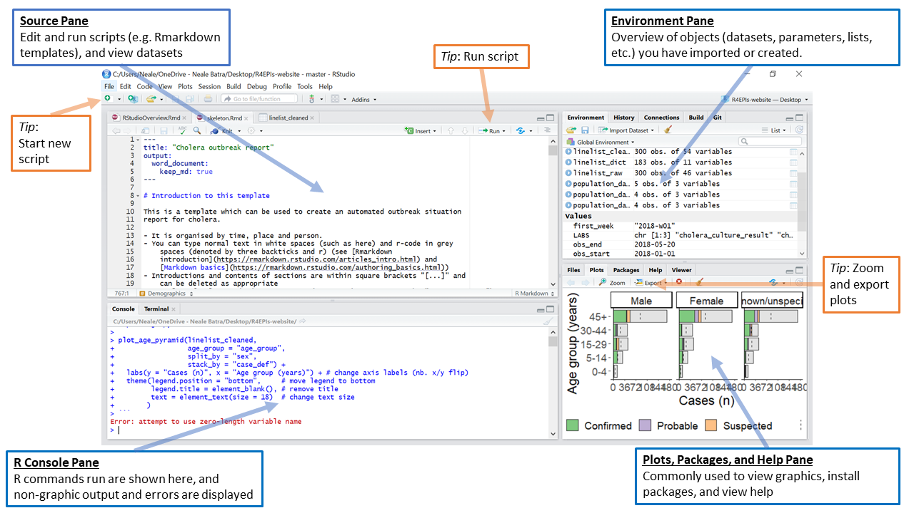

# Grundlæggende R {#baser}

```{r base-r-logo, echo=FALSE, out.width="20%", fig.alt="R-logoet"}

```

> “Det er ikke, fordi noget er svært, at vi ikke tør, det er, fordi vi ikke tør, at noget er svært.” - Seneca

## Læringsmål og videoer {#læringsmål-og-forberedelse}

Velkommen til kurset! Dette kapitel dækker det grundlæggende i base R. Vi forventer, at I kommer med forskellige erfaringer med programmering og R. Formålet er at give alle et fælles udgangspunkt, inden vi går videre til tidyverse og de øvrige emner i kurset. Målet er, at du kan følge, hvad koden gør, og selv ændre den, når spørgsmålet eller datasættet ændrer sig.

**R** er et programmeringssprog, som blandt andet bruges til statistik og visualisering. **RStudio** er det program, vi bruger til at skrive og organisere vores R-kode. Med **base R** mener vi her de funktioner og datasæt, der følger med en almindelig installation af R. Du skal derfor ikke installere ekstra R-pakker for at lave dette kapitels øvelser.

:::goals
I RStudio skal du efter kapitlet kunne:

* skrive, gemme og køre et kort R-script
* oprette objekter og vektorer og bruge funktioner med argumenter
* skelne mellem tal, tekst, logiske værdier og faktorer
* undersøge en dataframe og udvælge rækker og kolonner
* genkende manglende værdier og håndtere dem bevidst
* indlæse en enkel datafil og lave et plot med aksebetegnelser
* finde hjælp og undersøge almindelige fejl i din kode.
:::

### Sådan bruger du materialerne

Læs et lille afsnit, kør eksemplet, og prøv derefter at ændre én ting. Det er helt normalt at skulle slå funktioner og tegn op mange gange. Programmering handler ikke om at huske hele sproget udenad, men om at kunne formulere et spørgsmål præcist og undersøge, om koden besvarer det.

Kernestoffet går fra afsnittet om RStudio til og med dit første plot. Under [Problemstillinger](#baser-problemer) finder du øvelser til hver video og opgaver, hvor du bruger flere af kapitlets metoder sammen. De ekstra afsnit kan du vende tilbage til senere.

:::checklist
**Tjekliste**

- Sørg for, at både [R](https://cran.r-project.org/) og [RStudio Desktop](https://docs.posit.co/ide/user/download.html#rstudio-desktop) er installeret.
- **Hvis R er nyt for dig**, så start med [video 1–4](#videoer), og arbejd med de tilhørende problemstillinger.
- **Hvis du har arbejdet med R før**, så brug [problem 6–9](#problem-6) til at tjekke dit grundlag (du kan bruge kursusnotaterne som opslagsværk). Fortsæt eventuelt med [problem 10–11](#ekstra-problemstillinger).
- **Alle skal lave** “Quiz - Grundlæggende” på Absalon. Quizzen bliver tilgængelig kort før kursusstart. I næste lektion følger vi op på eventuelle huller i forståelsen.
:::

### Videoer

De fire videoer giver dig en hurtig introduktion til kapitlets vigtigste begreber og varer ca. 27 minutter i alt. I problemstillingerne øver du det, du har set i videoerne, og prøver fx at bruge metoderne på andre datasæt eller at ændre argumenterne i en funktion.

[**Video 1: Fra RStudio til dine første beregninger**]{#video-1 .video-label}

Du skriver og kører et script i RStudio og bruger objekter, vektorer og funktioner til enkle beregninger.

Læs [afsnit 1.2–1.4](#rstudio-skriv-kode-som-du-kan-køre-igen), og prøv derefter [problem 2](#problem-2).

<div class="course-video">
<iframe src="https://player.vimeo.com/video/1245430274" title="Video 1: Fra RStudio til dine første beregninger" loading="lazy" allow="fullscreen; picture-in-picture" allowfullscreen></iframe>
</div>

----

[**Video 2: En dataframe med biologiske data**]{#video-2 .video-label}

Du undersøger plantedata i en dataframe, ser på kolonnernes datatyper og tilføjer en beregnet kolonne.

Læs [afsnit 1.5–1.6](#datatyper-tal-tekst-logik-og-kategorier), og prøv derefter [problem 3](#problem-3).

<div class="course-video">
<iframe src="https://player.vimeo.com/video/1245430275" title="Video 2: En dataframe med biologiske data" loading="lazy" allow="fullscreen; picture-in-picture" allowfullscreen></iframe>
</div>

----

[**Video 3: Vælg rækker og forstå manglende værdier**]{#video-3 .video-label}

Du udvælger rækker og kolonner, filtrerer med betingelser og håndterer manglende værdier (`NA`).

Læs [afsnit 1.7–1.8](#udvælg-værdier-rækker-og-kolonner), og prøv derefter [problem 4](#problem-4).

<div class="course-video">
<iframe src="https://player.vimeo.com/video/1245430273" title="Video 3: Vælg rækker og forstå manglende værdier" loading="lazy" allow="fullscreen; picture-in-picture" allowfullscreen></iframe>
</div>

----

[**Video 4: Fra datafil til et plot**]{#video-4 .video-label}

Du gemmer og læser en CSV-fil, kontrollerer de indlæste data og laver et spredningsplot.

Læs [afsnit 1.9–1.10](#hvor-kommer-data-fra), og prøv derefter [problem 5](#problem-5).

<div class="course-video">
<iframe src="https://player.vimeo.com/video/1245430272" title="Video 4: Fra datafil til et plot" loading="lazy" allow="fullscreen; picture-in-picture" allowfullscreen></iframe>
</div>

## RStudio: skriv kode, som du kan køre igen

RStudio er et program, hvor du kan skrive og køre R-kode og se resultaterne.

> > Vi kommer til at være afhængige af RStudio til at arbejde med bl.a. R Markdown-dokumenter. R Markdown er temaet for emne 3, og vi går igennem hele emnet, så alle kan være med uanset tidligere erfaring.

Hvis du ikke har installeret RStudio på din computer, kan du [hente det gratis hos Posit](https://docs.posit.co/ide/user/download.html#rstudio-desktop). Bemærk, at R og RStudio skal installeres hver for sig. Installér [R](https://cran.r-project.org/) først, og følg derefter RStudios egne anvisninger.

Vælg **File > New File > R Script**, og gem den nye fil som `klasse1.R`. Et script er blot en tekstfil med den kode, du vil gemme.

### De forskellige paneler i RStudio {#rstudio}

RStudio har flere paneler. I **Source** skriver og gemmer du scriptet. I **Console** udfører R koden og viser tekstresultater eller fejlmeddelelser. **Environment** giver et overblik over de objekter, du har oprettet. Figurer og dokumentation vises typisk under **Plots** og **Help**. Panelernes placering kan variere, så kig efter navnene.

```{r base-rstudio-panes, echo=FALSE, out.width="100%", fig.align="center", fig.cap=if (knitr::is_latex_output()) "Oversigt over panelerne i RStudio. Billedkilde: The Epidemiologist R Handbook." else "Oversigt over panelerne i RStudio. Billedkilde: [The Epidemiologist R Handbook](https://epirhandbook.com/en/new_pages/basics.html#rstudio).", fig.alt="RStudio med markeringer af Source øverst til venstre, Console nederst til venstre, Environment øverst til højre samt Plots, Packages og Help nederst til højre."}

```

Du kan læse mere om panelerne i [The four RStudio Windows i YaRrr! The Pirate’s Guide to R](https://bookdown.org/ndphillips/YaRrr/the-four-rstudio-windows.html).

Skriv følgende i dit script. Placér markøren på en linje, og tryk **Ctrl + Enter** på Windows/Linux eller **Cmd + Enter** på Mac. Det sender linjen til R. Du kan også markere flere linjer og køre dem sammen.

```{r base-calculator, results="hold"}
2 + 2
12 / 3
3 * 4
2^3
(2 + 3) * 4
```

Tegnet `*` betyder gange, `/` betyder dividere, og `^` betyder opløftet i en potens. R bruger punktum i decimaltal, så to en halv skrives `2.5`. Et komma har en anden funktion i koden: det adskiller eksempelvis argumenter eller elementer.

```{r base-comments}
# Dette er en kommentar. R udfører ikke teksten efter #.
10 / 4  # Beregn ti divideret med fire.
```

:::tip
Gem dit script løbende. En gemt scriptfil indeholder koden, men ikke automatisk de objekter, du har i hukommelsen. Når du åbner en ny R-session, skal du køre scriptet fra begyndelsen for at genskabe dem. Det er netop sådan, andre kan gentage dit arbejde.
:::

## Objekter i R {#objekter-giv-en-værdi-et-navn}

Et **objekt** er noget, du gemmer i R under et navn. Det kan være et enkelt tal, en række målinger, en hel datatabel eller senere et statistisk resultat. Pilen `<-` betyder her: beregn det, der står til højre, og gem resultatet under navnet til venstre.

```{r base-assignment, results="hold"}
hoejde <- 12
hoejde

hoejde_mm <- hoejde * 10
hoejde_mm
```

Den første linje opretter objektet `hoejde`. Linjen med objektets navn viser indholdet. Når en linje kun tildeler en værdi med `<-`, bliver resultatet normalt ikke skrevet i konsollen; det betyder ikke, at linjen ikke blev udført.

Vælg navne, der fortæller, hvad objektet indeholder, eksempelvis `hoejde_cm` frem for `x1`. Brug gerne bogstaver, tal og understregninger, men begynd ikke med et tal. I eksemplerne bruger vi `ae`, `oe` og `aa` i objektnavne, så de er lette at skrive på forskellige tastaturer. Tekst og kommentarer kan sagtens indeholde æ, ø og å. R skelner mellem store og små bogstaver: `hoejde` og `Hoejde` er forskellige navne.

### R udfører instruktioner i den rækkefølge, du kører dem

Et gemt resultat opdateres ikke automatisk, når et tidligere objekt ændres. R fungerer på dette punkt anderledes end en celleformel i et regneark. Lad os tage et eksempel, hvor vi omregner en højde fra cm til mm.

```{r base-reassignment}
hoejde <- 12
hoejde_mm <- hoejde * 10

hoejde <- 15
hoejde_mm
```

For at opdatere `hoejde_mm` skal du køre beregningen igen, så R ganger den nye værdi af `hoejde` med 10.

```{r base-recalculate-height}
hoejde_mm <- hoejde * 10
hoejde_mm
```

::: {.stop-think}
**Stop og tænk:** Hvad bliver `antal` efter `antal <- 5` efterfulgt af `antal <- antal + 1`?

R læser først den gamle værdi, lægger 1 til og gemmer 6 under det samme navn.
:::

## Vektorer og funktioner

### En vektor indeholder flere værdier

En enkelt måling er sjældent nok i biologi. Vi kan samle flere målinger i en **vektor** med funktionen `c()`, som kombinerer værdierne i den rækkefølge, vi skriver dem.

```{r base-vectors, results="hold"}
hoejder <- c(11.2, 13.4, 12.1, 15.2)
hoejder
length(hoejder)
```

```{r base-text-vector}
plante_id <- c("P1", "P2", "P3", "P4")
plante_id
```

`hoejder` indeholder fire tal, og `plante_id` indeholder fire tekstværdier. Tekst skrives i anførselstegn. Uden anførselstegn ville R forsøge at finde et objekt med det pågældende navn. Brug almindelige lige anførselstegn i kode, eksempelvis `"P1"`.

Du kan udføre den samme beregning på alle værdier på én gang. Dette kaldes en **vektoriseret beregning**.

```{r base-vector-arithmetic, results="hold"}
hoejder * 10
hoejder + 2
```

```{r base-paired-arithmetic}
foer <- c(10, 12, 11, 13)
efter <- c(12, 13, 14, 15)
efter - foer
```

I den sidste beregning trækkes det første element i `foer` fra det første i `efter`, det andet fra det andet, og så videre. R ved ikke, hvilke planter tallene kommer fra. Du skal derfor sikre dig, at værdierne står i samme rækkefølge og hører til de samme planter, hvis resultatet skal fortolkes som ændringer i højde. Vi vender tilbage til denne idé i statistikkapitlet.

:::pin
Når du kombinerer to målevektorer element for element, skal de som udgangspunkt have samme længde og korrekt rækkefølge. R kan genbruge en kortere vektor, så en beregning godt kan give et resultat uden at være biologisk meningsfuld. At gange alle højder med det ene tal 10 er derimod en tilsigtet genbrug.
:::

### Funktioner har input og giver et resultat

En **funktion** udfører en bestemt opgave. Du skriver navnet efterfulgt af runde parenteser, og inde i parenteserne står funktionens **argumenter**: de data eller indstillinger, den skal bruge.

```{r base-functions, results="hold"}
length(hoejder)         # Hvor mange målinger?
sum(hoejder)            # Summen af målingerne.
mean(hoejder)           # Gennemsnittet: sum divideret med antal.
sqrt(16)               # Kvadratroden af 16.
round(3.14159, digits = 2)
```

I `round(3.14159, digits = 2)` er det første argument tallet, og `digits = 2` fortæller, hvor mange decimaler tallet afrundes til. Kommaet adskiller argumenterne. Lighedstegnet bruges her til at angive et argument; det er ikke en sammenligning. Når vi gemmer objekter, bruger vi konsekvent `<-`.

Du kan gemme funktionens resultat, ligesom du gemmer et tal:

```{r base-store-result}
gennemsnit <- mean(hoejder)
gennemsnit
```

I næste kapitel undersøger vi, hvad et gennemsnit fortæller om data, og hvad det ikke fortæller. Her er formålet at lære, hvordan man beder R om at beregne det.

### Find hjælp

Du kan åbne dokumentationen ved at skrive `?mean` eller `help("mean")` i konsollen. Dokumentationen viser blandt andet argumenterne og ofte et eksempel nederst. Du behøver ikke forstå hele hjælpesiden for at finde én bestemt indstilling.

```{r base-help, eval=FALSE}
?mean
?round
help("c")
```

Læg mærke til forskellen mellem `mean` og `mean(hoejder)`. Det første er selve funktionen; det andet er en instruktion om at anvende funktionen på `hoejder`.

## Datatyper {#datatyper-tal-tekst-logik-og-kategorier}

R skal vide, hvilken slags værdier et objekt indeholder. Du kan undersøge det med `class()`. De mest relevante typer i begyndelsen er:

| Det, du vil gemme | Eksempel | Typisk resultat fra `class()` |
|:--|:--|:--|
| Målinger som tal | `c(11.2, 13.4)` | `"numeric"` |
| Heltal (angivet eksplicit med `L`) | `c(5L, 6L)` | `"integer"` |
| Tekst | `c("P1", "P2")` | `"character"` |
| Sandt eller falsk | `c(TRUE, FALSE)` | `"logical"` |
| Kategorier med bestemte niveauer | `factor(c("kontrol", "goedning"))` | `"factor"` |

Almindelige tal som `5` gemmes normalt som typen `numeric`; du behøver ikke skrive `5L` for at kunne tælle blade eller planter. Vi viser `integer`, fordi du vil møde typen i output fra `str()`.

```{r base-types, results="hold"}
class(hoejder)
class(plante_id)
class(c(TRUE, FALSE))
class(c(5L, 6L))
```

En almindelig vektor har én grundlæggende datatype. Hvis du blander tal og tekst, omdanner R tallene til tekst for at kunne gemme elementerne sammen.

```{r base-coercion, results="hold"}
blandet <- c(11.2, "ukendt", 13.4)
blandet
class(blandet)
```

Her bliver også `11.2` og `13.4` tekst. Derfor er det en dårlig idé at skrive `"ukendt"` inde i en målekolonne, som skal behandles som tal. Til manglende værdier bruger vi `NA`, som vi ser på nedenfor.

### Faktorer repræsenterer kategorier

En behandling er en kategori, selvom den nogle gange er kodet med tal. Kategorien 2 er eksempelvis ikke nødvendigvis dobbelt så meget behandling som kategorien 1. En **faktor** fortæller R, hvilke kategorier, eller **niveauer**, der findes, og i hvilken rækkefølge de skal bruges.

```{r base-factors}
behandling <- factor(
  c("kontrol", "kontrol", "goedning", "goedning"),
  levels = c("kontrol", "goedning")
)
behandling
```

`levels()` viser kategoriernes navne:

```{r base-factor-levels}
levels(behandling)
```

`nlevels()` tæller antallet af niveauer:

```{r base-factor-nlevels}
nlevels(behandling)
```

`table()` tæller observationerne i hver kategori:

```{r base-factor-table}
table(behandling)
```

R kan også bruge tekstkolonner som grupper i mange funktioner, men en faktor gør kategorierne og deres rækkefølge eksplicitte. Det bliver nyttigt, når vi laver figurer og statistiske modeller.

Funktionen `unique()` viser de forskellige værdier, der faktisk findes i en vektor. Den virker også på tal og tekst og er nyttig, når du vil undersøge indholdet i en ukendt kolonne.

```{r base-unique, results="hold"}
unique(c("lys", "moerke", "lys"))
unique(c(0.5, 1, 2, 0.5))
```

Et ID kan være tekst eller en faktor afhængigt af formålet. Det vigtigste er at forstå, at det identificerer en observation. Et gennemsnit af plante-ID'er fortæller ikke noget om planterne. Undgå også at bruge `as.numeric()` direkte på en faktor for at genskabe oprindelige tal: det giver faktorens interne koder, som ikke nødvendigvis er de viste værdier.

## Dataframes {#dataframes-en-tabel-med-observationer-og-variabler}

En **dataframe** er en tabel, hvor kolonnerne kan have forskellige datatyper. I vores eksempel er hver række én plante, og hver kolonne beskriver en egenskab ved planten. Rækken er en **observation**, og kolonnen er en **variabel**. I andre datasæt kan flere rækker komme fra samme individ, så betydningen af en række skal altid undersøges.

```{r base-plant-data-for-diagram, ref.label="base-plant-data", include=FALSE}
```

::: {#dataframe-diagram}
```{r base-dataframe-diagram, echo=FALSE, fig.width=7.5, fig.height=2.7, dpi=180, out.width="100%", fig.alt="Udsnit af planter. Rækken for P2 er en observation. Kolonnen hoejde_cm er en variabel. Cellen 13.4 i rækken for P2 viser plantens højde i cm og er ét datapunkt."}
local({
  udsnit <- planter[c(1, 2, 5), c("plante_id", "behandling", "hoejde_cm")]
  x <- c(1.75, 3.07, 4.79, 6.34)
  y <- seq(2.46, 0.24, length.out = 5)
  kolonnemidte <- (head(x, -1) + tail(x, -1)) / 2
  raekkemidte <- (head(y, -1) + tail(y, -1)) / 2
  tekst <- "#26364a"
  raekkefarve <- "#674d83"
  kolonnefarve <- "#255f57"

  gamle_indstillinger <- par(mar = rep(0, 4), family = "sans")
  plot.new()
  plot.window(xlim = c(0, 8), ylim = c(0, 3.16), xaxs = "i", yaxs = "i")

  # Fremhæv overskrifter, observation, variabel og cellen i deres kryds.
  rect(x[1], y[2], x[4], y[1], col = "#f0f3f7", border = NA)
  rect(x[1], y[4], x[4], y[3], col = "#eee8f6", border = NA)
  rect(x[3], y[5], x[4], y[1], col = "#e5f4ef", border = NA)
  segments(x, y[5], x, y[1], col = "#c1ccd7")
  segments(x[1], y, x[4], y, col = "#c1ccd7")
  rect(x[3], y[4], x[4], y[3], col = "#b8dfd4", border = kolonnefarve, lwd = 1.5)

  text(kolonnemidte, raekkemidte[1], names(udsnit), family = "mono", font = 2, col = tekst)
  text(rep(kolonnemidte, each = nrow(udsnit)), rep(raekkemidte[-1], ncol(udsnit)),
       as.vector(as.matrix(udsnit)), family = "mono", col = tekst)

  text(0.69, raekkemidte[3], "Række\n(observation)", col = raekkefarve, font = 2)
  arrows(1.37, raekkemidte[3], 1.71, raekkemidte[3], length = 0.08, col = raekkefarve, lwd = 1.3)
  text(kolonnemidte[3], 2.98, "Kolonne (variabel)", col = kolonnefarve, font = 2)
  arrows(kolonnemidte[3], 2.76, kolonnemidte[3], 2.50, length = 0.08, col = kolonnefarve, lwd = 1.3)
  text(6.77, raekkemidte[3], "Datapunkt", adj = c(0, 0.5), col = kolonnefarve, font = 2)
  arrows(6.68, raekkemidte[3], 6.38, raekkemidte[3], length = 0.08, col = kolonnefarve, lwd = 1.3)
  par(gamle_indstillinger)
})
```
:::

Vi bruger følgende **fiktive undervisningsdata**. De er lavet til at øve programmering og dokumenterer ikke et virkeligt forsøg eller en effekt af gødning. Højden er målt i cm. For plante P4 mangler højdemålingen.

```{r base-plant-data}
planter <- data.frame(
  plante_id = c("P1", "P2", "P3", "P4", "P5", "P6", "P7", "P8"),
  behandling = factor(
    c("kontrol", "kontrol", "kontrol", "kontrol",
      "goedning", "goedning", "goedning", "goedning"),
    levels = c("kontrol", "goedning")
  ),
  hoejde_cm = c(11.2, 13.4, 12.1, NA, 15.2, 14.8, 13.9, 16.1),
  antal_blade = c(5L, 6L, 5L, 4L, 7L, 7L, 6L, 8L)
)
planter
```

Vi giver hver kolonne et navn inde i `data.frame()`. Kolonnerne beskriver de samme otte planter i samme rækkefølge. Hver kolonne skal derfor have en passende værdi for hver række, eventuelt en manglende værdi som `NA`.

### Få overblik, før du regner

```{r base-inspect}
head(planter)
str(planter)
dim(planter)
names(planter)
```

`head()` viser normalt de første seks rækker, og `str()` viser tabellens struktur og kolonnetyper. `dim()` giver to tal: antal rækker og derefter antal kolonner. `names()` viser kolonnenavnene. Du kan også bruge `nrow()` og `ncol()`, når du kun vil have den ene dimension.

```{r base-row-column-count, results="hold"}
nrow(planter)
ncol(planter)
```

```{r base-summary}
summary(planter)
```

`summary()` tilpasser sit output til kolonnens type. En numerisk kolonne opsummeres med blandt andet minimum, maksimum og gennemsnit; en faktor opsummeres med antallet i hver kategori. Vi forklarer de statistiske størrelser i næste kapitel. Lige nu skal du især kontrollere, om kolonnerne har de forventede typer, og om der mangler værdier.

### Hent en kolonne med `$`

```{r base-columns, results="hold"}
planter$hoejde_cm
planter$behandling
```

`planter$hoejde_cm` betyder “kolonnen `hoejde_cm` i tabellen `planter`”. Resultatet er en vektor. Det gør, at du kan bruge de funktioner, du allerede kender, direkte på en kolonne.

Du kan oprette en ny kolonne på samme måde, som du opretter et andet objekt:

```{r base-new-column}
planter$hoejde_mm <- planter$hoejde_cm * 10
head(planter)
```

Den oprindelige kolonne i cm findes stadig. For plante P4 bliver den nye værdi også `NA`, fordi R ikke kender højden. Bemærk, at tabellen nu har fem kolonner. Hvis du starter forfra og kører oprettelsen af `planter` igen, erstatter du tabellen med versionen med fire kolonner.

## Udvælg værdier, rækker og kolonner

### Positioner i en vektor

Firkantede parenteser, `[ ]`, bruges til at udvælge dele af et objekt. Positionerne i R begynder ved **1**.

```{r base-vector-index, results="hold"}
hoejder[1]
hoejder[c(1, 3)]
hoejder[1:3]
```

`1:3` laver heltallene 1, 2 og 3. I `hoejder[c(1, 3)]` beder vi om position 1 og 3; i `hoejder[1:3]` beder vi om alle tre positioner fra 1 til 3.

### To dimensioner i en dataframe

En dataframe har både rækker og kolonner. Inde i parenteserne står rækkerne **før** kommaet og kolonnerne **efter** kommaet:

```r
# Læsevejledning: tabel[rækker, kolonner]
```

```{r base-dataframe-index}
planter[1:3, ]
planter[1:3, c("plante_id", "hoejde_cm")]
planter[1, "hoejde_cm"]
```

En tom plads betyder “alle”. Derfor giver `planter[1:3, ]` de første tre rækker og alle kolonner. Det er let at glemme kommaet, men det ændrer betydningen: `planter[1:3]` vælger de første tre **kolonner**.

Når du udvælger én kolonne med to indeks, kan R returnere en vektor. Hvis du vil beholde dataframe-formatet, kan du skrive:

```{r base-drop-false}
planter[, "hoejde_cm", drop = FALSE]
```

Det er et opslagsværkstip; du behøver ikke mestre alle udvælgelsesformer nu. Brug gerne `$`, når du vil have en enkelt kolonne som vektor.

### En betingelse giver `TRUE` eller `FALSE`

Vi vil ofte vælge observationer ud fra deres indhold og ikke deres placering. Første skridt er at skrive en betingelse.

```{r base-logical-vector}
planter$behandling == "goedning"
```

R sammenligner hver værdi i kolonnen med teksten `"goedning"`. Resultatet er en logisk vektor med én værdi pr. række. `TRUE` betyder, at betingelsen er opfyldt. `FALSE` betyder, at den ikke er opfyldt. Bemærk de **to lighedstegn**: `==` sammenligner værdier.

Nu kan vi bruge den logiske vektor til at vælge rækker:

```{r base-filter-rows}
er_goedet <- planter$behandling == "goedning"
goedede_planter <- planter[er_goedet, ]
goedede_planter
```

R beholder rækkerne med `TRUE` og udelader rækkerne med `FALSE`. Vi kan også skrive betingelsen direkte i parenteserne:

```{r base-filter-direct}
planter[planter$behandling == "goedning", c("plante_id", "hoejde_cm")]
```

| Tegn | Betydning | Eksempel |
|:--|:--|:--|
| `==` | lig med | `behandling == "kontrol"` |
| `!=` | forskellig fra | `behandling != "kontrol"` |
| `<`, `<=` | mindre end; mindre end eller lig med | `antal_blade <= 5` |
| `>`, `>=` | større end; større end eller lig med | `antal_blade >= 6` |
| `&` | begge betingelser skal være opfyldt | `(antal_blade >= 6) & (behandling == "kontrol")` |
| \| | mindst én betingelse skal være opfyldt | `(antal_blade == 4)` \| `(antal_blade == 8)` |
| `%in%` | værdien findes blandt disse muligheder | `plante_id %in% c("P1", "P3")` |
| `!` | ikke | `!(plante_id %in% c("P1", "P3"))` |

Eksemplerne i tabellen viser udtrykkenes form. I din kode skal du også angive tabellen, eksempelvis `planter$antal_blade`.

```{r base-combine-conditions}
planter[(planter$behandling == "kontrol") &
          (planter$antal_blade >= 5), ]

planter[planter$plante_id %in% c("P1", "P3", "P8"), ]
```

Parenteserne omkring hver sammenligning gør betingelsen lettere at læse. Skriv ikke `plante_id == "P1" | "P3"`: begge sider af `|` skal være logiske betingelser. `%in%` er en praktisk måde at spørge, om en værdi er én af flere muligheder.

## Manglende værdier

`NA` betyder, at en værdi mangler eller ikke er kendt. I vores datasæt mangler højden for plante P4.

En sammenligning som `x == NA` giver selv et ukendt resultat. `is.na()` giver `TRUE` ved manglende værdier.

```{r base-missing}
is.na(planter$hoejde_cm)
```

Når `sum()` anvendes på en logisk vektor uden manglende værdier, tælles `TRUE` som 1 og `FALSE` som 0. Her tæller vi derfor antallet af manglende højder.

```{r base-count-missing}
sum(is.na(planter$hoejde_cm))
```

Uden yderligere instruktion bliver gennemsnittet `NA`, fordi en højde er ukendt.

```{r base-mean-with-missing}
mean(planter$hoejde_cm)
```

Argumentet `na.rm = TRUE` beder funktionen om at beregne gennemsnittet af de **kendte** højder. Det indsætter ikke en højde for P4 og sletter ikke en række i tabellen. Vi beregner blot et gennemsnit af syv målinger i stedet for otte.

```{r base-mean-known-heights}
mean(planter$hoejde_cm, na.rm = TRUE)
```

Hvis manglende målinger hænger sammen med eksempelvis plantens tilstand, kan de resterende planter give et skævt billede. Derfor skal vi altid vide, hvad der er udeladt.

### Manglende værdier i en udvælgelse

Vi vil udvælge de planter, der er mindst 14 cm høje. Først ser vi, hvad betingelsen giver for hver plante.

```{r base-missing-filter}
planter$hoejde_cm >= 14
```

Betingelsen giver `NA` for P4, fordi højden mangler. Bruger vi betingelsen direkte til at vælge rækker, får vi en række med manglende værdier. Med `!is.na()` kræver vi en kendt højde. Med `&` kræver vi samtidig, at højden er mindst 14 cm.

```{r base-filter-known-heights}
kendt_og_hoej <- !is.na(planter$hoejde_cm) & (planter$hoejde_cm >= 14)
planter[kendt_og_hoej, ]
```

::: {.stop-think}
**Stop og tænk:** Hvorfor er `sum(!is.na(planter$hoejde_cm))` lig 7, mens `nrow(planter)` er 8?

Den første beregning tæller kendte højder. `nrow()` tæller alle planter, også planten uden en højdemåling.
:::

## Hvor kommer data fra?

### Indbyggede datasæt

R indeholder flere små datasæt, som er velegnede til undervisning. Du kan indlæse dem med `data()` og læse dokumentationen i hjælpevinduet. Vi bruger blandt andet `iris`, der indeholder blomstermålinger for tre irisarter.

```{r base-iris}
data("iris")
head(iris)
str(iris)
table(iris$Species)
```

```{r base-iris-help, eval=FALSE}
?iris
```

Undersøg altid, hvad en variabel betyder, og hvilken enhed den er målt i. I `iris` er bægerblads- og kronbladsmål angivet i cm. Et kolonnenavn er ikke altid tilstrækkeligt til at forklare indholdet.

### Arbejdsmappen og relative filstier

R's **working directory**, eller arbejdsmappe, er den mappe, hvor R leder efter og gemmer filer, når du kun angiver et filnavn. Brug `getwd()` til at se, hvilken mappe du arbejder i, og `list.files()` til at se, hvad der ligger i den. Med `list.dirs()` og `recursive = FALSE` får du kun vist undermapperne på første niveau.

```{r base-file-location, eval=FALSE}
getwd()
list.files()
list.dirs(path = ".", recursive = FALSE)
```

Hvis R leder i den forkerte mappe, kan du skifte arbejdsmappe med `setwd()`. Vælg ét af eksemplerne nedenfor, og erstat stien med stien til din egen mappe. Brug derefter `getwd()` til at kontrollere, hvor R leder efter filer.

```{r base-change-working-directory, eval=FALSE}
# Mac og Linux
setwd("~/Documents")

# Windows: fremadrettede skråstreger
setwd("C:/Users/navn/Documents")

# Windows: dobbelte omvendte skråstreger i R-koden
setwd("C:\\Users\\navn\\Documents")
```

En relativ filsti som `"planter_oevelse.csv"` betyder en fil i den aktuelle arbejdsmappe. Stien `"data/planter_oevelse.csv"` betyder en fil i undermappen `data`. Relative stier gør det nemmere at flytte øvelsesmappen til en anden computer. Undgå derfor at bygge dine scripts op omkring en bestemt brugers personlige mapper.

### Gem og indlæs en CSV-fil

En **CSV-fil** er en almindelig tekstfil med en tabel. Den har typisk én linje pr. observation, en linje med kolonnenavne øverst og et skilletegn mellem værdierne. Her opretter vi selv en fil fra vores fiktive planter, så du ikke skal hente en ekstern øvelsesfil.

Kør følgende i RStudio. Filen gemmes i din aktuelle arbejdsmappe. Brug et nyt filnavn, hvis der allerede ligger en fil med samme navn, da `write.csv()` kan overskrive den.

```{r base-write-csv, eval=FALSE}
write.csv(planter, file = "planter_oevelse.csv", row.names = FALSE)
```

`row.names = FALSE` undgår en ekstra kolonne med R's rækkenumre. Find filen i RStudios Files-panel. Hvis du åbner den som tekst, kan du se kolonnenavnene, kommaerne og `NA` ved den manglende måling. Indlæs nu filen som et nyt objekt:

```{r base-read-csv, eval=FALSE}
planter_fra_fil <- read.csv("planter_oevelse.csv")
head(planter_fra_fil)
str(planter_fra_fil)
```

CSV gemmer værdierne og kolonnenavnene, men ikke alle R's oplysninger om objekterne. Derfor bliver kategorikolonnen normalt læst som tekst, og vi angiver faktorniveauerne igen. Tjek altid strukturen efter import; en fil kan godt blive indlæst uden en fejlmeddelelse og alligevel være fortolket forkert.

```{r base-restore-factor, eval=FALSE}
planter_fra_fil$behandling <- factor(
  planter_fra_fil$behandling,
  levels = c("kontrol", "goedning")
)
```

### Skilletegn og decimaltal

Filendelsen alene fortæller ikke sikkert, hvordan tabellen er gemt. `read.csv()` forventer komma mellem kolonnerne og punktum som decimaltegn. `read.csv2()` forventer semikolon mellem kolonnerne og komma som decimaltegn, hvilket er almindeligt ved eksport fra nogle danske regnearksindstillinger. En tabulatorsepareret tekstfil kan læses med `read.delim()`.

```{r base-import-reference, eval=FALSE}
# Opslagsværk: vælg kun den linje, der passer til din faktiske fil.
maalinger <- read.csv("maalinger.csv")
maalinger <- read.csv2("maalinger_med_semikolon.csv")
maalinger <- read.delim("maalinger.txt", header = TRUE)

# De samme valg kan angives eksplicit med read.table():
maalinger <- read.table(
  "maalinger.txt", header = TRUE, sep = "\t", dec = "."
)
```

`header = TRUE` betyder, at første linje indeholder kolonnenavne. `sep` angiver skilletegnet, og `dec` angiver decimaltegnet. Hvis alle data havner i én kolonne, er det ofte skilletegnet, du skal undersøge. Hvis tallene bliver tekst, kan det skyldes decimaltegnet eller tekstværdier i den samme kolonne.

### Importér data fra Excel

En `.xlsx`-fil bevarer sit Excel-format, selvom du ændrer filendelsen. Du kan læse filen direkte med `readxl::read_excel()`. Hvis du mangler pakken, kan du installere den én gang ved at køre `install.packages("readxl")` i konsollen.

Funktionen læser det første ark som standard. Brug `sheet` til at vælge et ark efter nummer, fx `sheet = 2`, eller efter navn, fx `sheet = "Målinger"`. Erstat filnavnet med navnet på din egen fil, vælg den linje, der passer, og kontrollér resultatet med `str()`.

```{r base-import-excel, eval=FALSE}
# Læs det første ark.
maalinger <- readxl::read_excel("maalinger.xlsx")

# Vælg i stedet det andet ark.
maalinger <- readxl::read_excel("maalinger.xlsx", sheet = 2)

str(maalinger)
```

## Dit første plot i base R

Et plot hjælper os med at se, om data ser rimelige ud, og hvilke mønstre det kan være relevant at undersøge. Vi begynder med et **spredningsplot**, hvor hver prik er en observation. Her er det en irisblomst, og vi viser bægerbladets længde på x-aksen og bredde på y-aksen.

```{r base-first-plot, fig.width=6, fig.height=4, fig.cap="Hvert punkt viser bægerbladsmålene for én observation i iris-datasættet. Arterne er samlet i dette første plot."}
plot(
  iris$Sepal.Length, iris$Sepal.Width,
  xlab = "Bægerbladets længde (cm)",
  ylab = "Bægerbladets bredde (cm)",
  main = "Bægerbladenes størrelse hos iris",
  pch = 19,
  col = "steelblue"
)
```

De første to argumenter er x- og y-værdierne. `xlab` og `ylab` giver navn til akserne, og `main` giver figuren en titel. `pch` bestemmer symbolet; 19 er en udfyldt cirkel. `col` bestemmer farven. Du behøver ikke huske alle mulighederne; gem et tydeligt eksempel, som du kan tilpasse.

Plottet samler tre arter. Derfor skal vi være varsomme med at fortolke en samlet sammenhæng som en sammenhæng inden for hver art. Senere lærer vi at vise grupperne hver for sig. I næste kapitel bruger vi også histogrammer og boxplots til at beskrive fordelingen af en variabel, og i de senere visualiseringskapitler bygger vi figurer med `ggplot2`.

## R-pakker {#r-pakker}

En **R-pakke** er en samling af funktioner og nogle gange også datasæt, der udvider det, du kan gøre med base R. Mange pakker kan hentes fra [CRAN](https://cran.r-project.org/). Til analyse af biologiske data findes der også pakker på [Bioconductor](https://bioconductor.org/), og nogle pakker kan installeres direkte fra GitHub.

Senere i kurset arbejder vi med **tidyverse**, en samling af R-pakker. Den omfatter bl.a. `ggplot2` til at lave figurer og `dplyr` til at arbejde med data. Øvelserne i dette kapitel bruger base R.

Kør `install.packages()` i konsollen for at installere pakken på din computer. Det gør du normalt kun én gang. Du kan installere `tidyverse` på forhånd, da det kan tage lidt tid at hente de pakker, den afhænger af.

```{r base-install-packages, eval=FALSE}
install.packages("tidyverse")
```

Kør `library()` i hver ny R-session, hvor du skal bruge pakken. `library(tidyverse)` indlæser de centrale pakker i samlingen på én gang. Skriv dine `library()`-kald øverst i dit script, så du hurtigt kan se, hvilke pakker koden bruger.

```{r base-packages, eval=FALSE}
library(tidyverse)
```

Nogle pakker har funktioner med samme navn. For eksempel findes `filter()` både i `dplyr` og i `stats`. Hvis du bare skriver `filter()`, bruger R den første funktion med det navn, den finder. Skriv `dplyr::filter()` eller `stats::filter()` for at vælge funktionen fra den pakke, du mener.

## Når koden ikke virker

En fejlmeddelelse er information om, hvor R gik i stå. Læs den første fejl og undersøg den linje, der udløste den. Kør gerne en mindre del af linjen for at kontrollere inputtet.

| Det, du ser | Hvad du kan undersøge |
|:--|:--|
| `object ... not found` | Er objektet oprettet i denne session? Er navnet stavet præcis som før, inklusive store og små bogstaver? |
| `could not find function` | Er funktionsnavnet korrekt? Hvis funktionen kommer fra en ekstra pakke, er pakken så installeret og indlæst? |
| `unexpected symbol` eller `unexpected ','` | Mangler der et komma, et anførselstegn eller en parentes? |
| Konsollen viser `+` i stedet for `>` | R venter på resten af et udtryk, ofte en afsluttende parentes eller et anførselstegn. Tryk Esc for at afbryde og ret linjen. |
| `NA` som resultat | Mangler en inputværdi? Skal beregningen bruge de kendte værdier, eller skal årsagen til manglende data undersøges først? |
| En fil kan ikke åbnes | Passer filnavn, endelse og placering til arbejdsmappe og filsti? |

:::tip
Hvis koden kun virker efter mange forsøg i konsollen, så prøv at genstarte R via **Session > Restart R** og køre scriptet fra toppen. Ret scriptet, så alle nødvendige trin er med. Det er en god slutkontrol af en øvelse.
:::

## Problemstillinger {#baser-problemer}

Lav et nyt script i RStudio via **File > New File > R Script**, og gem det som `emne1_oevelser.R`.

:::checklist
**Hvilke opgaver skal du lave?**

- **Alle** laver [problem 1](#problem-1) og arbejder med [problem 6–9](#problem-6), hvor du bruger flere af kapitlets metoder sammen.
- **Hvis R er nyt for dig**, så arbejd med [problem 2–5](#problem-2) efter de tilhørende videoer, før du går videre.
- **Hvis du har arbejdet med R før**, kan du gå direkte fra quizzen til [problem 6–9](#problem-6) og slå op i videoerne og noterne undervejs.
- **Hvis du vil prøve mere**, kan du fortsætte med [problem 10–11](#ekstra-problemstillinger).
:::

[**Problem 1: Quiz på Absalon**]{#problem-1 .problem-label}

Lav quizzen “Quiz - Grundlæggende” på Absalon.

### Øvelser til videoerne

[**Problem 2: Kør koden linje for linje**]{#problem-2 .problem-label}

Efter [video 1](#video-1) skal du prøve beregningerne i dit script.

::: {.problem-parts}
**a)** Kør koden én linje ad gangen. Forudsig, hvad de sidste to linjer giver, før du kører dem.

```{r base-exercise-calculations, eval=FALSE}
2 + 2
2 * 2
x <- 4
x <- x + 2
sqrt(x)
sqrt(x)^2
```

**b)** Opret vektoren `y <- c(1, 4, 6, 4, 3)`. Find antallet af værdier, summen og gennemsnittet.

**c)** Slå `round()` op i R's hjælp, og vis gennemsnittet med én decimal.
:::

[**Problem 3: Lav din egen dataframe**]{#problem-3 .problem-label}

Efter [video 2](#video-2) skal du selv vælge værdierne til en lille tabel.

::: {.problem-parts}
**a)** Brug `data.frame()` til at lave tabellen `personer` med fire fiktive personer og tre kolonner: `navn`, `alder` og `yndlingsfarve`. Brug tekst til navn og farve og tal til alder i år. Lad mindst to personer have samme yndlingsfarve. Tjek dimensioner og datatyper med `dim()` og `str()`.

**b)** Lav `yndlingsfarve` om til en faktor. Vis niveauerne, og tæl, hvor mange personer der har hver farve som yndlingsfarve.

**c)** Tilføj en kolonne `alder_maaneder` ved at gange alderen i år med 12. Hvor mange kolonner har tabellen nu?
:::

[**Problem 4: Vælg rækker i en tabel med fugleobservationer**]{#problem-4 .problem-label}

Efter [video 3](#video-3) skal du bruge betingelser på et lille fiktivt datasæt. Kopiér koden til dit script, og kør den først.

```{r base-exercise-bird-data, eval=FALSE}
fugle <- data.frame(
  sted = c("sø", "skov", "skov", "sø", "skov", "sø"),
  art = c("solsort", "musvit", "solsort", "bogfinke", "musvit", "solsort"),
  antal = c(3L, NA, 2L, 5L, 4L, NA)
)
```

::: {.problem-parts}
**a)** Vis de første to rækker med kun kolonnerne `art` og `antal`.

**b)** Brug `is.na()` til at finde rækkerne, hvor antallet af fugle mangler. Hvor mange er der?

**c)** Gem de observationer fra skoven, hvor antallet er kendt og mindst 3. Vis resultatet.
:::

[**Problem 5: Gem, indlæs og plot træmålinger**]{#problem-5 .problem-label}

Efter [video 4](#video-4) skal du prøve filimport og plot på et indbygget datasæt.

::: {.problem-parts}
**a)** Indlæs `trees` med `data("trees")`. Brug `?trees` til at finde ud af, hvad `Girth` og `Height` betyder, og hvilke enheder de har.

**b)** Gem tabellen som `traeer_oevelse.csv` med `write.csv()` og `row.names = FALSE`. Læs filen ind som `traeer`, og sammenlign dimensioner og kolonnetyper med originalen ved hjælp af `dim()` og `str()`. Har en kolonne skiftet type?

**c)** Lav et spredningsplot af træernes diameter på x-aksen og højde på y-aksen. Angiv enheder på begge akser.
:::

### Saml det, du har lært

[**Problem 6: Hastighed og bremselængde i `cars`**]{#problem-6 .problem-label}

::: {.problem-parts}
**a)** Indlæs `cars`, og brug `head()` til at se de første observationer. Slå enhederne op med `?cars`. Lav et spredningsplot med `speed` på x-aksen og `dist` på y-aksen, og angiv enhederne.

**b)** Tilføj en logisk kolonne `hurtig`, der er `TRUE`, når `speed > 15`. Brug `sum()` til at tælle de rækker, der opfylder betingelsen. Gem dem som `hurtige_biler` med kun kolonnerne `speed` og `dist`.
:::

**Ekstra.** Kør `mean(cars$hurtig)`. Når `TRUE` tæller som 1 og `FALSE` som 0, hvad fortæller gennemsnittet så om observationerne?

[**Problem 7: Indlæs en fil med muslingemålinger**]{#problem-7 .problem-label}

Filen indeholder fiktive målinger af muslinger.

::: {.problem-parts}
**a)** Hent `muslinger.csv` (downloades på Absalon under Module Uge 47). Læg filen i din arbejdsmappe. Brug `getwd()` og `list.files()` til at tjekke, at R kan finde den. Filen har semikolon som skilletegn og komma som decimaltegn. Vælg den passende importfunktion, og gem tabellen som `muslinger`. Tjek resultatet med `head()` og `str()`.

**b)** Lav `lokalitet` om til en faktor, og tæl observationerne på hver lokalitet.

**c)** Hvor mange værdier mangler i `skal_mm`? Gem de levende muslinger med en kendt skallængde i en ny dataframe, og beregn deres gennemsnitlige skallængde i mm.
:::

[**Problem 8: Fra udvælgelse til plot i `ToothGrowth`**]{#problem-8 .problem-label}

::: {.problem-parts}
**a)** Indlæs `ToothGrowth`, og læs `?ToothGrowth`. Hvad betyder `supp`, `dose` og `len`? Hvilke forskellige værdier har `dose`?

**b)** Gem rækker med `supp == "OJ"` og `len > 15` i en ny dataframe. Hvor mange rækker har den?

**c)** Gem rækker med `supp == "VC"`, hvor dosis er enten 0.5 eller 2. Brug `%in%` til at vælge doserne.

**d)** Beregn gennemsnittet af `len` for delmængden i c. Lav et spredningsplot af `len` mod `dose` for samme delmængde. Angiv dosis i mg pr. dag, og brug “Længdemål for tandvækst (datasættets skala)” som titel på y-aksen.
:::

[**Problem 9: Find fejlen, og kør scriptet igen**]{#problem-9 .problem-label}

::: {.problem-parts}
**a)** Prøv linjen nedenfor i Console. Brug `class()` til at undersøge vektoren, og ret linjen, så R afrunder tallene til én decimal.

```{r base-exercise-round-error, eval=FALSE}
rundede <- round(c("4.26", "5.83"), digits = 1)
```

**b)** Gem den rettede kode i dit script. Genstart R, og kør scriptet fra begyndelsen. Kan du genskabe dine resultater?
:::

## Ekstra: funktioner, du snart får glæde af {#baser-ekstra}

Dette afsnit er ikke nødvendigt for at nå problem 1–9. Det er et sted at vende tilbage til, når du møder gentagne beregninger eller mere avancerede øvelser senere i kurset.

### Talrækker, gentagelser og tilfældig udvælgelse

```{r base-sequences, results="hold"}
1:5
seq(from = 0, to = 10, by = 2)
rep("kontrol", times = 3)
```

`seq()` giver større kontrol over talrækken end `:`, og `rep()` gentager en værdi. `sample()` udvælger derimod tilfældigt blandt de værdier, du giver den.

```{r base-sampling}
set.seed(2027)
sample(c("P1", "P2", "P3", "P4"), size = 2, replace = FALSE)

valgte_raekker <- sample(1:nrow(iris), size = 5, replace = FALSE)
iris[valgte_raekker, ]
```

`replace = FALSE` betyder uden tilbagelægning: den samme position kan ikke vælges to gange. Med `replace = TRUE` kan den vælges igen. I det sidste eksempel udvælger vi **rækkenumre** og bruger dem derefter til at hente hele observationer. Hvis du anvender `sample()` direkte på en dataframe, får du ikke på denne måde en tilfældig stikprøve af rækker.

`set.seed()` fastlægger startpunktet for R's generator af pseudotilfældige tal, så du kan gentage et eksempel med samme indstillinger. Det gør ikke en stikprøve mere repræsentativ. Vi bruger den samme idé, når vi simulerer data i næste kapitel. Sæt typisk seed én gang før en samlet simulering, ikke på ny før hver gentagelse.

### `ifelse()` og `if`: forskellige opgaver

`ifelse()` vælger mellem to værdier **for hvert element** i en logisk vektor. Her får hver plante en tekstkategori ud fra antallet af blade.

```{r base-ifelse}
bladkategori <- ifelse(planter$antal_blade >= 6, "mindst_seks", "under_seks")
bladkategori
```

Det almindelige `if` vælger derimod, om et stykke kode skal udføres ud fra **én** sand/falsk-betingelse. Her spørger vi, om der overhovedet er en manglende højde. Funktionen `any()` samler de mange logiske værdier til ét svar.

```{r base-if}
if (any(is.na(planter$hoejde_cm))) {
  print("Mindst én plante mangler en højdemåling.")
} else {
  print("Alle planter har en kendt højde.")
}
```

Brug derfor ikke en hel målevektor som betingelse i `if`. Til rækkeudvælgelse har vi brugt `[betingelse, ]`; til en ny værdi pr. række kan `ifelse()` være relevant.

## Ekstra problemstillinger

[**Problem 10: Tilfældige observationer**]{#problem-10 .problem-label}

Brug `set.seed(2027)` og vælg ti rækkenumre fra `iris` uden tilbagelægning. Gem de tilhørende rækker. Hvorfor kan en udvælgelse med tilbagelægning indeholde den samme observation flere gange? Hvad skal du gøre for at gentage præcis den samme tilfældige udvælgelse?

[**Problem 11: Fra betingelse til kategori**]{#problem-11 .problem-label}

Brug `cars` fra problem 6. Tilføj kolonnen `fartgruppe` med `ifelse()`, så rækker med `speed > 15` får værdien `"hurtig"`, og de øvrige får `"langsom"`. Tæl rækkerne i hver kategori. Hvorfor passer `ifelse()` til opgaven?

## Klar til næste kapitel?

Du er klar til at arbejde med statistik, når du kan oprette en dataframe, hente en kolonne, vælge en gruppe observationer og forklare, hvad `NA` betyder. Du skal ikke kunne alle funktionerne udenad. I næste kapitel bruger vi disse redskaber til at beskrive biologiske data, forstå variation og vurdere, hvor sikkert en stikprøve kan besvare et spørgsmål.
