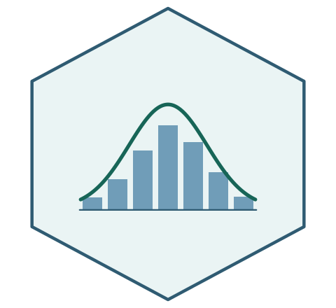
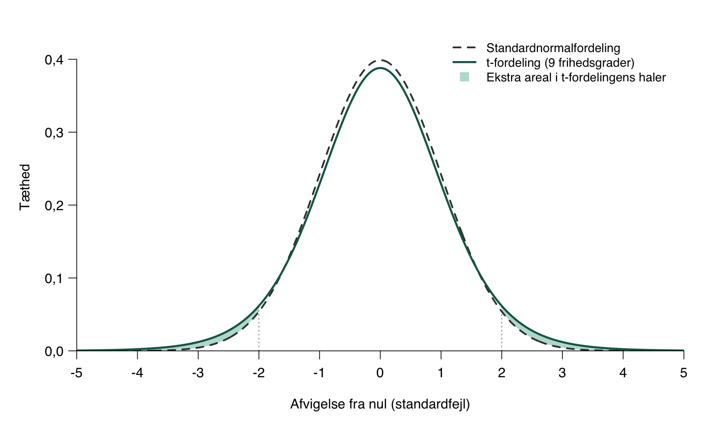
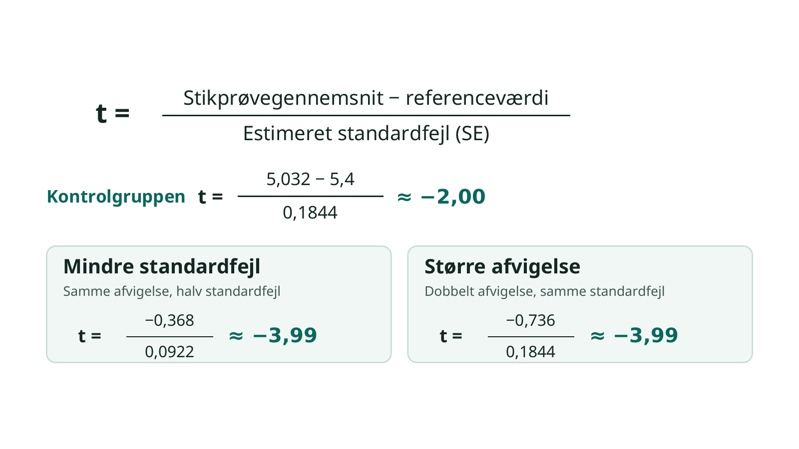

# Grundlæggende statistik i base R {#statistik}

```{r stats-logo, echo=FALSE, out.width="20%", fig.alt="Et histogram med en klokkeformet kurve i en sekskant"}

```

> “Hellere et omtrentligt svar på det rigtige spørgsmål end et præcist svar på det forkerte.” - John Tukey

## Læringsmål og videoer

I [det første kapitel](#baser) lærte du at gemme, undersøge og udvælge data i R. Nu bygger vi videre på dine R-færdigheder for at besvare biologiske spørgsmål ved hjælp af grundlæggende statistik. Statistik handler både om at **beskrive data** og om at **vurdere usikkerheden i vores konklusioner**.

I kurset arbejder vi praktisk med data. Undervejs øver du dig i at forklare, hvad der er målt, hvad du sammenligner, og hvilke antagelser analysen bygger på.

For at bestå kurset behøver du ikke kende alle detaljer og teorier bag de statistiske metoder. Du skal kunne bruge metoderne hensigtsmæssigt i R og fortolke resultaterne korrekt. En stærk statistisk intuition er dog en stor fordel, når du skal vælge en metode og vurdere, hvad resultaterne fortæller om dit biologiske spørgsmål.

Du får mange muligheder for at øve dig i at bruge statistik gennem hele kurset. Til eksamen spørger vi kun til metoder, der indgår i kursets øvelser, herunder workshopopgaverne.

:::goals
Du skal kunne:

- beskrive og sammenligne grupper med gennemsnit, median og standardafvigelse.
- formulere en nulhypotese og forstå p-værdiens betydning og fortolkning.
- vælge en passende t-test og udføre den i base R.
- bruge en chi-i-anden-test til at undersøge sammenhængen mellem to kategoriske variabler.
:::

### Sådan bruger du kapitlet

:::checklist
**Tjekliste**

1. Se [videoerne](#stats-videoer), eller læs de tilsvarende afsnit i notaterne.
2. Lav quizzen **Quiz - Statistik** på Absalon ([problem 1](#stats-quiz)).
3. Arbejd med de øvrige [problemstillinger](#stats-problemer) i undervisningen (problem 2–8). Løsningsforslagene bliver tilgængelige på Absalon mod slutningen af undervisningen.
4. **Valgfrit:** Vi gennemgår [afsnit 2.12 om korrelation og simpel lineær regression](#stats-regression) næste undervisningsgang. Hvis du har tid, kan du kigge på afsnittet allerede nu.
:::

### Videoer {#stats-videoer}

Videoerne er i alt cirka 44 minutter og giver et overblik over de statistiske emner. De viser idéen bag metoderne, hvordan du bruger dem i R, og hvordan du fortolker resultaterne.

I kursusnoterne kan du læse mere og finde koden til eksemplerne. I problemstillingerne arbejder du videre med emnerne.

Gennem kurset bruger vi metoderne i praksis på konkrete datasæt. Hvis noget virker svært i starten, får du flere muligheder for at vende tilbage til det og styrke din forståelse undervejs.

[**Video 1: Databeskrivelse: gennemsnit, median og spredning**]{#stats-video-1 .video-label}

Du beskriver plantevægte med gennemsnit, median og standardafvigelse og sammenligner grupperne i `PlantGrowth`.

Læs [§2.2 om population og stikprøve](#fra-biologisk-spørgsmål-til-observationer) og [§2.3 om at beskrive data](#stats-beskriv). Emnet går igen i [problem 2](#problem-2-centrum-og-en-usædvanlig-værdi) og [problem 3](#problem-1-hvad-indeholder-data).

<div class="course-video">
<iframe src="https://player.vimeo.com/video/1245781750" title="Video 1: Databeskrivelse: gennemsnit, median og spredning" loading="lazy" allow="fullscreen; picture-in-picture" allowfullscreen></iframe>
</div>

-----

[**Video 2: Stikprøver og standardfejl**]{#stats-video-2 .video-label}

Du ser, hvordan gennemsnittet varierer fra stikprøve til stikprøve, og beregner standardfejlen for kontrolgruppens gennemsnit.

Læs [§2.4 om fordelinger](#fordelinger-og-de-første-statistiske-figurer) og [§2.5 om usikkerhed på gennemsnit](#stats-usikkerhed), og prøv derefter [problem 4a–b](#problem-4-variation-og-standardfejl).

<div class="course-video">
<iframe src="https://player.vimeo.com/video/1245781749" title="Video 2: Stikprøver og standardfejl" loading="lazy" allow="fullscreen; picture-in-picture" allowfullscreen></iframe>
</div>

-----

[**Video 3: Hvad fortæller en p-værdi?**]{#stats-video-3 .video-label}

Du sammenligner kontrolplanternes gennemsnit med en reference på 5,4 vægtenheder og bruger de to haler af en normalkurve til at forstå p-værdien.

Læs [afsnittet om hypoteser og p-værdier](#stats-hypoteser), og prøv derefter [problem 4c–d](#problem-7-fortolk-med-omtanke).

<div class="course-video">
<iframe src="https://player.vimeo.com/video/1246282582" title="Video 3: Hvad fortæller en p-værdi?" loading="lazy" allow="fullscreen; picture-in-picture" allowfullscreen></iframe>
</div>

-----

[**Video 4 del 1: T-test for ét gennemsnit**]{#stats-video-4 .video-label}

Du sammenligner kontrolplanternes gennemsnit med en fast reference. Læs [afsnittet om ét gennemsnit mod en reference](#stats-et-gennemsnit), og prøv derefter [problem 4e](#problem-4-et-gennemsnit).

<div class="course-video">
<iframe src="https://player.vimeo.com/video/1246556979" title="Video 4 del 1: T-test for ét gennemsnit" loading="lazy" allow="fullscreen; picture-in-picture" allowfullscreen></iframe>
</div>

-----

[**Video 4 del 2: T-test for to uafhængige grupper**]{#stats-video-4-del-2 .video-label}

Du tester forskellen mellem to gruppers gennemsnit i R. Brug [afsnittet om t-test for to uafhængige grupper](#stats-welch) til [problem 5](#problem-5-en-anden-på-forhånd-valgt-sammenligning) og [problem 8](#problem-10-gentagne-målinger-i-co2).

<div class="course-video">
<iframe src="https://player.vimeo.com/video/1246556980" title="Video 4 del 2: T-test for to uafhængige grupper" loading="lazy" allow="fullscreen; picture-in-picture" allowfullscreen></iframe>
</div>

-----

**T-test til parrede målinger**

Læs [afsnittet om den parrede t-test](#stats-parret), før du arbejder med [problem 6](#problem-6-reaktionstider-og-parring).

-----

[**Video 5: Chi-i-anden-test**]{#stats-video-5 .video-label}

Du undersøger, om blomsterfarve hænger sammen med antallet af kopier af en bestemt allel. Læs [afsnittet om chi-i-anden-test](#stats-andre-metoder) for tabellen og koden. Brug derefter metoden på et andet datasæt i [problem 7 om Titanic](#problem-9-titanic).

<div class="course-video">
<iframe src="https://player.vimeo.com/video/1246556978" title="Video 5: Chi-i-anden-test" loading="lazy" allow="fullscreen; picture-in-picture" allowfullscreen></iframe>
</div>

## Population og stikprøve {#fra-biologisk-spørgsmål-til-observationer}

Forestil dig, at vi vil undersøge, om planter har forskellig tørvægt under forskellige behandlinger. Vi bruger det indbyggede datasæt `PlantGrowth`, som indeholder 30 observationer fordelt på en kontrolgruppe og to behandlingsgrupper. Ifølge [datasættets dokumentation](https://stat.ethz.ch/R-manual/R-patched/library/datasets/html/PlantGrowth.html) er `weight` tørvægt, mens `group` angiver forsøgsgruppen. Dokumentationen angiver ikke vægtens måleenhed, så vi bruger betegnelsen **vægtenheder** frem for at antage, at det er gram.

```{r stats-data}
data("PlantGrowth")
head(PlantGrowth)
str(PlantGrowth)
```

En **observationsenhed** er det, som en observation handler om. Her behandler vi hver række som en måling af én plante. `weight` er en numerisk variabel: Det giver mening at beregne en gennemsnitlig vægt. `group` er en faktor med de tre behandlingsgrupper `ctrl`, `trt1` og `trt2`.

En **population** er den samling af enheder, vi ønsker at udtale os om, for eksempel planter af en bestemt art dyrket under bestemte betingelser. En **stikprøve** er de enheder, vi faktisk har målt. Gennemsnittet af vores ti kontrolplanter beskriver netop disse planter. Når vi bruger det til at sige noget om populationens gennemsnit, kommer der usikkerhed ind i billedet: Ti andre planter ville sandsynligvis have givet et lidt andet gennemsnit.

```{r stats-population-sample, echo=FALSE, fig.width=5.2, fig.height=2.1, out.width="380px", fig.align="center", fig.alt="Stikprøven til højre består af de fremhævede enheder fra populationen til venstre. En streg peger fra en observation til ordet observation."}
local({
  par(mar = rep(0, 4))
  plot.new()
  plot.window(xlim = c(0, 13), ylim = c(0, 5.2), xaxs = "i", yaxs = "i")

  population <- expand.grid(x = seq(1.05, 6.55, length.out = 6),
                            y = seq(1, 3.6, length.out = 4))
  selected <- c(2, 5, 9, 13, 18, 22)
  sample <- expand.grid(x = c(9.9, 11, 12.1), y = c(1.75, 2.85))

  rect(0.2, 0.3, 7.4, 4.3, col = "#f1f5fa", border = "#becddd")
  rect(9.2, 1.1, 12.8, 3.5, col = "#eff8f5", border = "#a6cbc1")
  segments(sample$x[2], sample$y[2], sample$x[2], 0.76, col = "#597083")
  points(population$x[-selected], population$y[-selected],
         pch = 21, bg = "white", col = "#7c91aa", cex = 1.55)
  points(population$x[selected], population$y[selected],
         pch = 21, bg = "#207a6d", col = "#15564e", cex = 1.55)
  points(sample$x, sample$y,
         pch = 21, bg = "#207a6d", col = "#15564e", cex = 1.55)

  arrows(7.7, 2.3, 8.9, 2.3, length = 0.085, angle = 24,
         col = "#597083", lwd = 1.5)
  text(c(3.8, 11), c(4.75, 3.95), c("population", "sample"),
       col = "#23384b", font = 2, cex = 1.15)
  text(sample$x[2], 0.42, "observation", col = "#23384b", cex = 0.9)
})
```

### Antal rækker er ikke altid antal uafhængige observationer

Måler vi højden på én plante ti gange, har vi ti målinger, men stadig kun én plante. Målingerne kan ligne hinanden, fordi de kommer fra den samme plante. De indeholder derfor ikke den samme information som ti uafhængige planter. At behandle sådanne gentagne målinger som ti uafhængige planter kaldes ofte **pseudoreplikation** og kan få usikkerheden til at se mindre ud, end den er.

Uafhængighed afgøres først og fremmest ud fra, hvordan data er indsamlet. Et histogram eller en p-værdi kan ikke fortælle os, om forskeren har målt den samme plante flere gange. Hvis behandlinger gives til hele bakker eller potter, kan det desuden være bakken eller potten, der er den relevante uafhængige forsøgsenhed. Spørg derfor altid, *hvad der blev udvalgt eller behandlet uafhængigt*, før du tæller observationer.

::: {.stop-think}
**Stop og tænk 1:** Vi har fem planter, og hver plante vejes fire gange. Har vi 20 uafhængige planter? Hvilke oplysninger skal datasættet indeholde, hvis vi vil holde styr på gentagelserne?

```{=html}
<details class="stop-think-answer">
<summary>Vis svar</summary>
```

**Svar:** De 20 vejninger kommer fra fem planter. Skriv plantens ID ved hver måling, så du kan se, hvilke vejninger der hører til samme plante.

```{=html}
</details>
```
:::

## Databeskrivelse {#stats-beskriv}

Før vi udfører en test, skal vi forstå, hvordan data ser ud. Vi begynder med kontrolgruppen og gemmer vægtene i en vektor. Højresiden af `<-` udvælger de rækker, hvor gruppen er `ctrl`, præcis som ved delmængder i det første kapitel.

```{r stats-control, results="hold"}
ctrl <- PlantGrowth$weight[PlantGrowth$group == "ctrl"]
mean(ctrl)
sort(ctrl)
median(ctrl)
```

### Gennemsnit og median {#gennemsnit-og-median-to-mål-for-centrum}

Sorterer vi de ti kontrolvægte med `sort()`, står 5,14 og 5,17 på femte og sjette plads. Deres gennemsnit er 5,155, som er det samme resultat, vi får med `median(ctrl)`.

Gennemsnittet er summen af observationerne divideret med antallet af observationer. Hvis de tre højder er 2, 4 og 6 cm, bliver gennemsnittet $(2 + 4 + 6)/3 = 4$ cm. I R beregner `mean()` det samme.

```{r stats-centre, results="hold"}
hoejder <- c(2, 4, 6)
sum(hoejder) / length(hoejder)
mean(hoejder)
median(hoejder)
```

**Medianen** er den midterste værdi, når observationerne er sorteret. Hvis antallet er lige, bruger vi gennemsnittet af de to midterste værdier. Medianen beskriver derfor et punkt, hvor omtrent halvdelen af observationerne ligger på hver side.

Gennemsnit og median kan være meget forskellige. En ekstremt stor observation trækker gennemsnittet op, fordi alle værdier indgår direkte i summen. Medianen påvirkes mindre af, hvor langt en enkelt ekstrem observation ligger fra de øvrige værdier.

```{r stats-outlier, results="hold"}
hoejder_med_stor_vaerdi <- c(2, 4, 6, 40)
mean(hoejder_med_stor_vaerdi)
median(hoejder_med_stor_vaerdi)
```

Her er gennemsnittet 13 cm og medianen 5 cm. Ingen af tallene er en regnefejl: De besvarer forskellige spørgsmål om centrum. Et gennemsnit alene fortæller os ikke, at én af observationerne ligger meget langt fra de øvrige. Derfor skal vi også undersøge variationen og tegne data. Vi sletter ikke automatisk en usædvanlig observation; først undersøger vi, om den skyldes en fejl eller er en reel del af variationen.

### Sammenlign grupper med et boxplot

Et boxplot giver en kompakt oversigt over centrum og spredning. Stregen inde i boksen er medianen. Boksens kanter er de nedre og øvre *hinges*, som ligger tæt på kvartilerne. I små datasæt kan de afvige lidt fra resultatet af `quantile()`. “Whiskers” går ud til de yderste observerede værdier inden for 1,5 boksbredde fra boksens kanter; værdier længere ude vises som punkter. Sådanne punkter er ikke automatisk fejl.

```{r stats-boxplot, fig.width=4.5, fig.height=4, fig.align="center"}
boxplot(weight ~ group, data = PlantGrowth,
        xlab = "Gruppe", ylab = "Tørvægt (vægtenheder)")
```

I kontrolgruppen viser den tykke streg medianen på 5,155, og knurhårene går ud til gruppens mindste og største vægt. I behandling 1 ligger den største vægt, 6,03, så langt fra boksen, at den er tegnet som et punkt.

Formlen `weight ~ group` betyder her “vis vægt fordelt på grupper”. Tegnet `~` læses ofte som “som funktion af” eller “efter”. Argumentet `data = PlantGrowth` fortæller R, hvor de to variabler findes. Vi møder den samme formelsyntaks igen i t-tests og regressionsmodeller.

### Varians og standardafvigelse {#varians-og-standardafvigelse-hvor-forskellige-er-observationerne}

To grupper kan have samme gennemsnit og alligevel være meget forskellige. I `c(4, 4, 4)` er alle værdier ens. I `c(2, 4, 6)` ligger værdierne spredt omkring det samme gennemsnit. **Standardafvigelsen**, forkortet SD efter *standard deviation*, beskriver spredningen omkring gennemsnittet.

Vi kan sammenligne spredningen direkte med `sd()`.

```{r stats-compare-spread, results="hold"}
sd(c(4, 4, 4))
sd(c(2, 4, 6))
```

SD er kvadratroden af variansen og har samme enhed som målingerne. Her beregner vi først varians og SD for de tre højder og derefter gennemsnit og SD for kontrolplanternes tørvægt.

```{r stats-spread, results="hold"}
var(hoejder)
sd(hoejder)

mean(ctrl)
sd(ctrl)
```

Kontrolgruppens SD er cirka 0,58 vægtenheder. Det giver en idé om, hvor langt de enkelte plantevægte typisk ligger fra deres gennemsnit.

### Kvartiler og interkvartilafstand {#ekstra-kvartiler-og-interkvartilafstand}

Kvartiler opdeler en sorteret fordeling i omtrent fire lige store dele. Den nedre kvartil, $Q_1$, svarer til 25 %-fraktilen; medianen er 50 %-fraktilen; og den øvre kvartil, $Q_3$, svarer til 75 %-fraktilen. **Interkvartilafstanden**, IQR, er $Q_3-Q_1$ og beskriver bredden af den midterste del af fordelingen.

```{r stats-quantiles, results="hold"}
quantile(ctrl, probs = c(0.25, 0.50, 0.75))
IQR(ctrl)
range(ctrl)
```

`range()` giver den mindste og den største værdi. Kvartiler kan beregnes med forskellige interpolationsregler, især i små datasæt. Vi bruger R's standardregel i `quantile()`; derfor kan et kvartiltal ligge mellem to observerede værdier. Det ændrer ikke idéen om at beskrive centrum og spredning.

### `tapply()` {#det-samme-for-flere-grupper-med-tapply}

Vi vil ofte beskrive hver gruppe for sig. `tapply()` tager først de værdier, vi vil opsummere, derefter den variabel, der definerer grupperne, og til sidst den funktion, vi vil anvende på hver gruppe.

```{r stats-tapply, results="hold"}
table(PlantGrowth$group)
tapply(PlantGrowth$weight, PlantGrowth$group, mean)
tapply(PlantGrowth$weight, PlantGrowth$group, median)
tapply(PlantGrowth$weight, PlantGrowth$group, sd)
```

Læs den anden linje som: “Opdel vægtene efter gruppe, og beregn gennemsnittet i hver gruppe.” `mean` står her uden parenteser, fordi vi giver selve funktionen videre til `tapply()`.

Hvis der er manglende vægte, er `length()` antallet af værdier inklusive `NA`. Antallet af faktisk observerede vægte skal i stedet beregnes som `sum(!is.na(x))` for den relevante vektor. `mean(x, na.rm = TRUE)` beregner gennemsnittet blandt de observerede værdier, men forklarer ikke, hvorfor andre værdier mangler. Vi skal stadig undersøge det mønster.

## Fordelinger {#fordelinger-og-de-første-statistiske-figurer}

En **fordeling** beskriver, hvilke værdier en variabel kan have, og hvor hyppige eller sandsynlige de forskellige værdier er. I et histogram inddeles tallinjen i intervaller. Højden på hver søjle viser antallet af observationer i intervallet, når histogrammet er tegnet med antal på y-aksen.

### Normalfordelingen {#normalfordelingen-er-en-model}

En **normalfordeling** er en symmetrisk, klokkeformet model for variation. Som i video 2 starter vi med en tænkt population af planter med gennemsnit 5 og standardafvigelse 1 vægtenhed. En større standardafvigelse gør kurven bredere. Et større gennemsnit flytter kurven til højre. Antal celler, andele og stærkt skæve koncentrationer kan kræve andre modeller.

```{r stats-normal-model, echo=FALSE, fig.width=7, fig.height=2.4, out.width="100%", fig.align="center", fig.alt="Tre normalfordelinger på samme akser. Gennemsnit 5 og SD 1, gennemsnit 5 og SD 1,5 med en bredere kurve og gennemsnit 6 og SD 1 med kurven rykket til højre."}
local({
  grafik <- par(mfrow = c(1, 3), mar = c(2.2, 0.7, 2.3, 0.7),
                oma = c(1.75, 3, 0, 0), mgp = c(1.5, 0.4, 0))
  on.exit(par(grafik))
  x <- seq(1, 10, length.out = 401)
  for (i in 1:3) {
    centrum <- c(5, 5, 6)[i]
    spredning <- c(1, 1.5, 1)[i]
    tæthed <- dnorm(x, mean = centrum, sd = spredning)
    plot(x, tæthed, type = "n", ylim = c(0, 0.43), axes = FALSE,
         xlab = "", ylab = "", xaxs = "i", yaxs = "i")
    polygon(c(1, x, 10), c(0, tæthed, 0), col = "#e6efed", border = NA)
    lines(x, tæthed, col = "#176557", lwd = 2)
    segments(centrum, 0, centrum, max(tæthed), col = "#455b69", lty = 2)
    axis(1, at = c(2, 4, 6, 8, 10))
    if (i == 1) axis(2, at = c(0, 0.2, 0.4), las = 1)
    title(paste0("Gennemsnit ", centrum, ", SD ",
                 format(spredning, decimal.mark = ",")), cex.main = 0.9)
  }
  mtext("Vægt (vægtenheder)", side = 1, outer = TRUE, line = 0.35)
  mtext("Tæthed", side = 2, outer = TRUE, line = 1.3)
})
```

Hele arealet under en normalfordeling er 1. Sandsynligheden for, at en plantes vægt ligger inden for et bestemt interval, svarer til arealet over det interval. I den første model ligger halvdelen af arealet til højre for 5, så sandsynligheden for en vægt over 5 er 0,5.

::: {.stop-think}
**Stop og tænk 2:** To grupper har samme gennemsnit, men forskellige standardafvigelser. Vil et søjlediagram med kun de to gennemsnit vise forskellen mellem grupperne?

```{=html}
<details class="stop-think-answer">
<summary>Vis svar</summary>
```

**Svar:** Søjlerne bliver lige høje, fordi gennemsnittene er ens. Diagrammet viser derfor ikke forskellen i spredning mellem grupperne.

```{=html}
</details>
```
:::

## Usikkerhed på gennemsnit {#stats-usikkerhed}

Med `rnorm()` kan vi trække vægte fra den tænkte population med gennemsnit 5 og SD 1. Prøv at køre koden igen. Du får nye observationer og som regel et nyt gennemsnit. Histogrammerne viser vægtene for de enkelte planter. Hvert `mean()`-kald giver ét gennemsnit for hele stikprøven.

```{r stats-draw-samples, results="hold", fig.show="hold", out.width="49%", fig.width=4.25, fig.height=3.55, fig.alt=c("Histogram over de enkelte vægte i en simuleret stikprøve på 10 planter.", "Histogram over de enkelte vægte i en simuleret stikprøve på 40 planter.")}
x10 <- rnorm(10, mean = 5, sd = 1)
hist(x10, main = "10 planter", xlab = "Vægt", ylab = "Antal")
mean(x10)

x40 <- rnorm(40, mean = 5, sd = 1)
hist(x40, main = "40 planter", xlab = "Vægt", ylab = "Antal")
mean(x40)
```

Med `replicate()` gentager vi beregningen 1.000 gange for hver stikprøvestørrelse. `set.seed()` gør det muligt at genskabe tallene og figuren.

```{r stats-repeat-samples, results="hold"}
set.seed(2027)
means_10 <- replicate(1000, mean(rnorm(10, mean = 5, sd = 1)))
means_40 <- replicate(1000, mean(rnorm(40, mean = 5, sd = 1)))
head(means_10)

c(n10 = sd(means_10), n40 = sd(means_40))
```

```{r stats-sample-means-histograms, echo=FALSE, fig.width=6.6, fig.height=3.15, out.width="100%", fig.align="center", fig.alt="To histogrammer med fælles akser viser 1.000 stikprøvegennemsnit. Fordelingen ved 40 planter er smallere omkring 5 end fordelingen ved 10 planter."}
local({
  grafik <- par(mfrow = c(1, 2), mar = c(2.7, 2.9, 2.1, 0.6),
                oma = c(1.4, 0, 0, 0), mgp = c(1.8, 0.5, 0))
  on.exit(par(grafik))
  graenser <- seq(3.6, 6.4, by = 0.1)
  h10 <- hist(means_10, breaks = graenser, plot = FALSE)
  h40 <- hist(means_40, breaks = graenser, plot = FALSE)
  y <- c(0, max(h10$counts, h40$counts))
  plot(h10, xlim = range(graenser), ylim = y, main = "n = 10",
       xlab = "", ylab = "Antal", col = "#bad8d0", border = "white")
  abline(v = 5, lty = 2)
  plot(h40, xlim = range(graenser), ylim = y, main = "n = 40",
       xlab = "", ylab = "Antal", col = "#b9cddd", border = "white")
  abline(v = 5, lty = 2)
  mtext("Stikprøvegennemsnit (vægtenheder)", side = 1, outer = TRUE, line = 0.35)
})
```

Nu viser histogrammerne **gennemsnit af hele stikprøver**. Begge bruger de samme akser. Gennemsnittene ligger tættere på 5, når vi trækker 40 planter frem for 10. SD blandt de simulerede gennemsnit falder fra cirka 0,32 til 0,16 vægtenheder. Det viser, at flere uafhængige observationer giver et mere præcist estimat af populationens gennemsnit.

### Standardafvigelse og standardfejl

Som nævnt i [afsnit 2.3.3](#varians-og-standardafvigelse-hvor-forskellige-er-observationerne) beskriver **standardafvigelsen** (SD), hvor spredt målingerne ligger omkring stikprøvens gennemsnit. I R beregner `sd()` stikprøvens standardafvigelse med formlen

$$
s = \sqrt{\frac{\sum_{i=1}^{n}(x_i-\bar{x})^2}{n-1}}.
$$

Her er $x_i$ den enkelte måling, $\bar{x}$ gennemsnittet og $n$ antallet af målinger. Standardafvigelsen har samme enhed som målingerne.

Afvigelserne fra stikprøvens gennemsnit summerer til nul, så den sidste afvigelse er bestemt af de andre. Vi dividerer derfor med $n-1$ for at undgå at undervurdere populationens varians i gennemsnit.

**Standardfejlen** (SE, *standard error*) er standardafvigelsen for stikprøvegennemsnittet på tværs af nye stikprøver af samme størrelse. I vores tænkte population kender vi SD på 1. Med 10 uafhængige observationer får vi derfor `1 / sqrt(10)`, cirka 0,32 vægtenheder, som stemmer godt med simulationen.

For uafhængige observationer med samme populationsvarians estimeres standardfejlen på gennemsnittet som

$$
\mathrm{SE}(\bar{x}) = \frac{s}{\sqrt{n}}.
$$

Når planterne varierer meget, bliver $s$ og dermed usikkerheden større. Når vi måler flere uafhængige planter, kan deres variation i nogen grad udligne hinanden i gennemsnittet. Derfor bliver SE mindre med stigende $n$. En firedobling af $n$ halverer SE, hvis den underliggende variation er den samme. SD forventes derimod ikke at blive halveret, bare fordi vi måler flere planter.

For kontrolplanterne bruger vi standardafvigelsen fra de ti observerede vægte til at estimere SE.

```{r stats-standard-error}
n_ctrl <- length(ctrl)
mean_ctrl <- mean(ctrl)
sd_ctrl <- sd(ctrl)
se_ctrl <- sd_ctrl / sqrt(n_ctrl)

c(n = n_ctrl,
  gennemsnit = mean_ctrl,
  SD = sd_ctrl,
  SE = se_ctrl)
```

::: {.stop-think}
**Stop og tænk 3:** Vi firedobler antallet af uafhængige planter fra 10 til 40. Skal de enkelte planter nødvendigvis ligne hinanden mere? Hvad forventer vi derimod om usikkerheden på gennemsnittet?

```{=html}
<details class="stop-think-answer">
<summary>Vis svar</summary>
```

**Svar:** De enkelte planter behøver ikke ligne hinanden mere. Ved samme underliggende spredning bliver standardfejlen halvt så stor, fordi $\sqrt{40} = 2\sqrt{10}$.

```{=html}
</details>
```
:::

## Hypoteser og p-værdier {#stats-hypoteser}

I video 3 spørger vi, om kontrolplanternes populationsgennemsnit afviger fra **5,4 vægtenheder**. Vi bruger 5,4 som reference for at øve metoden. I en undersøgelse vælger vi referencen på forhånd ud fra det biologiske spørgsmål.

::: {.hypotheses}
- **Nulhypotesen** ($H_0$) er, at populationsgennemsnittet er 5,4.
- **Det tosidede alternativ** ($H_1$) er, at populationsgennemsnittet er forskelligt fra 5,4.
:::

```{r stats-reference-distance, results="hold"}
reference <- 5.4
afstand <- abs(mean_ctrl - reference)

mean_ctrl
afstand
```

Kontrolgruppens stikprøvegennemsnit er 5,032. Det ligger 0,368 vægtenheder fra referencen. Selv hvis nulhypotesen holder, vil nye stikprøver give forskellige gennemsnit. Hvor ofte ville et gennemsnit ligge mindst lige så langt fra 5,4?

### Hvad fortæller en p-værdi?

I video 3 bruger vi en **normaltilnærmelse** for stikprøvegennemsnittet, centreret ved 5,4 og med den beregnede standardfejl som spredning. Hele arealet under kurven er 1. De tre paneler viser, hvor meget areal der ligger tilbage i de to haler, når vi flytter grænserne længere fra 5,4.

```{r stats-null-area-examples, echo=FALSE, fig.width=7.2, fig.height=2.45, dpi=160, out.width="100%", fig.alt="Tre normalkurver med samme skala. Ved 5,4 ligger 50 procent på hver side. Mindst 0,1 fra 5,4 ligger cirka 59 procent. Mindst 0,5 fra 5,4 ligger cirka 0,67 procent."}
local({
  grafik <- par(no.readonly = TRUE)
  par(mfrow = c(1, 3), mar = c(1.9, 0.7, 2.7, 0.7),
      oma = c(1.5, 0, 0, 0), mgp = c(1.4, 0.35, 0), tcl = -0.2)
  par(cex = 1)

  afstande <- c(0, 0.1, 0.5)
  halearealer <- 2 * pnorm(-afstande / se_ctrl)
  titler <- c("To halvdele", "Afstand mindst 0,1", "Afstand mindst 0,5")
  etiketter <- c(
    "50 % + 50 %",
    paste0(formatC(100 * halearealer[2], format = "f", digits = 0), " % i halerne"),
    paste0(formatC(100 * halearealer[3], format = "f", digits = 2,
                   decimal.mark = ","), " % i halerne")
  )
  x <- seq(reference - 4 * se_ctrl, reference + 4 * se_ctrl, length.out = 401)
  y <- dnorm(x, reference, se_ctrl)

  for (i in seq_along(afstande)) {
    graenser <- reference + c(-1, 1) * afstande[i]
    omraader <- list(seq(min(x), graenser[1], length.out = 150),
                     seq(graenser[2], max(x), length.out = 150))
    farver <- if (i == 1) c("#a8dcd6", "#107f72") else c("#107f72", "#107f72")

    plot(x, y, type = "n", axes = FALSE, xlab = "", ylab = "",
         xaxs = "i", yaxs = "i", ylim = c(0, max(y) * 1.06))
    for (j in seq_along(omraader)) {
      omraade <- omraader[[j]]
      polygon(c(omraade[1], omraade, tail(omraade, 1)),
              c(0, dnorm(omraade, reference, se_ctrl), 0),
              col = farver[j], border = NA)
    }
    segments(graenser, 0, graenser,
             pmax(dnorm(graenser, reference, se_ctrl), 0.22 * max(y)),
             col = "#597083", lty = 3)
    lines(x, y, col = "#23384b", lwd = 1.6)
    axis(1, at = c(4.8, 5.4, 6), labels = c("4,8", "5,4", "6,0"), cex.axis = 0.82)
    title(main = titler[i], line = 1.45, cex.main = 0.92, col.main = "#23384b")
    mtext(etiketter[i], side = 3, line = 0.3, cex = 0.8, col = "#23384b")
  }
  mtext("Stikprøvegennemsnit (vægtenheder)", side = 1, outer = TRUE, line = 0.1, cex = 0.85)
  par(grafik)
})
```

Figuren fra video 3 viser de to haler ved afstanden for vores observerede gennemsnit på 5,032.

```{r stats-null-tails, echo=FALSE, fig.width=6.4, fig.height=3.4, dpi=160, out.width="85%", fig.align="center", fig.alt="Normalkurve med pile, der viser afstanden 0,368 fra 5,4 til hver af grænserne 5,032 og 5,768. De farvede haler udgør tilsammen 4,6 procent under normaltilnærmelsen."}
p_normal <- 2 * pnorm(-afstand / se_ctrl)
local({
  grafik <- par(mar = c(2.9, 2.75, 3.2, 0.6), mgp = c(1.55, 0.42, 0), tcl = -0.23)
  graenser <- reference + c(-1, 1) * afstand
  markeringer <- c(graenser[1], reference, graenser[2])
  x <- seq(reference - 4 * se_ctrl, reference + 4 * se_ctrl, length.out = 401)
  y <- dnorm(x, reference, se_ctrl)
  kurvetop <- max(y)
  pilhoejde <- 1.09 * kurvetop
  afstand_tekst <- formatC(afstand, format = "f", digits = 3, decimal.mark = ",")
  procent_tekst <- formatC(100 * p_normal, format = "f", digits = 1, decimal.mark = ",")

  plot(x, y, type = "n", axes = FALSE, xaxs = "i", yaxs = "i",
       ylim = c(0, 1.24 * kurvetop),
       xlab = "Stikprøvegennemsnit (vægtenheder)", ylab = "Tæthed")
  for (hale in list(seq(min(x), graenser[1], length.out = 120),
                    seq(graenser[2], max(x), length.out = 120))) {
    polygon(c(hale[1], hale, tail(hale, 1)),
            c(0, dnorm(hale, reference, se_ctrl), 0),
            col = "#107f72", border = NA)
  }
  segments(markeringer, 0, markeringer, pilhoejde, col = "#95a9bc", lty = 3)
  lines(x, y, col = "#23384b", lwd = 1.8)
  axis(1, at = markeringer,
       labels = formatC(markeringer, format = "fg", digits = 4, decimal.mark = ","))
  box(bty = "l")

  arrows(reference, pilhoejde, graenser, pilhoejde,
         angle = 24, length = 0.075, col = "#405d77", lwd = 1.2)
  points(reference, pilhoejde, pch = 16, col = "#405d77", cex = 0.55)
  text((markeringer[1:2] + markeringer[2:3]) / 2, 1.17 * kurvetop,
       afstand_tekst, col = "#405d77", cex = 0.85)
  title(main = paste("Afstand mindst", afstand_tekst), line = 1.9,
        cex.main = 1.06, col.main = "#23384b")
  mtext(paste(procent_tekst, "% i halerne (p-værdi)"), side = 3,
        line = 0.65, cex = 0.92, col = "#23384b")
  par(grafik)
})
```

De to haler har samme areal. Det samlede areal er derfor dobbelt så stort som arealet i venstre hale.

::: {.p-value-definition}
En **p-værdi** er sandsynligheden for et resultat mindst lige så ekstremt som det observerede, beregnet under nulhypotesen og modellens øvrige antagelser.

En lille p-værdi betyder, at et sådant resultat er usædvanligt under modellen.

P-værdien angiver **ikke** sandsynligheden for, at nulhypotesen er sand.
:::

Ved et på forhånd valgt **signifikansniveau** på 5 % afviser vi nulhypotesen, hvis p-værdien er under 0,05. En p-værdi på 0,05 eller derover giver for lidt grundlag til at afvise nulhypotesen ved det niveau.

Med normaltilnærmelsen giver de to haler tilsammen en p-værdi på 4,6 %. Det ligger lige under 5 %, så vi ville afvise nulhypotesen med denne tilnærmelse. I næste afsnit bruger vi en t-test, som tager højde for, at standardfejlen er estimeret fra data.

## Ét gennemsnit mod en reference {#stats-et-gennemsnit}

I normaltilnærmelsen brugte vi den estimerede standardfejl som et fast tal. I [video 4 del 1](#stats-video-4) bruger vi en t-test, hvor t-fordelingens tungere haler afspejler usikkerheden ved at estimere standardfejlen fra stikprøven. Med ti observationer bruger testen ni frihedsgrader.

```{r stats-normal-og-t-fordeling, echo=FALSE, out.width="68%", fig.align="center", fig.alt="Standardnormalfordelingen sammenlignet med t-fordelingen med ni frihedsgrader. De farvede områder viser det ekstra areal i t-fordelingens haler."}

```

```{r stats-one-sample}
t_kontrol <- t.test(ctrl, mu = reference, alternative = "two.sided")
t_kontrol
```

`mu` angiver gennemsnittet under nulhypotesen. Med `alternative = "two.sided"` tester vi for afvigelser i begge retninger.

### Hvad fortæller t-værdien?

I outputtet står `t =` `r format(round(t_kontrol$statistic, 4), decimal.mark = ",")`. Tælleren er stikprøvegennemsnittet minus referencen, og nævneren er den estimerede standardfejl. Kontrolgruppens gennemsnit ligger cirka to standardfejl under 5,4.

```{r stats-t-value, echo=FALSE, out.width="85%", fig.align="center", fig.alt="T-værdien er stikprøvegennemsnittet minus referencen divideret med den estimerede standardfejl. For kontrolgruppen giver det minus 2,00. Med halv standardfejl eller dobbelt afvigelse fra referencen bliver t cirka minus 3,99."}

```

Med samme forskel giver en mindre standardfejl en t-værdi længere fra nul. Det samme sker, hvis afvigelsen fra referencen bliver større, mens standardfejlen er uændret. Med de samme frihedsgrader bliver den tosidede p-værdi mindre, når t-værdien ligger længere fra nul.

```{r stats-one-sample-t-calculation}
(mean_ctrl - reference) / se_ctrl
```

T-testen giver `p =` `r format(round(t_kontrol$p.value, 3), decimal.mark = ",")`. T-fordelingen har mere areal i halerne ved den samme afstand målt i standardfejl, så p-værdien er større end normaltilnærmelsens `r format(round(p_normal, 3), decimal.mark = ",")`. Med t-testen har vi for lidt grundlag til at afvise 5,4 ved 5 %-niveauet.

Under `95 percent confidence interval` står de to grænser for kontrolgruppens populationsgennemsnit. Her går intervallet fra cirka 4,61 til 5,45 vægtenheder og omfatter 5,4.

Testen bygger på uafhængige observationer og en tilnærmelsesvis normal fordeling af vægtene i kontrolpopulationen. Med ti planter bør vi især være opmærksomme på stærk skævhed og usædvanlige værdier.

## T-test: to uafhængige grupper {#stats-welch}

I [video 4 del 2](#stats-video-4-del-2) bruger vi en t-test til at sammenligne kontrolgruppen med behandling 2. Vi beregner forskellen som **kontrol minus behandling 2**.

::: {.hypotheses}
- **Nulhypotesen** ($H_0$) er, at populationsmiddelværdierne for behandling 2 og kontrol er ens.
- **Det tosidede alternativ** ($H_1$) er, at populationsmiddelværdierne for behandling 2 og kontrol er forskellige.
:::

En **t-test for to uafhængige grupper** sammenligner to populationsmiddelværdier. Som standard tillader R's `t.test()`, at grupperne har forskellige varianser.

Før testen skal vi overveje, om observationerne er uafhængige både inden for og mellem grupperne. Med ti observationer i hver gruppe forudsætter vi her, at vægtene er tilnærmelsesvis normalfordelte i hver population. Brug [boxplottet med de tre forsøgsgrupper](#sammenlign-grupper-med-et-boxplot) til at se efter stærk skævhed og usædvanlige værdier. Vi ser nærmere på antagelserne i workshoppen ved næste undervisningsgang.

```{r stats-welch-test}
trt2 <- PlantGrowth$weight[PlantGrowth$group == "trt2"]
effekt <- mean(ctrl) - mean(trt2)
effekt

welch <- t.test(ctrl, trt2)
welch
```

Med `t.test(ctrl, trt2)` tester vi forskellen **første gruppe minus anden gruppe**.

### Sådan læser du outputtet

| Felt i R | Sådan læser du det |
|:--------------------------------|:--------------------------------------------------------------|
| `data` | De to grupper i samme rækkefølge som i `t.test()`. |
| `t` | Forskellen mellem stikprøvegennemsnittene målt i standardfejl. |
| `df` | Frihedsgraderne, som bestemmer den t-fordeling, R bruger. R beregner dem ud fra stikprøvestørrelserne og spredningen i begge grupper. |
| `p-value` | Sandsynligheden for en t-værdi mindst lige så langt fra nul som den observerede, hvis nulhypotesen og testens antagelser holder. |
| `alternative hypothesis` | Den alternative hypotese. `not equal to 0` betyder, at vi tester for forskelle i begge retninger. |
| `95 percent confidence interval` | Nedre og øvre grænse for 95 %-konfidensintervallet for forskellen mellem populationsgennemsnittene. |
| `sample estimates` | Stikprøvegennemsnittet for hver gruppe. `mean of x` er gennemsnittet for første gruppe, og `mean of y` er gennemsnittet for anden gruppe. |

**Eksemplet fra video 4 del 2**

- **Stikprøvegennemsnittene** er `r format(round(welch$estimate[1], 3), decimal.mark = ",")` for kontrol og `r format(round(welch$estimate[2], 3), decimal.mark = ",")` for behandling 2. Forskellen **kontrol minus behandling 2** er `r format(round(effekt, 3), decimal.mark = ",")` vægtenheder. Planterne i behandling 2 vejede altså i gennemsnit mere end kontrolplanterne.
- **T-værdien** er cirka `r format(round(welch$statistic, 2), decimal.mark = ",")`. Kontrolgruppens gennemsnit ligger godt to standardfejl under gennemsnittet for behandling 2. R bruger cirka `r format(round(welch$parameter, 1), decimal.mark = ",")` frihedsgrader.
- **P-værdien** er `r format(signif(welch$p.value, 3), decimal.mark = ",")`. Det er lige under 0,05, så ved et signifikansniveau på 5 % afviser vi nulhypotesen om ens populationsgennemsnit.
- **95 %-konfidensintervallet** for kontrol minus behandling 2 går fra `r format(round(welch$conf.int[1], 3), decimal.mark = ",")` til `r format(round(welch$conf.int[2], 3), decimal.mark = ",")` vægtenheder. Den øvre grænse ligger tæt på nul, så en meget lille forskel er også forenelig med data under modellen.

### Se de enkelte observationer {#hvad-skal-vi-undersøge-før-testen}

Med `plot()` kan vi vise hver plante som et punkt. Vi bruger 1 og 2 til at placere grupperne på x-aksen og `axis()` til at skrive gruppenavnene.

```{r stats-welch-data-plot, fig.width=6, fig.height=4, fig.alt="Punktdiagram af tørvægten for kontrolplanterne og planterne i behandling 2."}
gruppe <- rep(c(1, 2), times = c(length(ctrl), length(trt2)))
plot(gruppe, c(ctrl, trt2), pch = 1, xaxt = "n", xlim = c(0.5, 2.5),
     xlab = "Gruppe", ylab = "Tørvægt (vægtenheder)")
axis(1, at = c(1, 2), labels = c("Kontrol", "Behandling 2"))
```

Punkter med næsten samme tørvægt kan overlappe. Figuren supplerer boxplottet ved at vise spredningen og eventuelle usædvanlige målinger i hver gruppe.

Vi bruger `PlantGrowth` som et enkelt undervisningseksempel. Den korte dokumentation beskriver ikke alle detaljer om udvælgelse og randomisering. Hvor langt resultatet kan generaliseres, og om en forskel kan fortolkes kausalt, afhænger også af disse oplysninger.

## T-test til parrede målinger {#stats-parret}

Forestil dig nu, at vi måler de samme personers reaktionstid før og efter en øvelse. En person med langsom reaktionstid før øvelsen kan også have langsom reaktionstid efter. De to målinger fra personen er derfor ikke uafhængige. Vores spørgsmål er i stedet: **Hvad er den gennemsnitlige ændring inden for en person?**

Følgende tal er **konstruerede undervisningsdata**. Hver række indeholder én person, og begge reaktionstider måles i millisekunder. Datasættet ligger direkte i koden og kræver derfor ingen fil fra Absalon.

```{r stats-reaction-data}
reaktion <- data.frame(
  person = paste0("P", 1:10),
  before = c(720, 810, 690, 760, 850, 730, 780, 900, 840, 770),
  after  = c(700, 760, 710, 710, 800, 710, 750, 830, 800, 740)
)
reaktion$aendring <- reaktion$after - reaktion$before
reaktion
```

Vi har valgt **efter minus før**. Negative ændringer betyder derfor kortere, altså hurtigere, reaktionstider. Parret er bevaret, fordi begge målinger står på den samme række sammen med personens ID. Vi må ikke sortere de to kolonner hver for sig. Hvis målingerne kommer fra forskellige tabeller, skal de først forbindes ved hjælp af person-ID, ikke blot ved deres aktuelle rækkefølge. Hvis én måling i et par mangler, skal det pågældende par håndteres samlet; vi må ikke fjerne manglende værdier separat i de to vektorer og derved forskyde parringen. `t.test(..., paired = TRUE)` udelader ufuldstændige par, men vi skal stadig undersøge, hvorfor værdierne mangler.

```{r stats-paired-plot, fig.width=6, fig.height=4, fig.alt="Én prik pr. person (P1–P10) viser ændringen i reaktionstid. En stiplet vandret linje markerer nul."}
person_nr <- seq_along(reaktion$person)
plot(person_nr, reaktion$aendring,
     xlab = "Person", ylab = "Efter minus før (ms)",
     main = "Ændring for hver person", xaxt = "n",
     ylim = range(0, reaktion$aendring), pch = 19)
axis(1, at = person_nr, labels = reaktion$person)
abline(h = 0, lty = 2)
```

Hver prik viser én persons ændring. Prikker under nul svarer til kortere reaktionstider efter øvelsen.

::: {.hypotheses}
- **Nulhypotesen** ($H_0$) er, at den gennemsnitlige ændring i reaktionstid i populationen er 0 ms.
- **Det tosidede alternativ** ($H_1$) er, at den gennemsnitlige ændring i reaktionstid i populationen er forskellig fra 0 ms.
:::

```{r stats-paired-test}
parret <- t.test(reaktion$after, reaktion$before,
                 paired = TRUE)
parret
```

Reaktionstiden faldt i gennemsnit med `r abs(mean(reaktion$aendring))` ms i stikprøven. For ændringen efter minus før går 95 %-konfidensintervallet fra `r format(round(parret$conf.int[1], 1), decimal.mark = ",")` til `r format(round(parret$conf.int[2], 1), decimal.mark = ",")` ms, og p-værdien er `r format(signif(parret$p.value, 3), decimal.mark = ",")`. Intervallet ligger helt under nul, og p-værdien er under 0,05. Faldet er derfor statistisk signifikant ved 5 %-niveauet.

### Se fordelingen af ændringerne

De uafhængige enheder er de ti personer. Testens normalitetsantagelse vedrører **ændringerne**. Et histogram giver et indtryk af skævhed og usædvanlige værdier. Med ti personer er det svært at vurdere formen sikkert.

```{r stats-paired-histogram, fig.width=6, fig.height=4}
hist(reaktion$aendring,
     main = "Ændring i reaktionstid",
     xlab = "Efter minus før (ms)", ylab = "Antal personer",
     col = "lightblue")
```

**Ekstra:** Et Q–Q-plot sammenligner de sorterede ændringer med, hvad vi ville forvente under en normalfordeling. En nogenlunde ret linje er forenelig med modellen. Med få observationer kan punkterne også afvige fra linjen ved tilfældig variation.

```{r stats-paired-qq, fig.width=6, fig.height=4}
qqnorm(reaktion$aendring, main = "Q–Q-plot af ændringer")
qqline(reaktion$aendring)
```

Et før/efter-design uden en passende kontrol gør det ikke muligt alene at afgøre, om øvelsen forårsagede ændringen. For eksempel kan personerne også være blevet mere fortrolige med måleproceduren. En statistisk test erstatter ikke forsøgsdesign.

::: {.stop-think}
**Stop og tænk 4:** Hvad sker der med fortegnet på den gennemsnitlige ændring, hvis vi bruger før minus efter? Hvad sker der med p-værdien i en tosidet test?

```{=html}
<details class="stop-think-answer">
<summary>Vis svar</summary>
```

**Svar:** Den gennemsnitlige ændring skifter fortegn. P-værdien i den tosidede test er den samme, fordi t-værdien stadig ligger lige langt fra nul.

```{=html}
</details>
```
:::

## Chi-i-anden-test {#stats-andre-metoder}

Afsnittet følger [video 5](#stats-video-5).

Her bruger vi en **konstrueret** tabel til at undersøge, om blomsterfarven hænger sammen med antallet af kopier af en bestemt allel. Rækkerne viser de to farver, og kolonnerne viser grupperne med 0, 1 eller 2 kopier. Hver plante bidrager til præcis én celle. Tallet 24 viser, hvor mange lyserøde planter der har to kopier.

```{r stats-chi-table}
blomster <- matrix(c(29, 31, 16,
                         11, 16, 24),
                       nrow = 2, byrow = TRUE,
                       dimnames = list(
                         Farve = c("Roed", "Lyseroed"),
                         Allelkopier = c("0", "1", "2")))
blomster
```

::: {.hypotheses}
- **Nulhypotesen** ($H_0$) er, at blomsterfarve og antal allelkopier er uafhængige i populationen. Så forventer vi den samme andel lyserøde planter i hver gruppe.
- **Den alternative hypotese** ($H_1$) er, at blomsterfarve og antal allelkopier hænger sammen i populationen.
:::

Med `addmargins()` ser vi, at 51 af de 127 planter er lyserøde, og at 40 af de 127 har to kopier. Under uafhængighed ganger vi de to andele og ganger derefter med 127 for at få det forventede antal lyserøde planter med to kopier.

```{r stats-chi-expected-count}
addmargins(blomster)
127 * ((51 / 127) * (40 / 127))
```

Det giver cirka 16,06 forventede planter mod 24 observerede. Samme regneregel gælder for hver celle. Gang rækkesummen med kolonnesummen, og dividér med det samlede antal. Tabellen `chi$expected` viser alle de forventede antal.

```{r stats-chi-test}
chi <- chisq.test(blomster)
chi$expected
chi
```

For hver celle beregner testen den kvadrerede forskel mellem det observerede og det forventede antal divideret med det forventede antal. Summen af de seks bidrag er teststørrelsen. Du kan kontrollere den med `sum((blomster - chi$expected)^2 / chi$expected)`.

Her er p-værdien cirka 0,0069. Det er under 0,05, så ved et signifikansniveau på 5 % afviser vi nulhypotesen om uafhængighed.

Testen kræver uafhængige observationer og tilstrækkeligt store forventede celletal. Brug de observerede **antal** som inddata.

```{r stats-chi-proportions, results="hold"}
prop.table(blomster, margin = 2)
```

`margin = 2` beregner andele inden for hver kolonne. I eksemplet er 27,5 % af planterne med nul kopier lyserøde. Blandt planterne med to kopier er andelen 60 %. Andelene viser, hvordan blomsterfarven hænger sammen med antallet af kopier i tabellen.

## Problemstillinger {#stats-problemer}

[**Problem 1**]{#stats-quiz .problem-label}

Lav quizzen “Quiz - Statistik” på Absalon.

[**Problem 2**]{#problem-2-centrum-og-en-usædvanlig-værdi .problem-label}

Lav vektoren `maaling_oev <- c(8, 9, 10, 11, 12)`.

::: {.problem-parts}
**a)** Beregn gennemsnit, median og standardafvigelse.

**b)** Lav en ny vektor, hvor den sidste værdi er 40 i stedet for 12, og gentag beregningerne. Beskriv, hvad der ændrer sig.

**c)** Hvorfor er det en dårlig idé automatisk at slette 40, bare fordi den påvirker gennemsnittet?

*Hint:* Du kan ændre den femte værdi i en kopi med `ny_vektor[5] <- 40`.
:::

[**Problem 3**]{#problem-1-hvad-indeholder-data .problem-label}

I `ToothGrowth` måles tandvækst hos marsvin, der fik C-vitamin i forskellige doser som appelsinjuice eller askorbinsyre. Indlæs det indbyggede datasæt i dit script.

```{r stats-exercise-tooth-growth, eval=FALSE}
data("ToothGrowth")
```

::: {.problem-parts}
**a)** Kig på hjælpesiden til datasættet (`?ToothGrowth`). Hvad er observationsenheden? Hvilke variabler indeholder datasættet, og hvilke typer har de? Hvad betyder de to værdier i `supp`? Beregn, hvor mange marsvin der fik hver type tilskud.

*Hint:* Giv kolonnen `supp` til `table()`.

**b)** I `ToothGrowth` er der én måling pr. marsvin. Forestil dig et forsøg med de samme marsvin, hvor tandvæksten måles tre gange pr. dyr. Hvor mange målinger og hvor mange uafhængige marsvin ville der så være? Forklar forskellen.

**c)** Kolonnen `dose` angiver dosis i mg C-vitamin pr. dag. Lav en delmængde med de marsvin, der fik 1 mg om dagen, så du kan sammenligne de to tilskud ved samme dosis. Gem din delmængde som en ny dataframe med et passende navn.

[**d)**]{#problem-3-beskriv-planter-i-hver-gruppe} Brug `tapply()` på din delmængde til at beregne gennemsnit, median og standardafvigelse (SD) for `len` i hver tilskudsgruppe (`supp`).

**e)** Tegn et boxplot af `len` for de to typer tilskud, og giv akserne informative titler. Hvilken gruppe har den højeste median ifølge boxplottet? Har den samme gruppe også det højeste gennemsnit i d)?
:::

[**Problem 4**]{#problem-4-variation-og-standardfejl .problem-label}

Indlæs det indbyggede datasæt `ToothGrowth`. Vi vil undersøge, om populationsgennemsnittet for `len` i appelsinjuicegruppen (`OJ`) ved 1 mg C-vitamin om dagen afviger fra 20 (en referenceværdi, der er valgt på forhånd).

::: {.problem-parts}
**a)** Lav en delmængde af `ToothGrowth` med de marsvin, der fik 1 mg C-vitamin om dagen. Gem den som en ny dataframe med et passende navn. Udvælg `len` for appelsinjuicegruppen i delmængden, og brug målingerne til at beregne SD og SE for gruppen.

**b)** Hvad beskriver SD og SE hver især?

[**c)**]{#problem-7-fortolk-med-omtanke} Skriv nulhypotesen og den tosidede alternative hypotese for sammenligningen med 20.

**d)** Hvor langt ligger stikprøvegennemsnittet fra 20?

[**e)**]{#problem-4-et-gennemsnit} Brug `t.test()` til at teste tosidet, om OJ-gruppens populationsgennemsnit afviger fra 20. Hvilken p-værdi får du, og hvad konkluderer du ved et signifikansniveau på 5 %?
:::

[**Problem 5**]{#problem-5-en-anden-på-forhånd-valgt-sammenligning .problem-label}

Brug en delmængde af `ToothGrowth` med de marsvin, der fik 1 mg C-vitamin om dagen. Er den gennemsnitlige tandvækst forskellig mellem appelsinjuicegruppen (`OJ`) og askorbinsyregruppen (`VC`) ved den dosis?

::: {.problem-parts}
**a)** Skriv nulhypotesen og den tosidede alternative hypotese med ord.

**b)** Udvælg `len` for appelsinjuicegruppen (`OJ`) og askorbinsyregruppen (`VC`) fra delmængden. Beregn forskellen mellem gennemsnittene som **OJ minus VC**.

**c)** Udfør en t-test. Find intervallet og p-værdien i outputtet, og kontrollér, hvilken vej forskellen er defineret.

**d)** Skriv en konklusion med forskellens retning, størrelse og p-værdi. Hvilken dosis gælder din konklusion for?
:::

[**Problem 6**]{#problem-6-reaktionstider-og-parring .problem-label}

*[Læs afsnittet om den parrede t-test](#stats-parret).*

Hent `reactions.txt` på Absalon, læg filen i din arbejdsmappe, og indlæs den i R.

I filen er der én række pr. måling. `subject` er personens ID, `time` er tidspunktet (`before` eller `after`), og `RT` er den målte reaktionstid.

```{r stats-exercise-reaction-data, eval=FALSE}
reaktion_oev <- read.table("reactions.txt", header = TRUE)
```

::: {.problem-parts}
**a)** Gem delmængderne for `before` og `after` som `foer` og `efter`. Sortér rækkerne i hver delmængde efter `subject`, så oplysningerne på hver række følges ad. Tjek, at hver person optræder én gang i hver delmængde, og at ID'erne står i samme rækkefølge. Beregn den gennemsnitlige reaktionstid før og efter samt gennemsnittet af ændringerne **efter minus før**.

*Hint:* Sådan sorterer du førmålingerne efter personens ID.

```{r stats-exercise-reaction-sort-hint, eval=FALSE}
foer <- foer[order(foer$subject), ]
```

Gør det tilsvarende for `efter`, og brug `identical()` til at sammenligne de to ID-vektorer.

**b)** Hvor mange uafhængige enheder er der? Hvilken t-test passer til designet, og hvorfor?

**c)** Udfør testen. Find den gennemsnitlige ændring, t-statistikken og p-værdien i outputtet. Hvordan formulerer R den alternative hypotese?

**d)** Skriv en konklusion med ændringens størrelse og retning. Blev reaktionstiden kortere eller længere i gennemsnit? Hvilke oplysninger om forsøget mangler du for at kunne forklare årsagen til ændringen?
:::

[**Problem 7**]{#problem-9-titanic .problem-label}

Hænger overlevelse sammen med passagerklasse? Kør koden for at få en tabel over de tre passagerklasser i R's indbyggede `Titanic`-datasæt. Tabellen samler alders- og kønsgrupperne og udelader besætningen.

```{r stats-exercise-titanic, eval=FALSE}
data("Titanic")
passagerer <- margin.table(Titanic, c(1, 4))
passagerer <- passagerer[c("1st", "2nd", "3rd"), ]
passagerer
```

::: {.problem-parts}
**a)** Hvor mange passagerer er der i alt?

**b)** Skriv nulhypotesen med ord.

**c)** Beregn det forventede antal overlevende på første klasse ud fra række- og kolonnetotalerne.

**d)** Udfør en chi-i-anden-test. Kontrollér dit resultat fra c) med `$expected` i testresultatet.

**e)** Hvad fortæller p-værdien om sammenhængen?

**f)** Brug `prop.table(passagerer, margin = 1)` til at finde andelen, der overlevede i hver klasse. Hvilken klasse havde den højeste andel?

*Hint:* Passagerklasserne står i rækkerne, så `margin = 1` giver andele inden for hver klasse. I blomstereksemplet stod grupperne i kolonnerne, så vi brugte `margin = 2`.
:::

[**Problem 8**]{#problem-10-gentagne-målinger-i-co2 .problem-label}

Det indbyggede datasæt `CO2` indeholder flere målinger af de samme planter ved forskellige CO2-koncentrationer. Læs `?CO2`, og indlæs datasættet.

```{r stats-co2-exercise-data, eval=FALSE}
data("CO2")
```

::: {.problem-parts}
**a)** Lav en delmængde med de rækker, hvor `Type` er `"Quebec"`, og `conc` er `350`. Brug `table()` på kolonnen `Plant` i din delmængde til at kontrollere, at hver plante kun optræder én gang. Hvor mange planter er der i hver behandling?

**b)** Brug din delmængde fra a), og lav én vektor med `uptake` for `nonchilled` og én for `chilled`. Beregn gennemsnittet for hver gruppe, og udfør en t-test med de to vektorer som i video 4 del 2. Giv `t.test()` vektoren for `nonchilled` først.

**c)** Prøv også at køre t-testen med en formel. Tilpas skabelonen ved at erstatte `maalinger` med navnet på målekolonnen, `grupper` med navnet på gruppekolonnen og `din_delmaengde` med navnet på din delmængde.

```{r stats-co2-exercise-formula, eval=FALSE}
t.test(maalinger ~ grupper, data = din_delmaengde)
```

Får du de samme gruppegennemsnit og den samme p-værdi som i b)?

**d)** Hvorfor må vi ikke gøre stikprøven kunstigt større ved at inkludere alle koncentrationer og behandle rækkerne som uafhængige planter?

**e)** Hvilken begrænsning følger af det lille antal planter? Dækker testen forskelle over alle koncentrationer?
:::

## Korrelation og simpel lineær regression {#stats-regression}

**[Dette afsnit hører til næste undervisningsgang om R Markdown.]{style="color: #b42318;"}** Se [kapitel 3 om R Markdown](#rmarkdown).

Afsnittet ligger her sammen med de andre statistiske metoder. I undervisningen bruger vi simpel lineær regression som eksempel på, hvordan du samler kode, resultater og fortolkning i en rapport.

### Se sammenhængen før du beregner et tal

Datasættet `trees` indeholder målinger af 31 træer. Ifølge [R's dokumentation](https://stat.ethz.ch/R-manual/R-patched/library/datasets/html/trees.html) er variablen `Girth` trods sit navn **diameter i tommer**, `Height` er højde i fod, og `Volume` er volumen i kubikfod. Ét punkt i figuren er ét træ.

```{r stats-trees, fig.width=6, fig.height=4}
data("trees")
plot(trees$Girth, trees$Volume,
     xlab = "Diameter (tommer)", ylab = "Volumen (kubikfod)",
     main = "Diameter og volumen af 31 træer", pch = 19)
```

**Pearsons korrelation**, $r$, beskriver styrken og retningen af en lineær sammenhæng. Den ligger mellem $-1$ og $1$. Et positivt fortegn betyder, at større værdier af den ene variabel typisk følges af større værdier af den anden. En værdi tæt på nul betyder, at der er svag eller ingen *lineær* sammenhæng; der kan stadig være en tydelig kurvet sammenhæng.

```{r stats-correlation, results="hold"}
cor(trees$Girth, trees$Volume)
cor.test(trees$Girth, trees$Volume, method = "pearson")
```

`cor()` beregner korrelationen i de observerede data. `cor.test()` undersøger blandt andet nulhypotesen om nul populationskorrelation. Selve korrelationskoefficienten kan beregnes uden en normalitetsantagelse; den klassiske test og dens interval kræver yderligere modelantagelser, typisk uafhængige observationspar fra en bivariat normalfordeling. Ekstreme punkter og krumning kan gøre en enkelt korrelationskoefficient misvisende.

Korrelation dokumenterer ikke i sig selv en årsagssammenhæng. For eksempel kan to mål begge hænge sammen med en tredje egenskab, som alder eller størrelse. Her er diameter og volumen også geometrisk forbundne størrelser.

### En regressionslinje giver en ændring i responsens enhed

I simpel lineær regression beskriver vi den forventede værdi af en numerisk **respons** $Y$ ud fra en **prædiktor** $X$:

$$
Y_i = \beta_0 + \beta_1 X_i + \varepsilon_i.
$$

$\beta_0$ er linjens skæring med y-aksen, og $\beta_1$ er dens hældning. $\varepsilon_i$ beskriver afvigelsen omkring den forventede linje. Vi tilpasser modellen med `lm()`, som står for *linear model*:

```{r stats-linear-model, fig.width=6, fig.height=4}
model <- lm(Volume ~ Girth, data = trees)
summary(model)
coef(model)

plot(trees$Girth, trees$Volume,
     xlab = "Diameter (tommer)", ylab = "Volumen (kubikfod)",
     main = "En foreløbig lineær beskrivelse", pch = 19)
abline(model, col = "blue", lwd = 2)
```

`Volume ~ Girth` angiver volumen som respons og diameter som prædiktor. Hældningen er `r round(coef(model)[2], 2)` kubikfod pr. tomme: Inden for denne lineære model er en diameter, der er én tomme større, forbundet med en forventet volumen, der er cirka `r round(coef(model)[2], 2)` kubikfod større. Det er ikke en påstand om, at vi har ændret træets diameter i et kontrolleret forsøg.

Skæringen er den modellerede volumen ved diameter nul. Nul ligger uden for det observerede diameterinterval, og skæringen har derfor ikke en nyttig biologisk fortolkning her. Vi bør være varsomme med **ekstrapolation**, hvor modellen bruges langt uden for de observerede værdier.

### Residualer og $R^2$

En **residual** er den observerede værdi minus modellens tilpassede værdi. $R^2$ sammenholder modellens kvadrerede residualer med den variation, der er omkring det samlede gennemsnit:

$$
R^2 = 1 - \frac{\sum_i (y_i-\widehat{y}_i)^2}
                  {\sum_i (y_i-\bar{y})^2}.
$$

Tælleren er den variation, der er tilbage efter modellens tilpasning. Nævneren er variationen omkring ét samlet gennemsnit. For almindelig mindste-kvadraters-regression med en skæring beskriver $R^2$ derfor, hvor stor en andel af denne variation i de observerede responsværdier modellen gør rede for. Det er ikke andelen af observationer, der er “korrekte”, og heller ikke en garanti for god forudsigelse af nye data.

```{r stats-rsquared}
summary(model)$r.squared
head(residuals(model))
```

### Antagelser for lineær regression {#stats-regressionsantagelser}

Vi antager, at den forventede sammenhæng mellem diameter og volumen følger en ret linje, og at fejlene omkring linjen er uafhængige og har nogenlunde samme spredning ved alle diametre. Til de sædvanlige t-tests og konfidensintervaller antager vi også, at fejlene ved en given diameter er tilnærmelsesvis normalfordelte.

Vi vurderer uafhængighed ud fra, hvordan data blev indsamlet. I residualplottet ser vi efter mønstre og undersøger, om spredningen er nogenlunde ens på tværs af de tilpassede værdier.

```{r stats-regression-residuals, fig.width=6, fig.height=4}
plot(model, which = 1)
```

En systematisk bue tyder på, at en ret linje ikke beskriver sammenhængen tilstrækkeligt. I dette eksempel er der tegn på krumning, så den enkle model skal ses som en foreløbig beskrivelse, selvom $R^2$ er højt. Vi vender tilbage til transformationer og andre modeller senere.

```{r stats-regression-qq, fig.width=6, fig.height=4}
plot(model, which = 2)
```

Det andet plot er et normal-Q-Q-plot af residualerne. Punkter tæt på den rette referencelinje er forenelige med nogenlunde normalfordelte fejl.

### Opgave til næste undervisningsgang om R Markdown

[**Problem 9**]{#problem-8-korrelation-er-ikke-hele-historien .problem-label}

::: {.problem-parts}
**a)** Brug `trees` til at tegne diameter mod volumen og beregne Pearsons korrelation.

**b)** Tilpas `lm(Volume ~ Girth, data = trees)`. Find hældning og $R^2$, og forklar begge med ord og de relevante enheder.

**c)** Se residualplottet. Hvorfor er et højt $R^2$ ikke nok til at erklære modellen passende?

**d)** Kan en korrelation tæt på nul udelukke en kurvet sammenhæng?
:::
