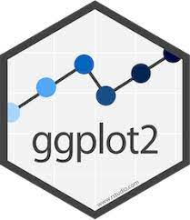
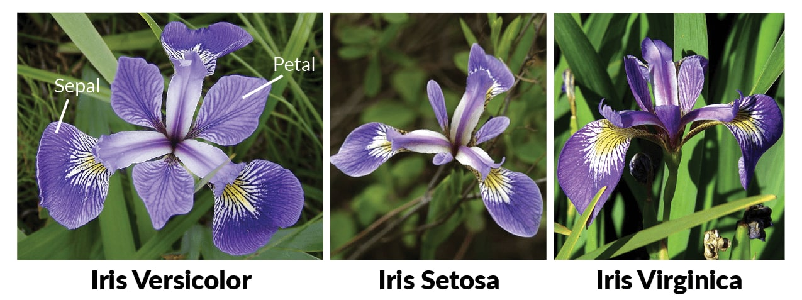
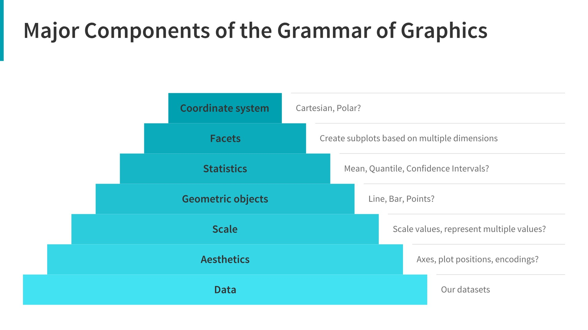

# Visualisering - ggplot2 dag 1 {#visual1}

```{r, echo=FALSE,out.height="25%",out.width="25%"}
# Bigger fig.width
library(jpeg)
library(knitr)

```

"Visualisering giver dig svar på spørgsmål, du ikke vidste, du havde." -- Ben Shneiderman

<!-- Local vs global aes -->

## Læringsmål og videoer

Dette kapitel giver en introduktion til, hvordan man visualiserer data med R-pakken **ggplot2**. Du skal være i stand til at:

:::goals
-   Forstå, hvad "Grammar of Graphics" betyder, og sammenhængen med **ggplot2**-pakken
-   Lære at bruge funktionen `ggplot()` og dens relevante **geoms** (`geom_point()`, `geom_bar()`, `geom_histogram()`, `geom_boxplot()`, `geom_density()`, `geom_line()`)
-   Lave en 'færdig' figur med en titel og korrekte etiketter på akserne
-   Begynde at arbejde med farver og temaer
:::

### Hvad er **ggplot2**?

De fleste i kurset har brugt funktionen `plot()`, som er den standard base-R funktion til at lave et plot. Man kan fortsætte med at bruge plotfunktioner fra base-pakken, men det kan være meget tidskrævende, især når man vil lave mere komplekse og æstetiske plots.

En alternativ løsning er pakken **ggplot2**, som står for "Grammar of Graphics" (se nærmere forklaring nedenfor). **ggplot2** er den mest populære pakke fra **tidyverse**. Som vi vil se i dette kapitel, har den en ret logisk tilgang, hvor man opbygger et plot vha. forskellige komponenter. Det kan virke uoverskueligt i starten, men når man først har lært det, er det faktisk meget intuitivt. Det nyttige i at lære **ggplot2** kan også ses, når man begynder at integrere de andre **tidyverse**-pakker senere i kurset.

### Brugen af materialerne

Vi starter med 'quick-start' RStudio-eksempler i videoerne. De er dog ikke designet til at indeholde alle detaljer, men til at fungere som udgangspunkt for at komme i gang med øvelserne. Vær venligst opmærksom på, at al den kode, der vises i videoerne, også findes i kursusnotaterne, hvis du selv vil prøve den. Vi anbefaler, at du bruger kursusnotaterne som en reference gennem kurset, når du arbejder på opgaverne. Vær venligst også opmærksom på, at nogle gange bliver nye aspekter også introduceret i selve øvelserne.

:::checklist
Tjekliste til Kapitel 4: ggplot2

* Se videoerne
* Kig igennem kursusnotaterne
* Lav quiz "ggplot2 - dag 1"
* Lav problemstillingerne
:::

### Videoressourcer

<!-- Link her hvis det ikke virker nedenunder: https://player.vimeo.com/video/544299069 -->

<!-- ```{r,echo=FALSE} -->

<!-- library("vembedr") -->

<!-- embed_url("https://vimeo.com/544299069") -->

<!--      embed_url("https://vimeo.com/544299069") #2022 -->

<!-- ``` -->

* Video 1: Det første plot med `ggplot2`

```{r,echo=FALSE}
library("vembedr")

#Link her hvis det ikke virker nedenunder: #<https://player.vimeo.com/video/701245598>

#embed_url("https://vimeo.com/543945046")

#2022
embed_url("https://vimeo.com/701245598") #2022
```

* Video 2: Boxplots

```{r,echo=FALSE}
#library("vembedr")

#Link her hvis det ikke virker nedenunder: #<https://player.vimeo.com/video/701245695>

#embed_url("https://vimeo.com/543989990") #2021

embed_url("https://vimeo.com/701245695") #2022
```

<!-- OBS: jeg sagde i videoen at `alpha=0.5` gøre punkterne mere markant, men jeg mente selvfølgelige mindre markant ;) -->

* Video 3:  Barplots

```{r,echo=FALSE}
#library("vembedr")
#Link her hvis det ikke virker nedenunder: <https://player.vimeo.com/video/704025240>

#embed_url("https://vimeo.com/544033975") #2021

embed_url("https://vimeo.com/704025240") #2022
```

* Video 4: Histogram og density plots

```{r,echo=FALSE}
#library("vembedr")

#Link her hvis det ikke virker nedenunder: <https://player.vimeo.com/video/703699213>

#embed_url("https://vimeo.com/544188160") #2021

embed_url("https://vimeo.com/703699213") #2022
```

## Transition fra base R til ggplot2

Vi starter som udgangspunkt med base-R og viser, hvordan man laver et lignende plot med **ggplot2**. Til dette formål bruger vi det indbyggede datasæt, der hedder `iris`. Datasættet er meget berømt, og det er næsten sikkert, at du allerede er stødt på det uden for dette kursus, enten på nettet eller i forbindelse med andre kurser, som handler om R. Datasættet blev oprindeligt indsamlet af statistikeren og biologen Ronald Fisher i 1936 og indeholder 50 stikprøver, der dækker forskellige målinger for hver af tre arter af planten iris (Iris setosa, Iris virginica og Iris versicolor).

```{r, echo=FALSE,out.width="85%"}
# Bigger fig.width
library(jpeg)
library(knitr)

```

Som vi også så i grundlæggende R, kan man indlæse et indbygget datasæt ved hjælp af funktionen `data()`.

```{r}
data(iris)
```

Først vil vi have et overblik over datasættet. Til at få det bruger vi `summary()`, `str()` og `print()`:

```{r}
summary(iris)
str(iris)
print(iris)
```

Forestil dig, at vi gerne vil lave et plot, som viser sammenhængen mellem længden og bredden af 'sepals' (bægerblade) - specifikt er vi interesserede i kolonnerne `iris$Sepal.Length` og `iris$Sepal.Width`. Lad os starte med at visualisere variablerne i base-R ved at bruge `plot()`:

```{r, fig.width=5}
plot(iris$Sepal.Length, iris$Sepal.Width)
```

Man kan gøre det meget pænere eksempelvis ved at bruge forskellige farver til at betegne de forskellige arter, eller ved at give en hensigtsmæssig overskrift eller aksenavne.

## Vores første ggplot

Vi vil imidlertid fokusere på at lave et lignende plot med pakken `ggplot2`. Hvis man ikke allerede har gjort det, så husk at indlæse pakken i R for at få nedenstående kode til at virke.

```{r}
#install.packages("ggplot2") #hvis ikke allerede installeret
library(ggplot2)
```

For at lave et plot med `ggplot2` tager man altid udgangspunkt i funktionen `ggplot()`. Først specificerer vi vores data - altså at vi gerne vil bruge dataframen `iris`. Dernæst angiver vi inden for funktionen `aes()` (som placeres inde i `ggplot()`), at x-aksen skal være `Sepal.Length` og y-aksen `Sepal.Width`. Det ser sådan ud:

```{r, eval=T,fig.width=4,fig.height=4}
ggplot(iris, aes(x=Sepal.Length, y=Sepal.Width))
```

Koden fungerer, men bemærk, at plottet er helt tomt og derfor ikke særligt brugbart. Men der er skabt et grundlag (se aksenavne osv.). Det er tomt, fordi vi endnu ikke har specificeret, hvilken plottype det skal være - for eksempel søljediagram/barplot, histogram, punktplot/scatter plot (vi vælger de engelske begreber herfra for at skabe den bedste sammenhæng med koden). Vi vil gerne bruge et scatter plot, som i **ggplot2** er angivet med funktionen `geom_point()`. Vi tilslutter derfor funktionen `geom_point()` til den `ggplot()`-funktion, som vi allerede har specificeret. Husk altid, at man bruger `+` til at forbinde de to "komponenter" (altså `ggplot()` og `geom_point()`) af plottet (ellers får vi fortsat et tomt plot).

Koden er således:

```{r, fig.width=4,fig.height=4}
ggplot(iris, aes(x = Sepal.Length, y = Sepal.Width)) +
  geom_point()
```

Bemærk, at vi ikke har skrevet noget indeni de runde parenteser i funktionen `geom_point()`. Det betyder, at vi accepterer alle standardparametrene, som funktionen tager. Hvis vi vil have noget andet end standardparametrene, kan vi godt specificere det. For eksempel kan vi gøre punkterne lidt større end ved standarden (prøv at tjekke `?geom_point()` for at se en liste over de mulige parametre, som man kan justere):

```{r, fig.width=4,fig.height=4}
ggplot(iris, aes(x = Sepal.Length, y = Sepal.Width)) +
  geom_point(size = 3)
```

Vi har nu et plot, som vi kan sammenligne med det ovenstående plot lavet i base-pakken. Ligesom i base-pakken vil vi gerne tilføje nogle ting for at gøre vores plot til vores *færdige figur*. Her i **ggplot2** gøres det ved at tilføje flere komponenter ovenpå ved brug af `+`, ligesom vi gjorde, da vi tilføjede `geom_point()` til `ggplot()`. Men først nogle generelle ord om **ggplot2** og filosofien bag pakken.

## Lidt om ggplot2

### Syntax

Som vi lige har set, tager `ggplot()` altid udgangspunkt i en dataframe, som vi specificerer først. Den angivne dataframe indeholder de variabler, vi skal bruge til at lave figuren. For at gøre det til noget mere konkret: lad os sammenligne koden mellem base-pakken og `ggplot()` for vores `iris` data. I base-R angav vi direkte vektorerne `iris$Sepal.Length` og `iris$Sepal.Width` som parametrene `x` og `y`, der tager henholdsvis første- og andenpladsen i funktionen `plot()`. I `ggplot()` specificerer man i stedet først hele datarammen på den første plads, og så bagefter ved brug af `aes()` angiver man, hvordan x-aksen og y-aksen ser ud ved at angive kolonnenavnene fra datarammen.

```{r, eval=FALSE}
#baseplot solution
plot(iris$Sepal.Length, iris$Sepal.Width) 

#ggplot2 solution
ggplot(iris, aes(x = Sepal.Length, y = Sepal.Width)) +
  geom_point()
```

En anden fordel ved `ggplot2` er, at man kan fortsætte med at forbedre plottet ved at tilføje ting oven på det eksisterende plot, hvilket kan beskrives som en lagbaseret tilgang. Dette gøres intuitivt ved at bruge "+". Man kan derfor starte med noget simpelt og gradvist opbygge noget mere komplekst. Dette er uafhængigt af, hvilken type plot man laver.

### Hvad betyder egentlig grammar of graphics?

Det `gg` i `ggplot2` står for *grammar of graphics*, og filosofien er, at man skal definere en *sætningsstruktur* til de figurer, man laver. Med andre ord består vores figur af forskellige komponenter, som man forbinder med "+".

```{r, echo=FALSE,out.width="50%"}
# Bigger fig.width
library(jpeg)
library(knitr)

```

Her er en beskrivelse af de forskellige komponenter, som bruges til at opbygge et plot:

-   Data: Datarammer tages altid som udgangspunkt.
-   Aesthetics: Variabler til x-aksen eller y-aksen, farve, form eller størrelse
-   Scale: Skalering af værdier eller repræsentation af flere værdier
-   Geometries: Også kaldet geoms - bestemmer hvilken type plot, der skal laves, som f.eks. søjler, punkter, linjer osv.
-   Statistics: Tilføjer f.eks. mean, median eller kvartiler, som beskriver dataene.
-   Facets: Opretter subplots baseret på flere dimensioner.
-   Coordinate system: Transformerer akser og ændrer afstanden for de viste data.

### Global versus lokal æstetik

I de fleste tilfælde bruger man funktionen `aes()` inden for `ggplot()`, hvilket betyder, at variablerne, der er specificeret inden for `aes()`, gælder globalt over alle komponenter i plottet. Man kan faktisk også skrive en lokal `aes()` inden for selve `geom`-funktionen, som i følgende eksempel:

```{r, fig.width=4,fig.height=4}
ggplot(iris) +
  geom_point(aes(x=Sepal.Length, y=Sepal.Width))
```

Vi får det samme plot som før, men det er kun `geom_point()`, der er påvirket af specificeringen inden for `aes()`. I simple situationer som dette er der ingen forskel, men når man har mange forskellige komponenter i spil, kan det nogle gange give mening at bruge lokal æstetik.

## Specificere etiketter og titel

Vi tager udgangspunkt i plottet, som vi har lavet ovenfor, og prøver at gøre det bedre ved at tilføje nye etiketter og en titel. I `ggplot` kan man opdatere etiketterne på y- og x-aksen ved at bruge henholdsvis `ylab()` og `xlab()`:

```{r, fig.width=4,fig.height=4}
ggplot(iris, aes(x=Sepal.Length, y=Sepal.Width)) +
  geom_point(size=3) +
  xlab("Sepal Length") +
  ylab("Sepal Width")
```

Vi tilføjer en titel med funktionen `ggtitle()`:

```{r, fig.width=4,fig.height=4}
ggplot(iris, aes(x=Sepal.Length, y=Sepal.Width)) +
  geom_point(size=3) +
  xlab("Sepal Length") +
  ylab("Sepal Width") +
  ggtitle("Scatter plot of Sepal Width vs Sepal Length")
```

## Ændre farver

I `ggplot2` kan man bruge "automatiske" farver for at skelne mellem de tre forskellige `Species` i datasættet `iris`. I den næste lektion vil vi dække, hvordan man kan være mere fleksibel ved at sætte farver manuelt, men ofte vil vi bare bruge den nemme løsning som udgangspunkt og eventuelt rette op på det senere med en ny komponent, hvis der er behov for det. Vi skriver `color=Species` inden for `aes()`, som i følgende eksempel. Bemærk, at der kommer en 'legend' med, der fortæller os, hvilken art der får hvilken farve.

```{r, fig.width=5,fig.height=4}
ggplot(iris, aes(x=Sepal.Length, y=Sepal.Width,color=Species)) +
  geom_point(size=3) +
  xlab("Sepal Length") +
  ylab("Sepal Width") +
  ggtitle("Scatter plot of Sepal Width vs Sepal Length")
```

## Ændre tema

Standardtemaet har en grå baggrund og gitterlinjer ("grid"-linjer), men man kan godt vælge noget andet. For eksempel kan man tilføje `theme_minimal()` som i nedenstående eksempel. Her får vi en hvid baggrund i stedet, mens man stadig får gitterlinjer. Man kan afprøve forskellige temaer (for eksempel `theme_classic()`, `theme_bw()`) og se, hvilket tema der fungerer bedst i det enkelte plot.

```{r, fig.width=5,fig.height=4}
ggplot(iris, aes(x=Sepal.Length, y=Sepal.Width,color=Species)) +
  geom_point(size=3) +
  xlab("Sepal Length") +
  ylab("Sepal Width") +
  ggtitle("Scatter plot of Sepal Width vs Sepal Length") +
  theme_minimal()
```

Her er nogle eksempler på mulige temaer, som du kan bruge i dine plots (det er dog generelt op til dig).

| tema              |
|-------------------|
| `theme_grey()`    |
| `theme_classic()` |
| `theme_bw()`      |
| `theme_dark()`    |
| `theme_minimal()` |
| `theme_light()`   |
| `theme_clean()`   |

Se også her, hvis du er interesseret i flere temaer: <https://r-charts.com/ggplot2/themes/>

## Forskellige geoms

Indtil videre har vi kun arbejdet med `geom_point()` for at lave et scatter plot, men der er også andre "geoms", som kan bruges til forskellige typer af plots. Her er en liste over nogle af de mest almindelige `geoms`:

| geom               | plot         |
|--------------------|--------------|
| `geom_point()`     | scatter plot |
| `geom_bar()`       | barplot      |
| `geom_boxplot()`   | boxplot      |
| `geom_histogram()` | histogram    |
| `geom_density()`   | density      |

For at lave disse `geoms` skal man tilføje dem til `ggplot()`-kommandoen ved at bruge `+`, på samme måde som vi gjorde med `geom_point()`. Der kan dog være specifikke overvejelser, der er værd at have i tankerne for nogle plottyper, før man bruger dem.

### Boxplot (`geom_boxplot()`)

For at lave et boxplot af `Sepal.Length` opdelt efter `Species` angiver vi `Species` på x-aksen og `Sepal.Length` på y-aksen. Vi vil også have, at hver art får sin egen farve, så vi bruger `fill=Species`.

```{r, fig.width=5, fig.height=4, message=FALSE, warning=FALSE}
ggplot(data=iris, aes(x=Species, y=Sepal.Length,fill=Species)) + 
  geom_boxplot() + 
  ylab("Sepal Length") + 
  ggtitle("Boxplot") +
  theme_minimal()
```

**Tilføj punkter ovenpå**

Det kan ofte være nyttigt at plotte de faktiske datapunkter oven på et boxplot, så man kan se både fordelingen i dataene samt de rå data. En løsning er at benytte `geom_point()` ved at tilføje det som komponent over vores eksisterende kode.

```{r, fig.width=5, fig.height=4, message=FALSE, warning=FALSE}
ggplot(data=iris, aes(x=Species, y=Sepal.Length,fill=Species)) + 
  geom_boxplot() + 
  geom_point() + 
  ylab("Sepal Length") + 
  ggtitle("Boxplot with points overlayed") + 
  theme_minimal()
```

Man kan dog se, at det ikke er særlig informativt, da alle punkter er på den samme lodrette linje. Hvis der er mange punkter med samme eller næsten samme værdier, kan man ikke se de fleste af dem i plottet. En bedre løsning er at indføre noget tilfældighed i punkterne langs x-aksen, så man tydeligere kan se dem. Dette kaldes "jitter", og man specificerer jitter ved at bruge `geom_jitter()` i stedet for `geom_point()`.

```{r, fig.width=5, fig.height=4, message=FALSE, warning=FALSE}
ggplot(data=iris, aes(x=Species, y=Sepal.Length,fill=Species)) + 
  geom_boxplot() + 
  geom_jitter() +
  ylab("Sepal Length") + 
  ggtitle("Boxplot with jitter") + 
  theme_minimal()
```

Man kan også specificere `alpha`, som gør punkterne mere gennemsigtige og mindre markante. Man kan også ændre på `width`, som kontrollerer deres spredning langs x-aksen.

```{r, fig.width=5, fig.height=4, message=FALSE, warning=FALSE}
ggplot(data=iris, aes(x=Species, y=Sepal.Length,fill=Species)) + 
  geom_boxplot() + 
  geom_jitter(alpha=0.5,width=0.2) +
  ylab("Sepal Length") + 
  ggtitle("Boxplot with jitter and transparency") + 
  theme_minimal()
```

**Fjern legenden, hvis den er unødvendig**

<!-- ### this doesn't work great - find out why  -->

Man kan se, at når man specificerer farver, får man en legende på højre side af plottet. I dette tilfælde er det faktisk ikke nødvendigt, da man kan se uden legende, hvad de tre boxplots refererer til. Derfor fjerner vi legenden fra plottet ved at bruge `theme(legend.position="none")`.

```{r, fig.width=4, fig.height=4}
ggplot(data=iris, aes(x=Species, y=Sepal.Length,fill=Species)) + 
  geom_boxplot() + 
  geom_jitter() +
  ylab("Sepal Length") + 
  ggtitle("Boxplot with jitter and no legend") +
  theme(legend.position="none")
```

Man kan, som alternativ til ovenstående, fjerne legenden ved at tilføje `show.legend = FALSE` som indstilling i den `geom`, der genererer den. Vær opmærksom på, at man i dette tilfælde skal skrive `show.legend = FALSE` i både `geom_boxplot()`- og `geom_jitter()`-funktionerne for at få legenden helt fjernet.

```{r, fig.width=4, fig.height=4}
ggplot(data=iris, aes(x=Species, y=Sepal.Length,fill=Species)) + 
  geom_boxplot(show.legend = FALSE) + 
  geom_jitter(show.legend = FALSE) +
  ylab("Sepal Length") + 
  ggtitle("Boxplot with jitter and no legend") 
```

### Barplot (`geom_bar`)

Med `ggplot()` kan man repræsentere data i et barplot ved at bruge `geom_bar()`. Her vil vi gerne tælle antallet af observationer for hver art (variablen `Species`) og visualisere dem som søjler. Inden for `geom_bar()` specificerer vi derfor `stat="count"`.

Vi bruger også `fill=Species` for at give forskellige farver automatisk for hver af de tre arter. Bemærk, at det var `color=Species` i det forudgående plot, da vi anvendte `geom_point()`. Det skyldes, at `color` bruges til punkter og linjer, mens `fill` er til større områder, der bliver udfyldt, såsom søjler og histogrammer.

```{r, fig.width=5, fig.height=4, message=FALSE, warning=FALSE}
ggplot(iris, aes(x=Species,fill=Species)) + 
  geom_bar(stat = "count") +
  ggtitle("Number of observations by species") +
  theme_minimal()
```

**Barplot: stack vs dodge**

Hvis man har flere kategoriske variabler, kan man lave barplots på forskellige måder. Til datasættet tilføjer vi en ekstra kategorisk variabel med navn `Sepal.Group`, som adskiller mellem `Long` og `Short` værdier af variablen `Sepal.Length`. Her specificerer jeg bare (med funktionen `ifelse()`), at hvis `Sepal.Length` er længere end den gennemsnitlige `Sepal.Length`, så betragtes den som `Long`, og ellers er den `Short`, som vist i følgende kode:

```{r,fig.width=5, fig.height=4, message=FALSE, warning=FALSE}
iris$Sepal.Group <- 
  ifelse(iris$Sepal.Length>mean(iris$Sepal.Length),  #test
         "Long",                                     #if TRUE
         "Short")                                    #if FALSE
```

Når vi laver et barplot med de to variabler, tilføjer jeg `Sepal.Group` med `fill`, og `ggplot` splitter antal observationer efter `Sepal.Group` med farver, som repræsenterer `Long` eller `Short`, og tilføjer en tilsvarende legende.

```{r,fig.width=5, fig.height=4, message=FALSE, warning=FALSE}
ggplot(iris, aes(x=Species, fill=Sepal.Group)) + 
  geom_bar(stat = "count") +
  ggtitle("Number of observations by species") +
  theme_minimal()
```

Mange gange foretrækker man at have søjler stående ved siden af hinanden i stedet for oven på hinanden. Dette kan opnås ved blot at tilføje `position="dodge"` inde i `geom_bar()`.

```{r,fig.width=5, fig.height=4, message=FALSE, warning=FALSE}
ggplot(iris, aes(x=Species, fill=Sepal.Group)) + 
  geom_bar(stat = "count", position = "dodge") +
  ggtitle("Number of observations by species") +
  theme_minimal()
```

Som et eksempel på fleksibiliteten i pakken `ggplot2` kan jeg nævne, at det kan være irriterende, når bredden af søjlerne for arten setosa i et barplot er dobbelt så bred som de andre søjler, fordi der ikke er nogle observationer i setosa-gruppen med en `Long` værdi i variablen `Sepal.Group`. En løsning på dette kan findes ved at tilføje `position=position_dodge2(preserve = "single")` i `geom_bar()`. Denne parameter gør bredden på alle søjler ens, uanset om der er data i alle kategorier eller ej.

```{r}
ggplot(iris, aes(x=Species, fill=Sepal.Group)) + 
  geom_bar(stat = "count", position = position_dodge2(preserve = "single")) +
  ggtitle("Number of observations by species") +
  theme_minimal()
```

### Histogram (`geom_histogram`)

<!-- Her præsenterer jeg to yderligere brugbart plot typer. -->

Et histogram bruges til at give et overblik over, hvordan dataene fordeler sig. Med `ggplot2` kan man lave et histogram med `geom_histogram()`. Variablen på x-aksen skal være en kontinuert variabel. Her specificerer vi, at vi gerne vil have et histogram for hver art (Species).

```{r, fig.width=5, fig.height=4, message=FALSE, warning=FALSE}
ggplot(data=iris, aes(x=Sepal.Length, fill=Species)) + 
  geom_histogram() + 
  xlab("Sepal Length") + 
  ggtitle("Iris histogram") + 
  theme_minimal()
```

Man kan også gøre det nemmere at skelne mellem de tre arter ved at sætte `alpha=0.5` inden for `geom_histogram()` og ved at angive en linjefarve som parameter i `geom_histogram()`.

```{r, fig.width=5, fig.height=4, message=FALSE, warning=FALSE}
ggplot(data=iris, aes(x=Sepal.Length, fill=Species)) + 
  geom_histogram(alpha=0.5,color="black") + 
  xlab("Sepal Length") + 
  ggtitle("Iris histogram") + 
  theme_minimal()
```

### Density (`geom_density`)

Med et density plot kan man, ligesom med et histogram, se fordelingen af dataene i form af en glat eller "smooth" kurve.

```{r, fig.width=5, fig.height=4, message=FALSE, warning=FALSE}
ggplot(data=iris, aes(x=Sepal.Length, color=Species)) + 
  geom_density() + 
  xlab("Sepal Length") + 
  ggtitle("Density plot") +
  theme_minimal()
```

**Density plot med fill og gennemsigtige farver**

Vi kan angive en værdi for `alpha` inden for `geom_density()`. Som før specificerer parameteren `alpha` gennemsigtigheden af density-kurverne i plottet.

```{r, fig.width=5, fig.height=4, message=FALSE, warning=FALSE}
ggplot(data=iris, aes(x=Sepal.Length, fill=Species)) + 
  geom_density(alpha=0.5) + 
  xlab("Sepal Length") + 
  ggtitle("Density plot with alpha=0.5") +
  theme_minimal()
```

**Tilføj linjer for middelværdien**

Vi bruger funktionen `tapply()` til at beregne middelværdierne af `Sepal.Length` for hver af de tre `Species`. Vi kan derefter tilføje dem som lodrette linjer til vores plot. Her bruger vi `geom_vline()` (OBS, det er `geom_hline()`, hvis man vil have en vandret linje) og fortæller, at `xintercept` skal være lig med de middelværdier, som vi har beregnet. Parameteren `lty=2` (i.e., linetype) betyder, at vi gerne vil have en stiplet ("dashed") linje.

```{r, fig.width=5, fig.height=4, message=FALSE, warning=FALSE}
means <- tapply(iris$Sepal.Length,iris$Species,median)

ggplot(data=iris, aes(x=Sepal.Length, color=Species)) + 
  geom_density(alpha=0.5) + 
  xlab("Sepal Length") + 
  ggtitle("Density plot with alpha=0.5") + 
  geom_vline(xintercept = means,lty=2) + 
  theme_minimal()
```

### Line plot (`geom_line()`)

`geom_line()` kan bruges til at lave linjediagrammer. Her indlæser vi datasættet `population` og filtrerer kun landene fra Skandinavien.

```{r}
library(tidyr)
data(population)
population_scand <- population[population$country %in% c("Denmark","Sweden","Norway","Finland"),]
head(population_scand)
```

Da tallene i variablen `population` er ret store, kan det være en god idé at normalisere, så de betegner befolkningsstørrelser i millioner.

```{r}
population_scand$population <- population_scand$population/1e06
```

Her laver vi et plot med `geom_line()`, så vi kan se udviklingen i befolkningsstørrelserne over tid. For at få det til at virke skal man huske at angive `group` inden for `aes()`, ud over at man specificerer farven med `colour`:

```{r, fig.width=5, fig.height=4, message=FALSE, warning=FALSE}
ggplot(data = population_scand, aes(x = year, y = population, group = country, colour = country)) +
  geom_line() +
  labs(title = "Populations in Scandinavia over time", x = "År", y = "Befolkningsstørrelse i millioner") +
  theme_minimal()
```

## Troubleshooting

Her er blot en lille liste over nogle aspekter, der kan forårsage fejl, når man kører kode med `ggplot2`. Jeg tilføjer også andre fejl, som kan opstå i vores lektion.

:::pin
* `ggplot(data=iris, aes(....))`: Husk her, at `data=iris` er korrekt og **ikke** `Data=iris` (R skelner mellem store og små bogstaver). Man kan også fjerne `data=` og skrive bare `iris` i stedet for.

* Forkert stavning: Dobbelttjek, at du har stavet variabel- eller funktionsnavne korrekt.

* Glemt `+`-symbol: For at forbinde komponenterne i plottet skal man huske at tilføje `+` i slutningen af en linje og skrive de næste komponenter bagefter (man behøver ikke at skrive hver komponent på en ny linje, men det gør det nemmere at læse koden).

* Skrev `%>%`-symbolet i stedet for `+`: De øvrige pakker fra **tidyverse** bruger `%>%`.

* Glemt parentes: Her har man glemt den sidste parentes, der skal være `fill=Species))` og **ikke** `fill=Species)`. Man får bare et `+` i konsolvinduet, fordi R forventer, at man fortsætter med at skrive mere kode.

```{r,eval=FALSE}
ggplot(data=iris, aes(x=Sepal.Length, fill=Species)
+ 
```

* `fill` og `colour`: Inden for `aes()` refererer `fill` til, at man udfylder f.eks. søjler eller regioner med farver, og `colour` refererer til farven på linjer eller punkter.
:::

## Problemstillinger

**1)** Quiz på Absalon - den hedder `Quiz - ggplot2 part 1`.

*OBS! Husk at lave følgende øvelser i R Markdown. Det er god praksis at sikre, at jeres dokument kan knitte - i selve eksamen afleverer du et html-dokument.*

-   *Lav et nyt R Markdown-dokument og fjern eksempelkoden. Husk at oprette en ny chunk ved at trykke på "Insert a new chunk" eller bruge genvejstastene CMD+ALT+I eller CTRL+ALT+I. Jeg anbefaler at oprette en ny chunk for hvert plot, I laver.*

Vi bruger datasættet `diamonds`. Husk først at indlæse dataene:

```{r,eval=FALSE}
data(diamonds)
```

Her er beskrivelsen af `diamonds`:

*Prices of over 50,000 round cut diamonds:* a dataset containing the prices and other attributes of almost 54,000 diamonds.

Se også `?diamonds` for en beskrivelse af variablerne.

**2)** Brug datasættet `diamonds` til at lave et spredningsdiagram / scatter plot (`geom_point()`) med:

-   `carat` på x-aksen
-   `price` på y-aksen

Som reference og til sammenligning: Dit plot skal se sådan ud:

```{r,echo=FALSE,fig.width=4,fig.height=4}
library(ggplot2)
ggplot(
    data = diamonds,
    mapping = aes(
        x = carat,
        y = price
      )
    ) +
  geom_point()
```

**3)** Tilføj følgende komponenter til dit plot fra **2)**:

-   En x-akseetiket / label (`xlab()`) og en y-akseetiket / label (`ylab()`)
-   En titel (`ggtitle()`)
-   Et tema, som hedder `theme_bw()`
-   Husk at forbinde komponenterne med `+` og skriv de nye komponenter hver på en ny linje.

Det skal se sådan ud:

```{r,echo=FALSE,fig.width=4,fig.height=4}
ggplot(
    data = diamonds,
    mapping = aes(
        x = carat,
        y = price
      )
    ) +
  geom_point() +
  xlab("Carat of diamond") +
  ylab("Price of diamond") + 
  ggtitle("Scatter plot of caret and price") +
  theme_bw()
```

**4)** Ændr temaet på dit plot til `theme_classic()` eller `theme_minimal()` i stedet for `theme_bw()` og se på resultatet.

-   Hvis man (måske ved et uheld) skriver **to** temaer på samme tid (f.eks. `+ theme_bw() + theme_classic()`), hvilket tema vil så blive anvendt i plottet?
-   Valgfri ekstra: Her er nogle flere temaer, du kan prøve: <https://ggplot2.tidyverse.org/reference/ggtheme.html>.

**5)** Lav det samme plot som i **3)**, og skriv `color = color` i `aes()`. Den første `color` refererer til punktfarver og den anden til variablen `color` i dataframen.

-   Fjern nu `color = color` fra funktionen `aes()`, og tilføj i stedet `aes(color = color)` i funktionen `geom_point()`. Får du så samme resultat?

<!-- * Tilføj også `x=depth` til din nye lokale `aes()` funktion indenfor `geom_point()` - hvad får du på x-aksen? Passer etiketten på x-aksen?   -->

-   Bemærk, at det er det samme, om man bruger britisk eller amerikansk stavning i `ggplot2` - f.eks. `colour` eller `color` inde i `aes()` giver samme resultat.

```{r,eval=FALSE,fig.width=4,fig.height=4}
ggplot(data = diamonds, mapping = aes(x = carat, y = price)) +
  geom_point() +
  xlab("Carat of diamond") +
  ylab("Price of diamond") + 
  ggtitle("Scatter plot of caret and price") +
  theme_bw()
```

```{r}
ggplot(
    data = diamonds,
    mapping = aes(
        x = carat,
        y = price,
        color = color
      )
    ) +
  geom_point() +
  xlab("Carat of diamond") +
  ylab("Price of diamond") + 
  ggtitle("Scatter plot of caret and price") +
  theme_bw()
```

```{r}
ggplot(
    data = diamonds,
    mapping = aes(
        x = carat,
        y = price
      )
    # color = color
    ) +
  geom_point(
      mapping = aes(
        color = color
      )
    ) +
  xlab("Carat of diamond") +
  ylab("Price of diamond") + 
  ggtitle("Scatter plot of caret and price") +
  theme_bw()
```

**6)** Bemærk, at `diamonds` er et ret stort datasæt. Tjek, hvor mange observationer datasættet har, og prøv derefter følgende:

- Anvend `sample()`-funktionen til at udtage kun 1000 tilfældige rækker fra datasættet og lav dit punktplot igen. (OBS! Se venligst kapitel 1, hvis du er usikker på `sample()`.)

```{r,echo=FALSE,eval=FALSE,fig.width=4,fig.height=4}
set.seed(14071789)
rownr <- base::sample(nrow(diamonds), 1000)
diamonds_2 <- diamonds[rownr,]

ggplot(
    data = diamonds_2,
    mapping = aes(
        x = carat,
        y = price,
        color = color
      )
    ) +
  geom_point() +
  xlab("Carat of diamond") +
  ylab("Price of diamond") + 
  ggtitle("Scatter plot of caret and price") +
  theme_bw()
```

- En mulig løsning, der bruger hele datasættet men uden at have mange punkter på plottet, er at lave et contour plot ved at erstatte `geom_point()` med `geom_density_2d()`. Prøv det.

Det ser sådan ud: (OBS! Vi bruger indstillingen `bins=50` i `geom_density_2d()`, men prøv venligst at justere på antallet af bins).

```{r,echo=FALSE,eval=TRUE,fig.width=4,fig.height=4}
ggplot(
    data = diamonds,
    mapping = aes(
        x = carat,
        y = price
      )
    ) +
  geom_density_2d(
      bins = 50
    ) +
  xlab("Carat of diamond") +
  ylab("Price of diamond") + 
  ggtitle("Contour plot of caret and price with 50 bins") +
  theme_bw()
```

Som ekstra kan du prøve indstillingen `geom = "polygon"` inde i `stat_density_2d()`. [Der er andre muligheder her.](https://r-charts.com/correlation/contour-plot-ggplot2/)

Det ser sådan ud: (OBS! Vi bruger indstillingen `bins=50` i `stat_density_2d()`, men prøv igen at justere på binantallet).

```{r,echo=FALSE,eval=TRUE,fig.width=4,fig.height=4}
ggplot(
    data = diamonds,
    mapping = aes(
        x = carat,
        y = price
      )
    ) +
  # geom_density_2d(
  #     bins = 50
  #   ) +
  stat_density_2d(
      bins = 50,
      geom = "polygon"
    ) +
  xlab("Carat of diamond") +
  ylab("Price of diamond") + 
  ggtitle("Contour plot of caret and price with 50 bins") +
  theme_bw()
```

**7)** Fortsæt med at anvende `diamonds`-datasættet til at lave et boxplot med: 

-   `cut` på x-aksen (giv x-aksen label `Cut`).
-   `price` på y-aksen (giv y-aksen label `Price of diamond`).
-   Brug `fill` til at give forskellige farver til de mulige værdier af `cut`.
-   Brug temaet `theme_bw()`.

Det skal se sådan ud:

```{r,echo=FALSE,eval=TRUE,fig.width=5,fig.height=4}
ggplot(
    data = diamonds,
    mapping = aes(
        x = cut,
        y = price,
        fill = cut
      )
    ) +
  geom_boxplot() +
  xlab("Cut") +
  ylab("Price of diamond") + 
  theme_bw()
```

-   Hvordan ser det ud, hvis man bruger `colour` i stedet for `fill`? Eller hvis man specificerer begge to?

```{r,echo=FALSE,eval=FALSE,fig.width=5,fig.height=4}
ggplot(
    data = diamonds,
    mapping = aes(
        x = cut,
        y = price,
        fill = cut,
        colour = cut
      )
    ) +
  geom_boxplot() +
  xlab("Cut") +
  ylab("Price of diamond") + 
  theme_bw()
```

**8)** Lav følgende ekstra ændringer til dit boxplot fra ovenstående:

-   Tilføj `geom_jitter()` til dit boxplot.
-   Fjern legenden ved at tilføje `theme(legend.position = "none")`.
-   Man kan også tilføje `show.legend = FALSE` til både `geom_boxplot()` og `geom_jitter()` i stedet - prøv det i stedet for `theme(legend.position = "none")`. Er det nok at tilføje `show.legend = FALSE` til kun én af de to geoms?

Dit resultat skal se sådan ud:

```{r,echo=FALSE,eval=TRUE,fig.width=4,fig.height=4}
ggplot(
    data = diamonds,
    mapping = aes(
        x = cut,
        y = price,
        fill = cut
      )
    ) +
  geom_jitter(show.legend = FALSE) +
  geom_boxplot(show.legend = FALSE) +
  xlab("Cut") +
  ylab("Price of diamond") + 
  theme_bw() +
  theme(legend.position = "none")
```

-   Man kan også prøve at forbedre plottet ved at give nogle indstillinger i `geom_jitter()`, for eksempel kan man prøve `geom_jitter(size = 0.2, color = "grey", alpha = 0.5)`, så punkterne fylder mindre i plottet (ellers kan man overveje at fjerne dem).

```{r,echo=FALSE,eval=FALSE,fig.width=4,fig.height=4}
ggplot(
    data = diamonds,
    mapping = aes(
        x = cut,
        y = price,
        fill = cut
      )
    ) +
  geom_jitter(
      size = 0.2,
      color = "grey",
      alpha = 0.5,
      show.legend = FALSE
    ) +
  geom_boxplot(show.legend = FALSE) +
  xlab("Cut") +
  ylab("Price of diamond") + 
  theme_bw() +
  theme(legend.position = "none")
```

Leg med de tre indstillinger `size`, `color` og `alpha`, og se på forskellen. Her er flere detaljer vedrørende `alpha`:

*Alpha refers to the opacity of a geom. Values of alpha range from 0 to 1, with lower values corresponding to more transparent colors.* <https://ggplot2.tidyverse.org/reference/aes_colour_fill_alpha.html>

-   Prøv at skifte rækkefølgen af `geom_jitter()` og `geom_boxplot()` i din plotkommando og se - gør det en forskel for, hvordan plottet ser ud?

```{r,echo=FALSE,eval=FALSE,fig.width=4,fig.height=4}
ggplot(
    data = diamonds,
    mapping = aes(
        x = cut,
        y = price,
        fill = cut
      )
    ) +
  geom_boxplot(show.legend = FALSE) +
  geom_jitter(
      size = 0.2,
      color = "grey",
      alpha = 0.5,
      show.legend = FALSE
    ) +
  xlab("Cut") +
  ylab("Price of diamond") + 
  theme_bw() +
  theme(legend.position = "none")
```

**9)** Lav et barplot med indstillingen `stat = "count"` og:

-   Variablen `clarity` på x-aksen.
-   Forskellige farver til gruppevariablen `cut`.
-   Specificer `position = "dodge"` for at få søjlerne ved siden af hinanden.
-   Brug også indstillingen `color = "black"` og noter effekten.
-   Tilføj et tema.

```{r,echo=FALSE,eval=FALSE,fig.width=5,fig.height=4}
ggplot(
    data = diamonds,
    mapping = aes(
        x = clarity,
        fill = cut
      )
    ) + 
  geom_bar(
      stat = "count",
      position = "dodge",
      color = "black"
    ) +
  xlab("Clarity") +
  ylab("Price of diamond") + 
  theme_bw()
```

**10)** Lav et histogram med:

-   Variablen `depth` på x-aksen.
-   Forskellige farver til gruppevariablen `cut`.
-   Brug indstillingen `alpha` til at ændre gennemsigtigheden af søjlerne.
-   Giv søjlerne en sort ramme.
-   Tilføj et tema osv.

Dit resultat skal se sådan ud:

```{r,echo=FALSE,eval=TRUE,fig.width=6,fig.height=4}
ggplot(
    data = diamonds,
    mapping = aes(
        x = depth,
        fill = cut
      )
    ) + 
  geom_histogram(
      colour = "black",
      alpha = 0.5
      # bins = 40
    ) +
  theme_minimal() + 
  ggtitle("Histogram of depth, according to cut")
```

-   Tip: Ændr på parameteren `bins` i `geom_histogram()`-funktionen.

**11)** Lav et density plot:

-   Det kan være svært at sammenligne fordelingerne i de histogrammer, som du har oprettet tidligere.
-   Erstat `geom_histogram()` med `geom_density()` i din kode fra **10)**.
-   Er det nu lettere at sammenligne fordelingerne efter de forskellige niveauer af `cut`?
-   Tilføj lodrette linjer med beregnede medianværdier af variablen `depth` for hvert af `cut`-niveauerne.
    -   Tip: Brug `tapply()` til at beregne medianværdierne og `geom_vline()` til at tilføje lodrette linjer.

```{r,echo=FALSE,eval=FALSE,fig.width=6,fig.height=4}
mymeans <- tapply(diamonds$depth, diamonds$cut, mean)
ggplot(
    data = diamonds,
    mapping = aes(
        x = depth,
        group = cut,
        fill = cut
      )
    ) + 
  geom_density() + 
  geom_vline(
      xintercept = mymeans,
      linetype = "dashed"
    ) +
  theme_minimal()
```

```{r,echo=FALSE,eval=FALSE,fig.width=6,fig.height=4}
ggplot(data = diamonds, aes(x = clarity, fill = cut)) + 
  geom_bar(stat = "count", position = "dodge", colour = "black") +
  theme_bw()

ggplot(data = diamonds, aes(x = clarity, fill = cut)) + 
  geom_density(stat = "count", position = "dodge", colour = "black") +
  theme_bw()

ggplot(data = diamonds, aes(x = clarity, fill = cut)) + 
  geom_density() +
  theme_bw()

ggplot(data = diamonds, aes(x = clarity, group = cut, fill = cut)) + 
  geom_density() +
  theme_bw()

ggplot(data = diamonds, aes(x = depth, fill = cut)) + 
  geom_density() +
  theme_bw()

mymeans <- tapply(diamonds$depth, diamonds$cut, mean)
ggplot(data = diamonds, aes(x = depth, group = cut, fill = cut)) + 
  geom_density() + 
  geom_vline(xintercept = mymeans, lty = "dashed") +
  theme_minimal()
```

* Ekstra: Hvis du vil have linjerne til at passe sammen med farverne i dine density-kurver, så se venligst den næste code chunk og prøv at forstå koden.

```{r,echo=TRUE,eval=FALSE}
#calculate medians
mymedians <- ## din tapply funktion her

#make a data frame containing the medians and cut (as an ordinal variable to match the dataset itself - so the colour match)
median_df <- data.frame("mean" = mymedians, "cut" = as.ordered(names(mymedians)))

#use the data frame in geom_vline and use local aes() in plot

####   TODO: ERSTAT geom_vline() med følgende:
####   geom_vline(data = mean_df, aes(xintercept = mean, colour=cut),lty=2)

```

Det endelige resultat:

```{r,echo=FALSE,eval=TRUE}

#calculate medians
mymedians <- tapply(diamonds$depth, diamonds$cut, median) 

#make a data frame containing the means and cut (as an ordinal variable to match the dataset itself - so the colour matches)
median_df <- data.frame(
    mean = mymedians,
    cut = as.ordered(names(mymedians))
  )

#use the data frame in geom_vline and use local aes()
ggplot(
    data = diamonds,
    mapping = aes(
        x = depth,
        fill = cut
      )
    ) + 
  geom_density() + 
  geom_vline(
      data = median_df,
      mapping = aes(
          xintercept = mean,
          colour = cut
        ),
      linetype = 2
    ) +
  theme_minimal()
```

**12)** Lav et simpelt line plot.

Åbn datasættet `BOD`:

```{r}
data(BOD)
#BOD: This dataset contains the biochemical oxygen demand (BOD) of water samples taken at different time points.
```

-   Plot variablen `Time` på x-aksen.
-   Plot variablen `demand` på y-aksen.
-   Anvend geom `geom_line()`.
-   Vælg selv etiketter / labels, titel og tema.

```{r,echo=FALSE,eval=TRUE,fig.width=4,fig.height=4,eval=T}
ggplot(
    data = BOD,
    mapping = aes(
        x = Time,
        y = demand
      )
    ) +
  geom_line() +
  theme_bw() +
  xlab("Time") +
  ylab("Biochemical oxygen demand") +
  ggtitle("Biochemical oxygen demand over time")
```

**13)** Lav et line plot (`geom_line()`).

Åbn datasættet `CO2`:

```{r}
data(CO2)
```

-   Lav en delmængde til typen "Quebec" (variablen `Type`).
-   Anvend derefter din delmængde til at lave et line plot med variablen `conc` på x-aksen og variablen `uptake` på y-aksen.
-   Dit plot bør have seks linjer (én for hver plante i variablen `Plant`).
-   Linjerne farves efter behandlingsmetode (variablen `Treatment`).

```{r,echo=FALSE,eval=TRUE}
CO2_subset <- CO2[CO2$Type=="Quebec",]
```

Det endelige resultat kunne se sådan ud:

```{r,echo=FALSE,eval=TRUE,fig.width=6,fig.height=4,eval=T}
ggplot(
    data = CO2_subset,
    mapping = aes(
        x = conc,
        y = uptake,
        group = Plant,
        colour = Treatment
      )
    ) +
  geom_line() +
  theme_bw() +
  xlab("Ambient carbon dioxide concentration") +
  ylab("Carbon dioxide uptake")
```

**14)** En ekstra øvelse: Arbejd frit med at lave andre plots fra nogle af de andre indbyggede datasæt i R (indtast `datasets::` i konsollen for at fremkalde en liste over muligheder). 

Tilføj i alle tilfælde akse-labels, en titel, et tema osv.

## Næste gang

Efter at have lavet disse øvelser vil man kunne se, at der er rigtig meget fleksibilitet involveret i at lave et plot med `ggplot2`. I den næste lektion kommer vi til at fortsætte med andre plottyper og lære, hvordan man f.eks. manuelt kan vælge farver.
