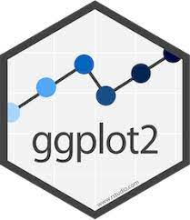
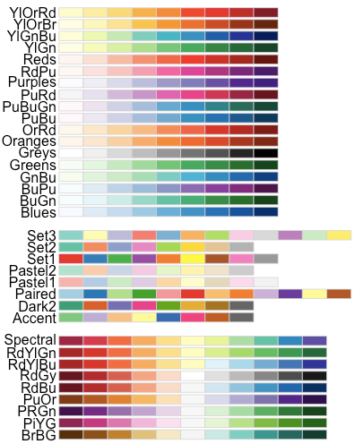

# Visualisering - ggplot2 dag 2 {#visual2}

```{r, echo=FALSE,out.height="25%",out.width="25%"}
# Bigger fig.width
library(jpeg)
library(knitr)

```

## Læringsmål og videoer

I dette kapitel udvider du værktøjskassen af kommandoer i pakken __ggplot2__, så du kan opnå større fleksibilitet i dine visualiseringer. Jeg anbefaler, at du bruger notaterne som en reference, samtidig med at du arbejder med problemstillingerne.

:::goals
Du skal være i stand til at:

* Arbejde fleksibelt med koordinatsystemer – transformere, modificere og spejle ("flip") x- og y-aksen.
* Udvide brugen af farver og punktformer.
* Tilføje tekst direkte på plottet ved hjælp af `geom_text()` og `geom_text_repel()`.
* Bruge `facet_grid()` eller `facet_wrap()` til at opdele plots efter en kategorisk variabel.
:::


```{r,echo=FALSE}
library(ggplot2) #husk
iris <- datasets::iris
```

:::checklist
Tjekliste til Kapitel 5: ggplot2 (dag 2)

* Se videoerne
* Kig igennem kursusnotaterne
* Lav quiz "ggplot2 - dag 2"
* Lav problemstillingerne
:::

### Videoressourcer

* Video 1: Koordinatsystemer

```{r,echo=FALSE}
library("vembedr")
#Link her hvis det ikke virker nedenunder: https://player.vimeo.com/video/544201985

embed_url("https://vimeo.com/544201985")
```

* Video 2: Farver og punktformer 

```{r,echo=FALSE}
library("vembedr")
#Link her hvis det ikke virker nedenunder: https://player.vimeo.com/video/544218153

embed_url("https://vimeo.com/544218153")
```

* Video 3: Etiketter (labels) – `geom_text()` og `geom_text_repel()`

```{r,echo=FALSE}
library("vembedr")
#Link her hvis det ikke virker nedenunder: https://player.vimeo.com/video/544226498

#embed_url("https://vimeo.com/544226498")
embed_url("https://vimeo.com/939254856")
```

* Video 4: Facets

```{r,echo=FALSE}
library("vembedr")
#Link her hvis det ikke virker nedenunder: https://player.vimeo.com/video/704140333

embed_url("https://vimeo.com/704140333")
```

## Koordinatsystemer

Her arbejder vi videre med koordinater i pakken __ggplot2__.

### Zoom (`coord_cartesian()`, `expand_limits()`)

Man kan bruge funktionen `coord_cartesian()` til at zoome ind på et bestemt område i plottet. __Inden i__ `coord_cartesian()` angives `xlim` og `ylim`, som specificerer de nedre og øvre grænser langs henholdsvis x-aksen og y-aksen. Man kan også bruge `xlim()` og `ylim()` uden `coord_cartesian()`, men i så fald bliver de punkter, som ligger uden for de angivne grænser, fjernet fra datasættet (og R giver en advarsel). Med `coord_cartesian()` beholder man til gengæld samtlige data, og man får derfor ingen advarsel.

Nedenfor kan I se vores oprindelige scatter plot:

```{r,fig.width=5,fig.height=4}
ggplot(iris, aes(x = Sepal.Length, y = Sepal.Width,color = Species)) +
  geom_point() + 
  theme_minimal() 
```

Og her anvender jeg funktionen `coord_cartesian()` samt `xlim` og `ylim` til at zoome ind på det udvalgte område på plottet:

```{r,fig.width=5,fig.height=4}
ggplot(iris, aes(x = Sepal.Length, y = Sepal.Width,color = Species)) +
  geom_point() + 
  coord_cartesian(xlim = c(4,6), ylim = c(2.2,4.5)) +
  theme_minimal() 
```

Du kan også zoome ud ved at bruge `expand_limits()` – for eksempel hvis du gerne vil have punkterne $x = 0$ og $y = 0$ (`c(0,0)` eller origo) med i selve plottet:

```{r,fig.width=5,fig.height=4}
ggplot(iris, aes(x=Sepal.Length, y=Sepal.Width,col=Species)) +
  geom_point() + 
  expand_limits(x = 0, y = 0) +
  theme_minimal() 
```

Det kan være brugbart i situationer, hvor man for eksempel har flere etiketter omkring punkterne i selve plottet, som bedre kan ses, hvis man giver lidt ekstra plads.  

### Transformering af akserne – log, sqrt osv. (`scale_x_continuous()`)

Nogle gange kan det være svært at visualisere visse variable på grund af deres fordeling. Hvis der er mange outliers i en variabel, vil de fleste punkter samle sig i et lille område i plottet. Transformering af x-aksen og/eller y-aksen med enten `log` eller `sqrt` er en populær tilgang til at visualisere dataene på en mere informativ måde:

```{r,fig.width=5,fig.height=4}
ggplot(iris, aes(x=Sepal.Length, y=Sepal.Width,col=Species)) +
  geom_point(size=3) + 
  scale_x_continuous(trans = "log2") +
  scale_y_continuous(trans = "log2") +
  theme_minimal() 
```

Man kan også prøve at bruge `"sqrt"` i stedet for `"log2"`.

Det er dog vigtigt at bemærke, at dette adskiller sig fra at transformere selve de data, som bruges i plottet. Man kan for eksempel opnå det samme resultat ved at ændre datasættet, før man anvender `ggplot2`. Her behøver man ikke at bruge `scale_x_continuous(trans = "log2")`, men bemærk, at tallene på akserne da afspejler de transformerede data og ikke de oprindelige værdier. Valget afhænger af, hvad man gerne vil opnå med analysen af dataene.

```{r,fig.width=5,fig.height=4}
iris$Sepal.Length <- log2(iris$Sepal.Length)
iris$Sepal.Width <- log2(iris$Sepal.Width)
ggplot(iris, aes(x=Sepal.Length, y=Sepal.Width,col=Species)) +
  geom_point(size=3) +
  theme_minimal() 
```

### Spejl koordinater (`coord_flip()`)

Vi kan bruge `coord_flip()` til at bytte om på x-aksen og y-aksen (hvilket svarer til at dreje plottet 90 grader). Se følgende eksempel, hvor jeg først opretter variablen `Sepal.Group`, laver et barplot og anvender `coord_flip()` for at få søjlerne til at ligge vandret:

```{r,fig.width=5, fig.height=3, message=FALSE, warning=FALSE}
#Sepal.Group defineret som i går
iris$Sepal.Group <- ifelse(iris$Sepal.Length>mean(iris$Sepal.Length),"Long","Short")

ggplot(iris,aes(x=Species,fill=Sepal.Group)) + 
  geom_bar(stat="count",position="dodge",color="black") +
  coord_flip() +
  theme_minimal()
```

Man kan ændre rækkefølgen af de tre `Species` ved at bruge funktionen `scale_x_discrete()` og angive den nye rækkefølge med indstillingen `limits`:

```{r,fig.width=5, fig.height=3, message=FALSE, warning=FALSE}
ggplot(iris,aes(x=Species,fill=Sepal.Group)) + 
  geom_bar(stat="count",position="dodge",color="black") +
  coord_flip() +
  scale_x_discrete(limits = c("virginica", "versicolor","setosa")) +
  theme_minimal()
```

## Mere om farver og punktformer

Der er flere måder at specificere farver på i `ggplot2`. Man kan nøjes med den automatiske løsning, som er hurtig (og effektiv i mange situationer), eller man kan bruge den manuelle løsning, som tager lidt længere tid at kode, men er brugbar, hvis man gerne vil lave et plot til præsentation for andre.

### Automatiske farver

Her er den nemme løsning, hvor vi anvender automatisk farvelægning ved at benytte `colour=Species` inden i `aes()`:

```{r, fig.width=5,fig.height=5}
#automatisk løsning
ggplot(iris, aes(x=Sepal.Length, y=Sepal.Width, colour=Species)) +
  geom_point() +
  theme_minimal() 
```

### Manuelle farver

Hvis man foretrækker at bruge sine egne farver, kan man gøre det ved at benytte funktionen `scale_colour_manual()`. Her angiver man stadig `colour=Species` inden i `aes()`, men man specificerer farverne for de forskellige arter i `scale_colour_manual()` med indstillingen `values`:

```{r, fig.width=5,fig.height=4}
#manuelt løsning
ggplot(iris, aes(x=Sepal.Length, y=Sepal.Width, colour=Species)) +
  scale_colour_manual(values=c("purple", "yellow","pink")) +
  geom_point() +
  theme_minimal() 
```

En fantastisk pakke er `RColorBrewer`. Pakken indeholder mange forskellige farvepaletter ("colour palettes"), det vil sige grupper af farver, der passer godt sammen. Man kan derfor slippe for selv at sammensætte en farvekombination, der passer til plottet. Nogle af farvepaletterne tager også hensyn til farveblindhed, eller om man ønsker en farvegradient eller et sæt diskrete farver, som tydeligt adskiller sig fra hinanden.

I følgende eksempel indlæser jeg pakken `RColorBrewer` og anvender funktionen `scale_colour_brewer()` med indstillingen `palette="Set1"`:

```{r, fig.width=5,fig.height=4}
#install.packages("RColorBrewer")
library(RColorBrewer)

#manuelt løsning
ggplot(iris, aes(x=Sepal.Length, y=Sepal.Width, colour=Species)) +
  scale_colour_brewer(palette="Set1") +
  geom_point() +
  theme_minimal() 
```

Bemærk, at både `scale_color_manual()` og `scale_color_brewer()` bruges til at sætte farver på punkter og linjer, hvorimod man ved boxplots eller barplots bruger `scale_fill_manual()` eller `scale_fill_brewer()` til at sætte farver på de udfyldte områder. I følgende eksempel vil jeg gerne sætte farver på de udfyldte områder i et boxplot:

```{r, fig.width=5,fig.height=4}
ggplot(iris,aes(x=Species,y=Sepal.Length,fill=Species)) + 
  geom_boxplot() +
  scale_fill_brewer(palette="Set2")  + 
  theme_minimal()
```


Her er en oversigt over de fire funktioner:

Funktion | Beskrivelse
--- | ---
`scale_fill_manual(values=c("firebrick3","blue"))` | Bruges til manuelle farver i forbindelse med boxplots og barplots mv.
`scale_color_manual(values=c("darkorchid","cyan4"))` | Bruges til manuelle farver i forbindelse med punkter og linjer mv.
`scale_fill_brewer(palette="Dark2")` | Bruger farvepaletter fra `RColorBrewer` i forbindelse med boxplots, barplots mv.
`scale_color_brewer(palette="Set1")` | Bruger farvepaletter fra `RColorBrewer` i forbindelse med punkter og linjer mv.

Der er også andre muligheder, hvis man har behov for dem – for eksempel kan man søge efter `scale_fill_gradient()` til kontinuerte data.


***Farver i RColorBrewer***

Her er en nyttig reference, der viser de forskellige farvepaletter i pakken `RColorBrewer`.




### Punktformer

Ligesom man kan lave forskellige farver, kan man også lave forskellige punktformer. Vi starter med den automatiske løsning, ligesom vi gjorde med farver. Når det er en variabel, vi angiver, skal variabelnavnet skrives inden i `aes()`. `shape` er en parameter, der er specifik for `geom_point()`. Derfor vælger vi at skrive en ny `aes()` inden i `geom_point()` i stedet for inden i funktionen `ggplot()`. Husk, at man i funktionen `ggplot()` specificerer globale parametre, der gælder for hele plottet, mens man i funktionen `geom_point()` angiver parametre, der kun gælder for `geom_point()`. Se følgende eksempel:


```{r,fig.width=5,fig.height=4}
ggplot(data=iris, aes(x = Sepal.Length, y = Sepal.Width, color = Species)) +
  scale_color_brewer(palette="Set2") +
  geom_point(aes(shape=Species)) + 
  theme_minimal()
```

Nu har vi både en farve og en punktform til hver art i variablen `Species`.

***Indstil punktform manuelt***

Hvis vi ikke bryder os om de tre automatiske punktformer, kan vi ændre dem ved at bruge `scale_shape_manual()`. Her vælger vi for eksempel `values=c(1,2,3)`, og i referencen nedenfor kan du se sammenhængen mellem de numeriske værdier og punktformerne, så du kan vælge dine favoritter.

```{r,fig.width=5,fig.height=4}
ggplot(data=iris, aes(x = Sepal.Length, y = Sepal.Width, colour=Species)) +
  geom_point(aes(shape=Species)) + 
  scale_color_brewer(palette="Set2") +
  scale_shape_manual(values=c(1,2,3)) +
  theme_minimal()
```

***Reference for punktformer***

Her er referencetabellen for forskellige punktformer i `ggplot2`:

```{r,fig.width=4,fig.height=4,echo=FALSE,comment=FALSE}
df_shapes <- data.frame(shape = 0:25, shape_name = factor(paste0(0:25)))

ggplot(df_shapes, aes(0, 0, shape = shape)) +
  geom_point(aes(shape = shape), size = 5, fill = 'red', stroke = 2) +
  scale_shape_identity() +
  facet_wrap(~reorder(shape_name, shape)) +
  theme_void()
```

## Annotationer (`geom_text()`)

### Tilføjelse af etiketter direkte på plottet

Man kan bruge `geom_text()` til at tilføje tekst til punkterne direkte på plottet. Her kan man angive, hvad teksten skal være – i dette tilfælde specificerer vi navnene på bilerne fra datasættet `mtcars`. Plottet er et scatter plot mellem variablerne `mpg` og `wt`.

```{r,fig.width=4,fig.height=4}
data(mtcars)

mtcars$my_labels <- row.names(mtcars) #take row names and set as a variable

ggplot(mtcars,aes(x=mpg,y=wt)) + 
  geom_point() +
  geom_text(aes(label=my_labels)) + 
  theme_minimal()
```

For at gøre det nemmere at læse kan man også fjerne selve punkterne:

```{r,fig.width=4,fig.height=4}
ggplot(mtcars,aes(x=mpg,y=wt)) + 
  #geom_point() +
  geom_text(aes(label=my_labels)) + 
  theme_minimal()
```

Teksten på plottet kan stadig være svær at læse. En god løsning er at bruge R-pakken `ggrepel`, som vist i følgende eksempel:

### Pakken `ggrepel` til at tilføje tekstetiketter

```{r}
#install.packages("ggrepel") #installere hvis nødvendeigt
```

For at anvende pakken `ggrepel` på datasættet `mtcars` skal man blot erstatte `geom_text()` med `geom_text_repel()`:

```{r,fig.width=4,fig.height=4}
library(ggrepel)
ggplot(mtcars,aes(x=mpg,y=wt)) + 
  geom_point() +
  geom_text_repel(aes(label=my_labels)) + 
  theme_minimal()
```

Nu kan vi se, at der ikke er nogen etiketter, som ligger oven i hinanden, fordi `geom_text_repel()` placerer dem tæt på deres tilhørende punkter uden overlap. Ved nogle punkter har funktionen også tilføjet en forbindelseslinje for at gøre det tydeligt, hvilket punkt teksten refererer til.

Vi har dog fået en advarsel i ovenstående kode. Hvis vi vil undgå denne advarsel, kan vi f.eks. specificere `max.overlaps = 20`:

```{r}
library(ggrepel)
ggplot(mtcars,aes(x=mpg,y=wt)) + 
  geom_point() +
  geom_text_repel(aes(label=my_labels),max.overlaps = 20) +
  theme_minimal()
```

Nu kan du se, at du ikke længere får en advarsel, og der er tilføjet tekst til alle punkterne.

### Tilføjelse af rektangler i interesseområder (`annotate()`)

Hvis man gerne vil fremhæve et bestemt område i plottet, kan man bruge funktionen `annotate()`. Prøv selv at regne ud, hvad indstillingerne inden i `annotate()` betyder i det følgende eksempel:

```{r,fig.width=4,fig.height=4}
ggplot(mtcars,aes(x=mpg,y=wt)) + 
  geom_point() +
  geom_text_repel(aes(label=my_labels)) +
  annotate("rect",xmin=18,xmax=23,ymin=2.5,ymax=3,alpha=0.2,fill="orange") +
  theme_minimal()
```

Man kan også benytte den samme funktion til at tilføje tekst på et bestemt sted:

```{r,fig.width=4,fig.height=4}
ggplot(mtcars,aes(x=mpg,y=wt)) + 
  geom_point() +
  geom_text_repel(aes(label=my_labels)) +
  annotate("rect",xmin=18,xmax=23,ymin=2.5,ymax=3,alpha=0.2,fill="orange") +
  annotate("text",x=25,y=2.75,label="Cars of interest",col="orange") + 
  theme_minimal()
```

## Adskille plots med facets (`facet_grid()` / `facet_wrap()`) 

En stor fordel ved `ggplot2` er muligheden for at bruge funktionerne `facet_grid()` og `facet_wrap()` til at opdele værdierne af en kategorisk variabel over flere delplots. I følgende kode får vi et density plot, hvor de tre kurver, der tilhører de tre arter, ligger oven på hinanden i det samme plot:

```{r,echo=F}
iris <- datasets::iris
```

```{r,fig.width=5,fig.height=4}
ggplot(iris,aes(x=Sepal.Length,fill=Species)) + 
  geom_density(alpha=0.5) + 
  theme_minimal()
```

Med funktionerne `facet_grid()` og `facet_wrap()` bruger vi `~` (tilde) til at angive, hvordan vi gerne vil visualisere de forskellige delplots. Vi angiver, om vi ønsker at opdele dem over rækker (variablerne til venstre for `~`) eller over kolonner (variablerne til højre for `~`).

```{r,eval=F,echo=T}
#notrun
variable(s) to split into row-wise plots ~ variables(s) to split into column-wise plots
```

Det ovenstående density plot af `Sepal.Length` kan adskilles efter `Species`, således at man får tre plots i hver sin kolonne (ét for hver af de tre arter) ved hjælp af `facet_grid()`-funktionen:

```{r,fig.width=5,fig.height=4}
ggplot(iris,aes(x=Sepal.Length,fill=Species)) + 
  geom_density(alpha=0.5) + 
  facet_grid(~Species) + #split Species into different column-wise plots
  theme_minimal()
```

Man kan også vælge at fordele plottene over rækkerne ved hjælp af `facet_grid()`. Her skal man dog huske at bruge et `.` efter `~` for at angive, at man kun vil adskille plots over rækkerne, mens man til gengæld kan udelade `.`, hvis man kun vil adskille over kolonner som i det foregående eksempel:

```{r,fig.width=5,fig.height=4}
ggplot(iris,aes(x=Sepal.Length,fill=Species)) + 
  geom_density(alpha=0.5) + 
  facet_grid(Species~.) + #split Species into different column-wise plots
  theme_minimal()
```

Her angives `Sepal.Group ~ Species`, hvilket betyder, at plottene bliver adskilt efter både `Sepal.Group` og `Species` – `Sepal.Group` over rækkerne og `Species` over kolonnerne – ved hjælp af `facet_grid()`-funktionen:

```{r,echo=F}
iris$Sepal.Group <- ifelse(iris$Sepal.Length > mean(iris$Sepal.Length), "Long", "Short")
iris$Sepal.Group <- as.factor(iris$Sepal.Group)
```

```{r,fig.width=5,fig.height=4}
ggplot(iris,aes(x=Sepal.Length,fill=Species)) + 
  geom_density(alpha=0.5) + 
  facet_grid(Sepal.Group~Species) + #split Species into different column-wise plots
  theme_minimal()
```

Bemærk forskellen mellem `facet_grid()` og `facet_wrap()`:

```{r,fig.width=5,fig.height=4}
#same plot, replace facet_grid with facet_wrap
ggplot(iris,aes(x=Sepal.Length,fill=Species)) + 
  geom_density(alpha=0.5) + 
  facet_wrap(Sepal.Group~Species) + 
  theme_minimal()
```

I `facet_grid()` er layoutet fastlåst som et gitter ("grid"). Vi får således 6 plots i et 2 x 3-gitter (2 niveauer for variablen `Sepal.Group` og 3 niveauer for variablen `Species`), og det sker, selvom den ene kombination ikke har nogen data – der findes altså ingen observationer, hvor `Species` er `"setosa"` og `Sepal.Group` er `"Long"`, men der vises et tomt plot alligevel for at bevare strukturen. Med `facet_wrap()` bliver plots uden data udeladt, og i dette tilfælde får man 5 plots i et bånd ("ribbon").

Med `facet_wrap()` kan man også angive antallet af rækker og kolonner, man vil have til plottene. For eksempel kan man angive `nrow = 1` eller `ncol = 5` for at få alle fem plots på én række:

```{r,fig.width=6.5,fig.height=3.5}
ggplot(iris,aes(x=Sepal.Length,fill=Species)) + 
  geom_density(alpha=0.5) + 
  facet_wrap(Sepal.Group~Species,nrow = 1) + 
  theme_minimal()
```

Til sidst kan det være, at vi gerne vil frigøre skalaen på y-aksen. På den måde har ikke alle plots de samme maksimale y-værdier, og de enkelte plots benytter i stedet deres egne værdier til at bestemme skalaen. Det kan være brugbart, hvis man sammenligner forskellige målinger. Vær dog opmærksom på, hvad der giver bedst mening – hvis man direkte vil sammenligne to plots, er det bedre, at de deler samme y-akseskala.

```{r,fig.width=6.5,fig.height=3.5}
#same plot, replace facet_grid with facet_wrap
ggplot(iris,aes(x=Sepal.Length,fill=Species)) + 
  geom_density(alpha=0.5) + 
  facet_wrap(Sepal.Group~Species,ncol = 5,scales = "free") + 
  theme_minimal()
```


Disse funktioner er meget brugbare, selvom de opnår stort set samme resultat. Der er dog små forskelle mellem dem, som er værd at huske.

## Gem dit plot

Her bruger vi R Markdown til at lave en rapport, som indeholder vores plots. Men det kan også være, at man gerne vil gemme sit plot som en fil på computeren. Til det kan man bruge kommandoen `ggsave()`:

```{r, eval=FALSE}
ggsave(myplot, "myplot.pdf")
```

Figuren vil blive gemt i dit _working directory_ (den mappe, hvor din `.Rmd`-fil ligger). Filtypen `.pdf` kan erstattes med andre formater, f.eks. `.png` eller `.jpeg`. Hvis man gerne vil redigere sit plot (f.eks. i Adobe Illustrator eller Inkscape), anbefaler jeg at gemme det som `.pdf`.

Man kan også ændre højden og bredden på det gemte plot med `width` og `height`:

```{r, eval=FALSE}
ggsave(myplot, "myplot.pdf", width = 4, height = 4)
```

## Problemstillinger

__Problem 1__) Lav quizzen "Quiz - ggplot2 dag 2".

- - -

__Problem 2__) (*Øvelse med faktorer og plots*)
 
 __a__) Åbn datasættet `mtcars` og lav et barplot:

  * Brug variablen `cyl` på x-aksen og tilføj forskellige farver til de forskellige niveauer (dvs. factor levels) af `cyl`.
  * Hvad kunne være et problem med måden, `cyl` er plottet på? Er farverne vist som forventet i plottet?
  * Tjek x-aksen – variablen er numerisk, men bør fortolkes som en faktor.
  * Lav variablen om til en faktor (eller skriv blot `as.factor(cyl)` i selve plottet) og lav dit plot igen.

```{r,echo=FALSE,eval=FALSE,fig.width=5,fig.height=4}
data(mtcars)
ggplot(
    data = mtcars,
    mapping = aes(
        x = cyl,
        fill = cyl
      )
    ) +
  geom_bar(stat = "count") +
  theme_minimal()
```

```{r,echo=FALSE,eval=FALSE}
mtcars$cyl <- as.factor(mtcars$cyl)
ggplot(
    data = mtcars,
    mapping = aes(
      x = cyl,
      fill = cyl
      )
    ) +
  geom_bar(stat = "count") +
  theme_minimal()
```

  __b__) Rediger nedenstående kode, så data fordeles baseret på `gear`:
  
  * Opdel søjlerne ved at angive farver efter variablen `gear` i dit plot. 
  * `gear`-søjlerne skal stå ved siden af hinanden (husk `position`-argumentet).
  * Vær igen opmærksom på, hvordan R fortolker variablen.

```{r,echo=TRUE,eval=FALSE}
ggplot(
    data = mtcars,
    mapping = aes(
        x = cyl,
        fill = mpg
      )
    ) +
  geom_bar(stat = "count") + 
  theme_minimal()
```

```{r,echo=FALSE,eval=FALSE}
ggplot(
    data = mtcars,
    mapping = aes(
        x = cyl,
        fill = as.factor(gear)
      )
    ) +
  geom_bar(
      stat = "count",
      position = "dodge"
    ) + 
  theme_minimal()
```

- - -

I det følgende spørgsmål arbejder du med datasættet `Palmer Penguins`. Installer venligst pakken `palmerpenguins`, hvis du ikke har brugt den før.

Databeskrivelse: *The palmerpenguins data contains size measurements for three penguin species observed on three islands in the Palmer Archipelago, Antarctica.*

```{r,echo=FALSE,comment=FALSE,warning=FALSE,out.width="20%"}
# Bigger fig.width
library(png)

```

```{r,comment=FALSE,warning=FALSE,message=FALSE}
#install.packages("palmerpenguins") #køre hvis ikke allerede installeret
library(palmerpenguins)
library(ggplot2)
library(tidyverse)
head(penguins)
```

```{r,echo=FALSE,eval=FALSE}
write.csv(
    x = penguins,
    file = base::paste0(
        "/Users/pbr316/Documents/20251113_kurs_visualisering/",
        "uge48_markdowns/",
        "penguins.csv"
      ),
    row.names = TRUE,
    col.names = TRUE
  )
```

Brug venligst `?penguins` for at se flere detaljer om variabelnavnene.

*Vi skal starte med at rydde lidt op i datasættet. Brug til det formål `drop_na()` til at fjerne alle rækker med `NA`-værdier (manglende værdier) – her skal `tidyverse`-pakken være indlæst:*

```{r}
penguins <- drop_na(penguins)
```

- - -

__Problem 3__) *Manuelle farver og punktformer* 

__a__) Lav et spredningsdiagram / scatter plot med `ggplot()`-funktionen: 

  * `bill_length_mm` på x-aksen.
  * `bill_depth_mm` på y-aksen.
  * Giv hver art (variablen `species`) sin egen farve.
  * Sæt et tema.

```{r,echo=FALSE,eval=FALSE,fig.width=4,fig.height=3.5}
ggplot(
    data = penguins,
    mapping = aes(
        x = bill_length_mm,
        y = bill_depth_mm,
        color = species
      )
    ) +
  geom_point() +
  xlab("Bill length (mm)") +
  ylab("Bill depth (mm)") +
  ggtitle("Scatter plot for penguin data") +
  theme_minimal()
```

__b__) Lav følgende ændringer til dit plot fra __a__):
  
  * Ændr farverne manuelt – prøv at angive farver med `scale_color_manual()`.
  * Brug forskellige punktformer til hver art i variablen `species`.
  * Prøv at vælge punktformer fra listen (i kursusnotaterne) og specificer dem manuelt.

```{r,echo=FALSE,eval=FALSE,fig.width=4,fig.height=3.5}
ggplot(
    data = penguins,
    mapping = aes(
        x = bill_length_mm,
        y = bill_depth_mm,
        color = species,
        shape = species
      )
    ) +
  geom_point() +
  scale_color_manual(values = c("black", "blue", "red")) +
  xlab("Bill length (mm)") +
  ylab("Bill depth (mm)") +
  ggtitle("Scatter plot for penguin data") +
  theme_minimal()
```

- - -

__Problem 4__) *Koordinatsystemer* 

Tag udgangspunkt i ovenstående scatter plot fra __3__):

__a__) Brug `coord_cartesian()`, så kun pingviner med en næblængde (variablen `bill_length_mm`) mellem 40 og 50 og en næbdybde (variablen `bill_depth_mm`) mellem 16 og 19 er medtaget på plottet.
__b__) Brug pakken `ggrepel` (husk at installere/indlæse den) og tilføj navnene på de forskellige øer som tekstetiketter / labels direkte på plottet.
__c__) Lav en delmængde af datasættet `penguins` efter samme betingelser som i __a__) og brug din nye dataframe som parameteren `data` i `geom_text_repel()`-funktionen. Dette undgår, at der bliver plottet tekst for punkter uden for det område, der er angivet med `coord_cartesian()`.

```{r,echo=FALSE,eval=FALSE,fig.width=5,fig.height=4}
library(ggrepel)
# peng_subset <- subset(penguins, bill_depth_mm > 16 & bill_depth_mm < 19 & bill_length_mm > 40 & bill_length_mm < 50)
peng_subset <- penguins[penguins$bill_depth_mm > 16 & penguins$bill_depth_mm < 19 & penguins$bill_length_mm > 40 & penguins$bill_length_mm < 50,]

ggplot(
    data = penguins,
    mapping = aes(
        x = bill_length_mm,
        y = bill_depth_mm,
        color = species,
        shape = species
      )
    ) +
  geom_point() +
  coord_cartesian(ylim = c(16, 19), xlim = c(40, 50)) +
  scale_color_brewer(palette = "Accent") + 
  geom_text_repel(data = peng_subset, aes(label = island)) +
  xlab("Bill length (mm)") +
  ylab("Bill depth (mm)") +
  ggtitle("Scatter plot for penguin data") +
  theme_minimal()
```

__Problem 5__) *Histogram med facets*

Lav et histogram:

  * Variablen `flipper_length_mm` på x-aksen.
  * Anvend `facet_grid()` til at adskille dit plot i tre dele efter variablen `species`.
  * Kombiner samtidig forskellige farver med hver art fra `species`-variablen.
  * Ændr om nødvendigt parameteren `bins` til noget andet inden i `geom_histogram()`.

Her er en mulig løsning:

```{r,echo=FALSE,eval=TRUE,fig.width=6,fig.height=4}
ggplot(
    data = penguins,
    mapping = aes(
        x = flipper_length_mm,
        fill = species
      )
    ) +
  geom_histogram(
      bins = 30,
      alpha = 0.5,
      colour = "black"
    ) +
  scale_fill_brewer(palette = "Set1") +
  ggtitle("Histogram over flipperlængde fordelt på arter") +
  facet_grid(cols = vars(species)) +
  xlab("Flipperlængde (mm)") +
  theme_minimal()
```

- - -

__Problem 6__) *Density plot med facets*

__a)__ Lav et tæthetsdiagram / density plot af `body_mass_g`-variablen:

  * Anvend funktionen `facet_grid()` til at lave tre plots – ét for hver art i variablen `species`.
  * Brug også `fill` til at opdele hver af dine tre density-kurver efter variablen `sex` (dvs. du har stadig 3 plots, og hvert plot har to density-kurver).
  * Gør dine density plots gennemsigtige.
  * Skriv en sætning om forskellen i `body_mass_g` mellem hunner ("females") og hanner ("males").

```{r,echo=FALSE,eval=FALSE,fig.width=4,fig.height=3}
ggplot(
    data = penguins,
    mapping = aes(
        x = body_mass_g,
        fill = sex
      )
    ) +
  geom_density(alpha = 0.5) +
  facet_grid(cols = vars(species)) +
  xlab("Kropsmasse (g)") +
  ylab("Densitet") + 
  ggtitle("Densitetsplots fordelt efter køn") +
  theme_minimal()
```

__b__) Udbyg din `facet_grid()`-kode til at adskille plottene yderligere, således at du har en gitterstruktur ("grid") med de forskellige øer (variablen `island`) på rækkerne og de tre arter (variablen `species`) på kolonnerne.

```{r,echo=FALSE,eval=FALSE,fig.width=4,fig.height=3}
ggplot(
    data = penguins,
    mapping = aes(
        x = body_mass_g,
        fill = sex
      )
    ) +
  geom_density(alpha = 0.5) +
  facet_grid(
      cols = vars(species),
      rows = vars(island)
    ) +
  xlab("Kropsmasse (g)") +
  ylab("Densitet") + 
  ggtitle("Densitetsplots fordelt efter køn") +
  theme_minimal()
```

__c__) Kan du forklare, hvorfor der er tomme plots i dit gitter ("grid")? Eksperimenter f.eks. med `facet_wrap()` i stedet for `facet_grid()` for at undersøge det. 

```{r,echo=FALSE,eval=FALSE,fig.width=4,fig.height=3}
ggplot(
    data = penguins,
    mapping = aes(
        x = body_mass_g,
        fill = sex
      )
    ) +
  geom_density(alpha = 0.5) +
  facet_wrap(facets = island ~ species) +
  xlab("Kropsmasse (g)") +
  ylab("Densitet") + 
  ggtitle("Densitetsplots fordelt efter køn") +
  theme_minimal()
```

- - -

__Problem 7__) *Koordinatsystemer* 

Lav et søjlediagram / barplot af antallet for `species` opdelt efter `sex`: 

  * Anvend `coord_flip()` for at gøre plottet vandret (horisontalt).
  * Vælg nogle farver – f.eks. `palette = "Accent"` fra `RColorBrewer`.

```{r,echo=FALSE,eval=FALSE,fig.width=4.5,fig.height=2.5}
ggplot(
    data = penguins,
    mapping = aes(
        x = species,
        fill = sex
      )
    ) +
  geom_bar(
      stat = "count",
      position = "dodge"
    ) + 
  coord_flip() + 
  scale_fill_brewer(palette = "Accent") +
  theme_minimal()
```

```{r,echo=FALSE,eval=FALSE,fig.width=4.5,fig.height=2.5}
ggplot(
    data = penguins,
    mapping = aes(
        y = species,
        fill = sex
      )
    ) +
  geom_bar(
      stat = "count",
      position = "dodge"
    ) + 
  # coord_flip() + 
  scale_fill_brewer(palette = "Accent") +
  theme_minimal()
```

  * Ændr rækkefølgen af de tre søjler, således at arten med flest observationer er øverst, og arten med færrest er nederst.
  * Prøv også at tilføje `scale_y_reverse()` og kig på resultatet.

Her er en mulig løsning:

```{r,echo=FALSE,eval=TRUE,fig.width=5,fig.height=3,eval=TRUE}
ggplot(
    data = penguins,
    mapping = aes(
        x = species,
        fill = sex
      )
    ) +
  geom_bar(
      stat = "count",
      position = "dodge"
    ) + 
  coord_flip() + 
  scale_x_discrete(limits = rev(c("Adelie", "Gentoo","Chinstrap"))) + 
  scale_fill_brewer(palette = "Accent") +
  theme_minimal()
```

- - -

__Problem 8__) Lav et boksplot / boxplot af `body_mass_g` opdelt efter `species`:

  * Tilføj "jitter"-punkter oven på boksplottet.
  * Specificer nogle farver manuelt til både boksene og punkterne (én farve til hver art).
  * Giv plottet en passende titel og akseetiketter.
  * Tilføj en ny variabel `island_binary` til `penguins`, som er `"Biscoe"`, hvis `island` er `'Biscoe'`, og `"not Biscoe"` hvis ikke.
  * Adskil plottene ved at opdele efter `island_binary`.

```{r,echo=FALSE,eval=FALSE,fig.width=5,fig.height=4}
penguins$island_binary <- ifelse(penguins$island == "Biscoe","Biscoe","not Biscoe")

ggplot(
    data = penguins,
    mapping = aes(
        x = species,
        y = body_mass_g,
        fill = species,
        colour = species
      )
    ) +
  geom_boxplot( #<-- geom_violin()
      show.legend = FALSE,
      alpha = 0.25
    ) +
  geom_jitter(
      show.legend = FALSE,
      alpha = 0.75
    ) +
  facet_grid(cols = vars(island_binary)) +
  scale_colour_brewer(palette = "Set2") + 
  scale_fill_brewer(palette = "Set2") + 
  ylab("Species") + 
  ylab("Kropsmasse (g)") +
  ggtitle("Kropsmasse fordelt efter art") +
  theme_bw()
```

  * Ekstra: Prøv `?geom_violin` som erstatning for `geom_boxplot()`.

- - -

__Problem 9__) *Annotationer og linjer* 

__a__) Lav et spredningsdiagram / scatter plot af `bill_length_mm` mod `bill_depth_mm`:

  * Anvend passende titel, etiketter og tema.
  * Anvend forskellige farver for de tre `species`.
  * Tjek funktionen `?annotate` og brug den med `geom = "text"` samt passende x- og y-akseværdier til at tilføje `species`-navne som tekst direkte på plottet (se eksemplet nedenfor).
  * Udforsk, hvordan man gør teksten større, som i løsningen nedenfor.
  * Fjern legenden med `show.legend = FALSE` inden i `geom_point()`.

Her er en mulig løsning:

```{r,eval=TRUE,echo=FALSE,fig.width=4,fig.height=4}
ggplot(
    data = penguins,
    mapping = aes(
        x = bill_length_mm,
        y = bill_depth_mm,
        colour = species
      )
    ) +
  geom_point(show.legend = FALSE) +
  scale_colour_brewer(palette = "Set2") + 
  annotate(
      geom = "text",
      x = 40,
      y = 20,
      label = "Adelie",
      size = 8
    ) +
  annotate(
      geom = "text",
      x = 55,
      y = 19,
      label = "Chinstrap",
      size = 8
    ) +
  annotate(
      geom = "text",
      x = 45,
      y = 15,
      label = "Gentoo",
      size = 8
    ) +
  xlab("Næblængde (mm)") +
  ylab("Næbdybde (mm)") + 
  theme_bw()
```

__b__) Vi vil gerne tilføje nogle lodrette og vandrette linjer til plottet, som viser gennemsnitsværdierne for variablerne for de tre arter:

* Først skal du bruge `tapply()` til at beregne de gennemsnitlige værdier for henholdsvis `bill_length_mm` og `bill_depth_mm` opdelt efter `species` (gem dem som `mean_length` og `mean_depth`).
* Brug `mean_length` og `mean_depth` til at tilføje linjer til plottet med den relevante funktion.

```{r,echo = FALSE,eval=TRUE}
mean_length <- tapply(penguins$bill_length_mm, penguins$species, mean)
mean_depth <- tapply(penguins$bill_depth_mm, penguins$species, mean)
```

__c__) Kan du tilpasse linjerne, så deres farver matcher punkterne for den samme art (se løsningen nedenfor)? Der er sikkert mange måder at gøre det på, men hvis du har brug for et hint, kan du kigge nedenfor:

* Hint: Start med følgende dataframe, der bruger dine beregnede værdier:

```{r,echo=FALSE,eval=TRUE}
lines <- data.frame("species" = names(mean_length), "mlength" = mean_length, "mdepth" = mean_depth)
lines
```

* Angiv parameteren `data` til at være ovenstående dataframe i `geom_vline()`, og brug lokal æstetik (`aes()`) til at angive parametre til linjerne.
* Gør det samme for `geom_hline()`.
* Specificer også stiplede ("dashed") linjer.

Her er en mulig løsning:

```{r,echo=FALSE,eval=TRUE,fig.width=5,fig.height=5}
ggplot(
    data = penguins,
    mapping = aes(
        x = bill_length_mm,
        y = bill_depth_mm,
        colour = species
      )
    ) +
  geom_point(show.legend = FALSE) + 
  geom_vline(
      data = lines,
      mapping = aes(
          xintercept = mlength,
          colour = species
        ),
      show.legend = FALSE,
      linetype = "dashed"
    ) +
  geom_hline(
      data = lines,
      mapping = aes(
          yintercept = mdepth,
          colour = species
        ),
      show.legend = FALSE,
      linetype = "dashed"
    ) +
   annotate(
      geom = "text",
      x = 40,
      y = 20,
      label = "Adelie",
      size = 8
    ) +
  annotate(
      geom = "text",
      x = 55,
      y = 19,
      label = "Chinstrap",
      size = 8
    ) +
  annotate(
      geom = "text",
      x = 45,
      y = 15,
      label = "Gentoo",
      size = 8
    ) +
  xlab("Bill length (mm)") +
  ylab("Bill depth (mm)") + 
  theme_minimal()
```

- - -

__Problem 10__) *Ekstra*: Kig på oversigten ("cheatsheet") for `ggplot2` (klik på "Help" > "Cheatsheets" og vælg den for `ggplot2`), og prøv nogle af de funktioner, som ikke er blevet dækket i kurset indtil videre! Vi vil gerne høre, hvis du finder noget meget nyttigt, som er blevet udeladt i notaterne.
